# axon examples

Complete programs built on [axon](https://github.com/AR1011/axon), a Rust library of typed actors that run on a
cluster of nodes, with streams between the nodes and a console to watch them. Each example is a crate of its own,
shaped like a known product (a job queue, a chat backend, a workflow engine), and its README says how to run it, how
it works, what it measured and what it leaves out.

## The examples

Click an image or a name to open the example's README.

| | Example | What it is | axon features it shows |
|---|---|---|---|
| <a href="examples/workflows/README.md">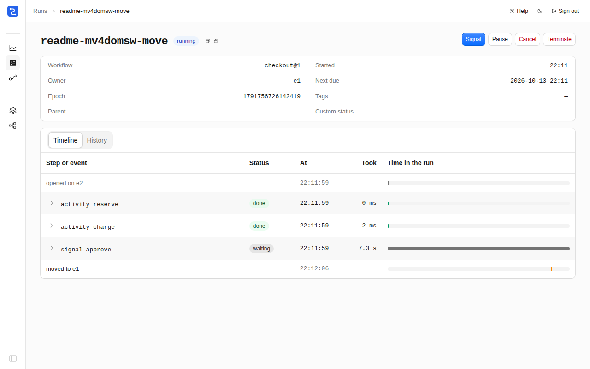</a> | [workflows](examples/workflows/README.md) | A durable workflow engine like Temporal. A workflow is a Rust `async fn`, and each step goes into a journal on three nodes. | `axon::files::Log`, keyed actors with `.eager` under `PaxosLeases`, `request_parts`, `Quotas`, the World |
| <a href="examples/edge-workers/README.md">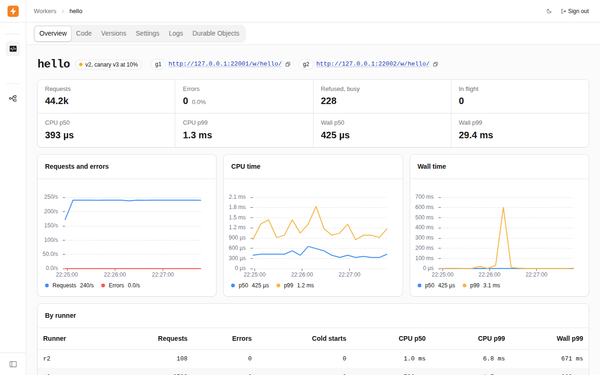</a> | [edge-workers](examples/edge-workers/README.md) | A platform for JavaScript functions like Cloudflare Workers, with versions, a canary, rollback and Durable Objects. | keyed actors under `PaxosLeases`, a compacted stream on disk, `request_parts`, `Quotas`, the World |
| <a href="examples/mdpad/README.md">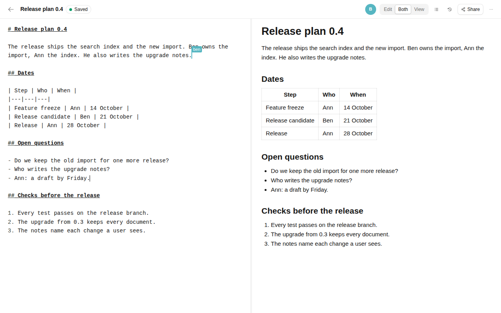</a> | [mdpad](examples/mdpad/README.md) | A collaborative Markdown editor like HedgeDoc. An edit is on its home node's disk before the editor says "saved". | keyed actors placed by a label, `axon::files::Log`, compacted streams with relays, `Health`, the World |
| <a href="examples/kv/README.md">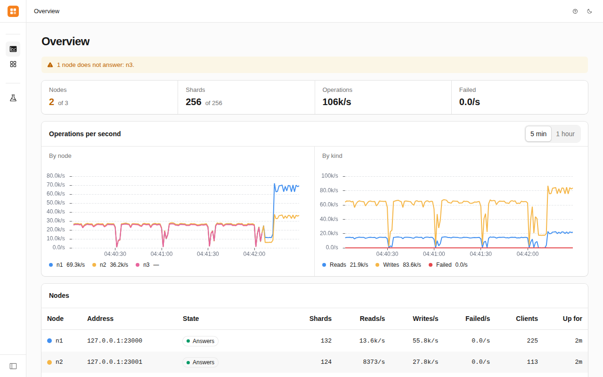</a> | [kv](examples/kv/README.md) | A sharded key-value store that speaks the Redis protocol. Each write is on a majority of disks before the client gets its answer. | keyed actors of an eager kind under `PaxosLeases`, `axon::files::Log`, `send_parts` and `upload`, the World |
| <a href="examples/task-queue/README.md">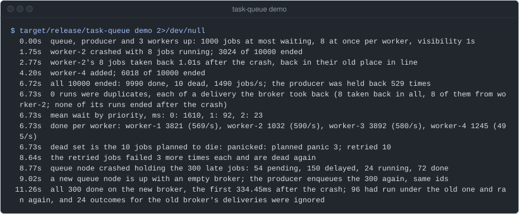</a> | [task-queue](examples/task-queue/README.md) | A background-job queue like Sidekiq or Celery: priorities, delays, attempts, backoff and a dead set. | `publish` and `NamedRef`, `WireProtocol`, jobs and `on_turn_end`, `catch_panic`, timers, `err.retry()` |
| <a href="examples/chat/README.md">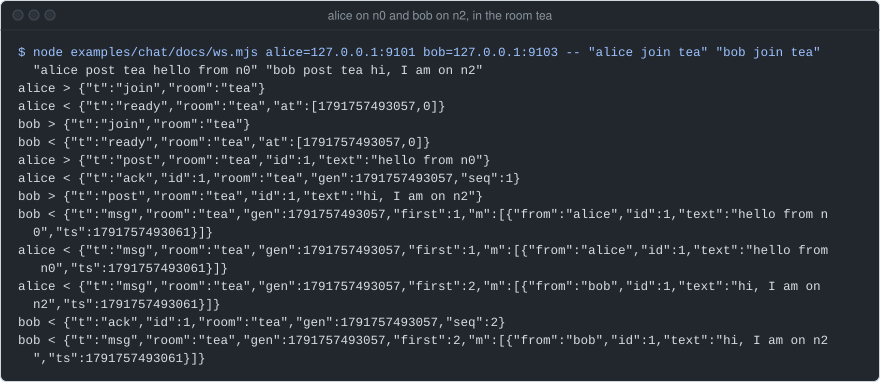</a> | [chat](examples/chat/README.md) | The backend of a group chat, cut down to rooms and messages. A client that reconnects resumes with no gap and no duplicate. | keyed actors, streams with relays and resume, sources and sinks, seed discovery, axon's console |
| <a href="examples/api-gateway/README.md">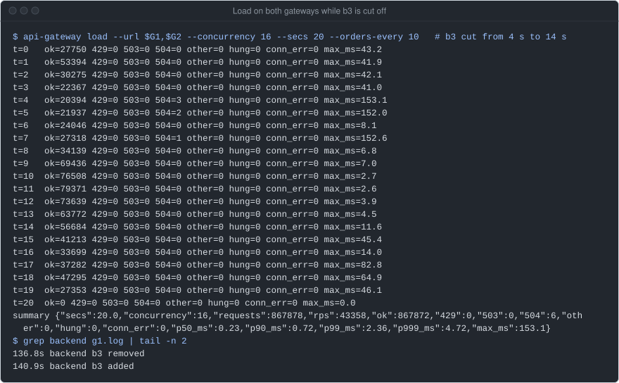</a> | [api-gateway](examples/api-gateway/README.md) | An HTTP gateway like the edge proxy of a service mesh: it sheds load, retries within a budget and gives each request a deadline. | `request_within`, `err.retry()`, bounded mailboxes, membership events, axon's console |
| <a href="examples/crawler/README.md">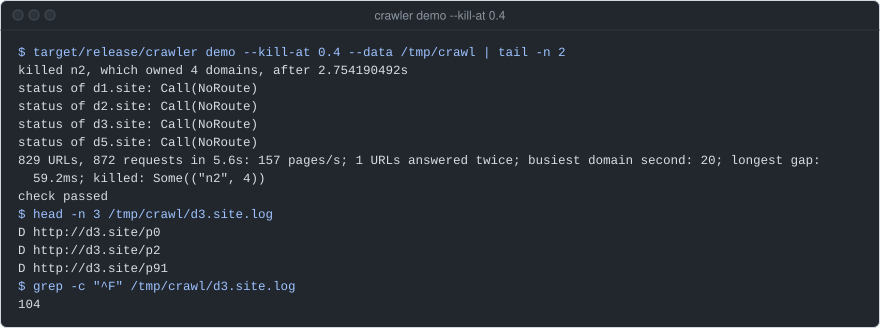</a> | [crawler](examples/crawler/README.md) | A distributed web crawler, run against a site it makes on loopback. A node killed during the crawl loses no URL. | keyed actors, jobs and `pause_until`, timers, a mailbox weighed in bytes, `cluster.owner` |
| <a href="examples/device-twins/README.md">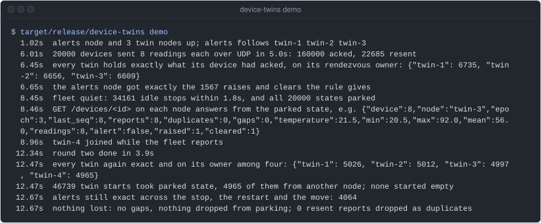</a> | [device-twins](examples/device-twins/README.md) | A digital twin per IoT device, like AWS IoT Device Shadow. Readings come over UDP to any node, alerts go out on a stream. | keyed actors that stop when idle, `KeyedRefs`, `request_until`, raw endpoints, streams |
| <a href="examples/ledger/README.md">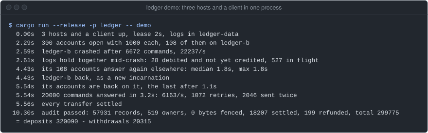</a> | [ledger](examples/ledger/README.md) | An event-sourced account ledger. Each account is one actor, and a retried command never applies twice. | keyed actors under `PaxosLeases`, the epoch as a fencing token, group commit in `on_turn_end` |
| <a href="examples/matching-engine/README.md">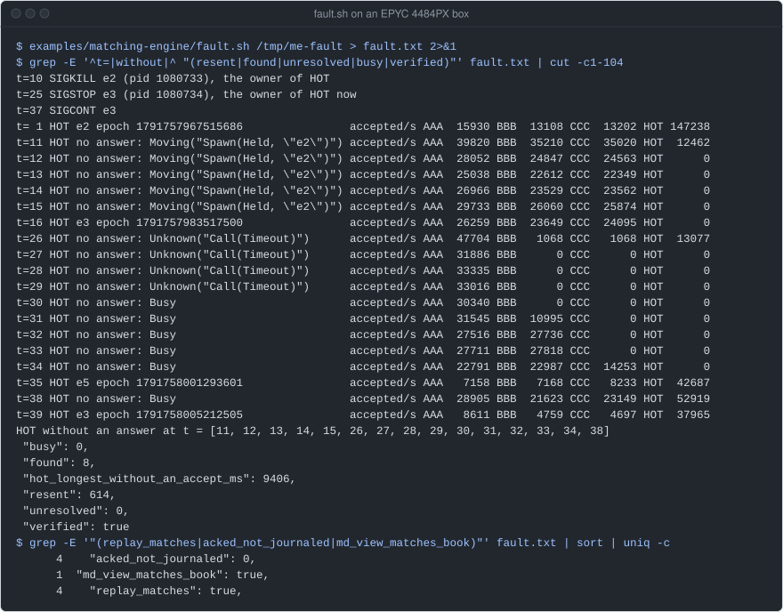</a> | [matching-engine](examples/matching-engine/README.md) | The order books of an exchange: one book per symbol, written to a journal before it answers. | keyed actors under `PaxosLeases`, a bounded mailbox as backpressure, the epoch as a fence, streams |
| <a href="examples/saga/README.md">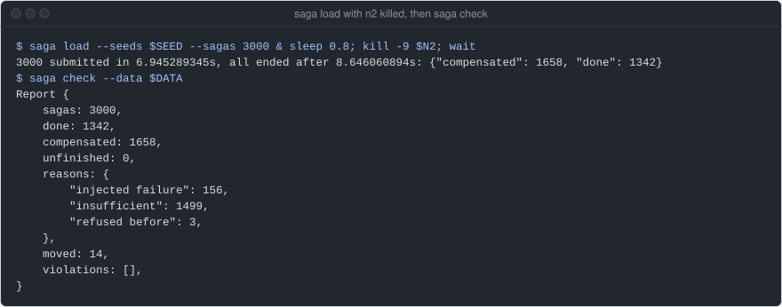</a> | [saga](examples/saga/README.md) | Order fulfilment as sagas: each step has an undo, and a saga goes on when its node is killed. | keyed actors with `.eager` under `PaxosLeases`, the epoch as a fencing token, jobs, `err.retry()` |
| <a href="examples/cron-singleton/README.md">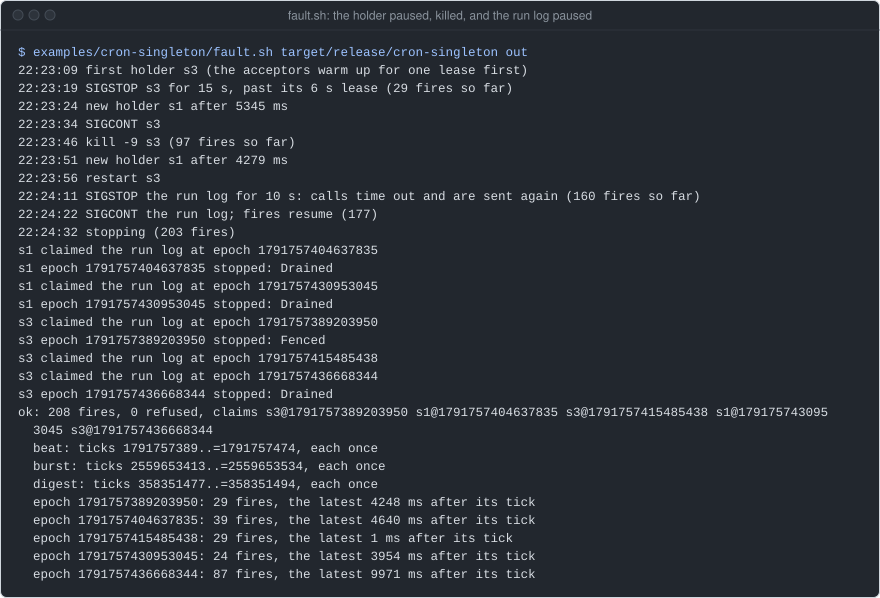</a> | [cron-singleton](examples/cron-singleton/README.md) | A cron for a cluster: one scheduler at a time, and the run log refuses an older owner, so no tick fires twice. | a keyed actor as a singleton under `PaxosLeases`, `watch_key`, `pause_until`, `EmbeddedDriver` |
| <a href="examples/paxos/README.md">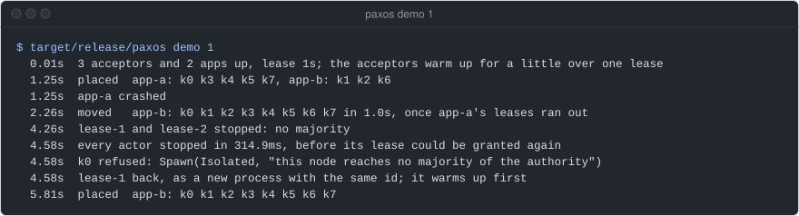</a> | [paxos](examples/paxos/README.md) | One actor per key under leases that three acceptor processes decide with Paxos, with no lock service such as etcd. | `PaxosLeases` with acceptors of their own, the epoch of a lease, seed discovery, a lost majority |
| <a href="examples/market-data/README.md">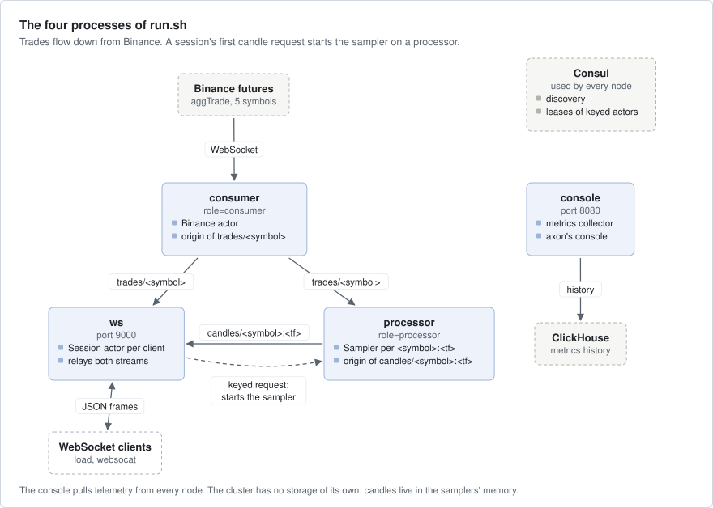</a> | [market-data](examples/market-data/README.md) | Live futures trades from Binance, folded into candles at any timeframe and sent to WebSocket clients. | streams across nodes, keyed actors started on first use, Consul, axon's console with ClickHouse |

The images are the first image of each README: a screenshot of the example's own UI where it has one, else a
terminal capture of a run or the example's topology.

## Which example to read for what

| To learn | Read |
|---|---|
| actors, timers, `tell`, `send` and `ask`, and workers with a limit | [task-queue](examples/task-queue/README.md) |
| a keyed actor per entity, started on first use, on any node | [device-twins](examples/device-twins/README.md), [chat](examples/chat/README.md), [crawler](examples/crawler/README.md) |
| one owner per key under Paxos leases, and what a deposed owner must not do | [paxos](examples/paxos/README.md), [cron-singleton](examples/cron-singleton/README.md), [ledger](examples/ledger/README.md), [matching-engine](examples/matching-engine/README.md) |
| a log on disk with `axon::files::Log` | [workflows](examples/workflows/README.md) (replicated on three nodes), [kv](examples/kv/README.md) (one per node for all its shards, replicated on three), [mdpad](examples/mdpad/README.md) (one per home node); a log of your own on shared storage: [ledger](examples/ledger/README.md) |
| streams between nodes, relays, resume after a cursor | [chat](examples/chat/README.md), [market-data](examples/market-data/README.md), [mdpad](examples/mdpad/README.md), [edge-workers](examples/edge-workers/README.md) |
| retries, deadlines, load shedding, `err.retry()` | [api-gateway](examples/api-gateway/README.md), [saga](examples/saga/README.md) |
| long-running work that survives node loss: steps, timers, signals, compensation | [saga](examples/saga/README.md) for one flow, [workflows](examples/workflows/README.md) for an engine |
| quotas per key across the cluster | [edge-workers](examples/edge-workers/README.md), [workflows](examples/workflows/README.md) |
| fault stories by seed on axon-testkit's World (real clusters on virtual time) | [workflows](examples/workflows/README.md), [kv](examples/kv/README.md), [edge-workers](examples/edge-workers/README.md), [mdpad](examples/mdpad/README.md) |
| a seeded network simulation with axon-testkit's `Simulator` | [saga](examples/saga/README.md), [crawler](examples/crawler/README.md), [matching-engine](examples/matching-engine/README.md), [api-gateway](examples/api-gateway/README.md) |
| node roles, a rolling restart and a fault run with real processes | [edge-workers](examples/edge-workers/README.md), [workflows](examples/workflows/README.md) |
| an HTTP API behind a login, and a web console of the example's own | [edge-workers](examples/edge-workers/README.md), [workflows](examples/workflows/README.md), [mdpad](examples/mdpad/README.md) |
| axon's own console, Consul and ClickHouse | [market-data](examples/market-data/README.md) |

## Run an example

You need Rust 1.99 or later.
Commands in every README run from this repository's root. Most examples have a `demo` that runs the whole story in
one process and checks each step:

```bash
cargo run --release -p task-queue -- demo      # every node in one process, each step checked
cargo run --release -p ledger -- demo          # a host crashes under load, then the audit
cargo test -p saga                             # the tests of one example
```

The "Run it" section of each README has the rest: a cluster of real processes on loopback, the UI and how to sign in.
No example has TLS between its nodes. Where one of its processes can listen beyond 127.0.0.1, each process that joins
the cluster starts only with `--plaintext`, which the scripts pass: use it on loopback or a private network only.
The demos above run in one process and need none.
Two examples need more. edge-workers needs its JavaScript engine first:
`examples/edge-workers/scripts/fetch-engine.sh`. market-data needs Docker for Consul and ClickHouse, and the internet
for Binance.

## Numbers, boxes and commits

The numbers in the READMEs come from runs of the tests, fault scripts and benches. Each number names its box and its
commit:

- **build-1**: Ryzen 9900X, two NVMe without power-loss protection: an md RAID1 for the system and an md RAID0
  for `/data`, where kv's bench writes. One `fdatasync` takes about 4.2 ms.
- **an EPYC 4484PX box**: 12 cores, one NVMe. One `fsync` takes about 0.1 ms.
- **the earlier kv bench**: another EPYC 4484PX with an NVMe, for kv's full bench alone, with the governor
  `powersave`.
- **the dev box**: an EPYC 4484PX with 24 threads, shared with other builds. The older runs, from before
  the examples moved out of the axon repository, are on it or on a box their record does not name.
- **main `1e52123`**, **ex/workflows `7106241`** and **axon `ee925dc7`** name the code measured. They are commits
  from before the first public release, so they are not in the published history.

These numbers show how an example behaves. They are not a benchmark of axon.

## The READMEs and their images

Figures (SVG) are drawn from each example's `docs/figures.json` by
`tools/figures/figures.py`; screenshots are taken by `tools/shots/shot.mjs` against a real run.

```bash
python3 tools/figures/figures.py --check       # exit 1 if an SVG differs from its data
```

## The axon rev

Every example builds against the one axon commit that `[workspace.dependencies]` in `Cargo.toml` pins. To move to a
newer one, replace the `rev` on all six lines, then run these and commit `Cargo.lock` with it, which the first
build moves to the new rev:

```bash
cargo clippy --workspace --all-features --all-targets -- -D warnings
cargo test --workspace --all-features
```

`.github/workflows/check.yml` holds the same checks (fmt, clippy and the tests) at the pinned rev, and every night
against axon's `main`.
`examples/clippy.toml` holds the lint rules the examples keep from axon: every channel is bounded.

To build against an axon checkout instead, patch it in `.cargo/config.toml` (ignored by git):

```toml
[patch."https://github.com/AR1011/axon"]
axon = { path = "../axon/crates/axon" }
axon-cluster = { path = "../axon/crates/axon-cluster" }
axon-net = { path = "../axon/crates/axon-net" }
axon-obs = { path = "../axon/crates/axon-obs" }
axon-stream = { path = "../axon/crates/axon-stream" }
axon-testkit = { path = "../axon/crates/axon-testkit" }
```

## Licence

Apache License 2.0. See [LICENSE](LICENSE).
