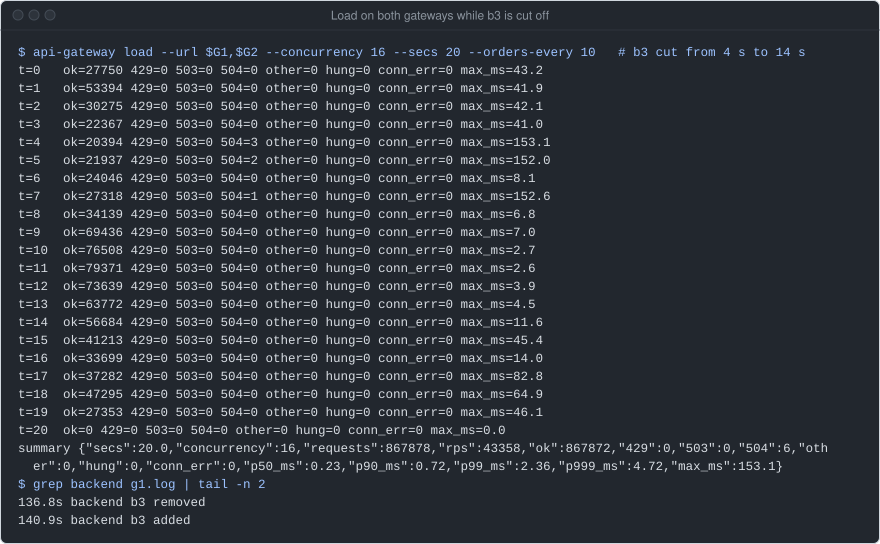
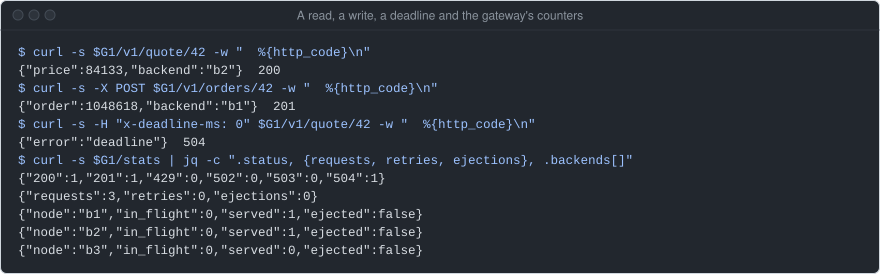
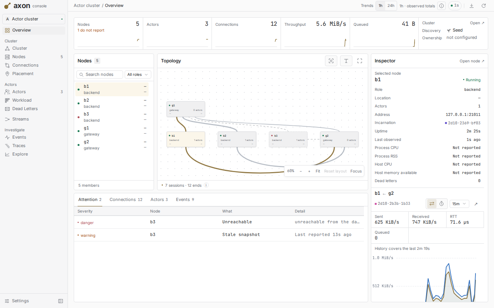
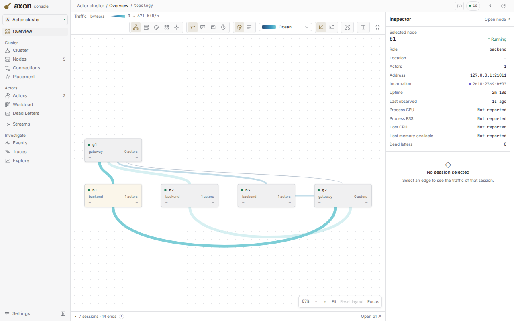
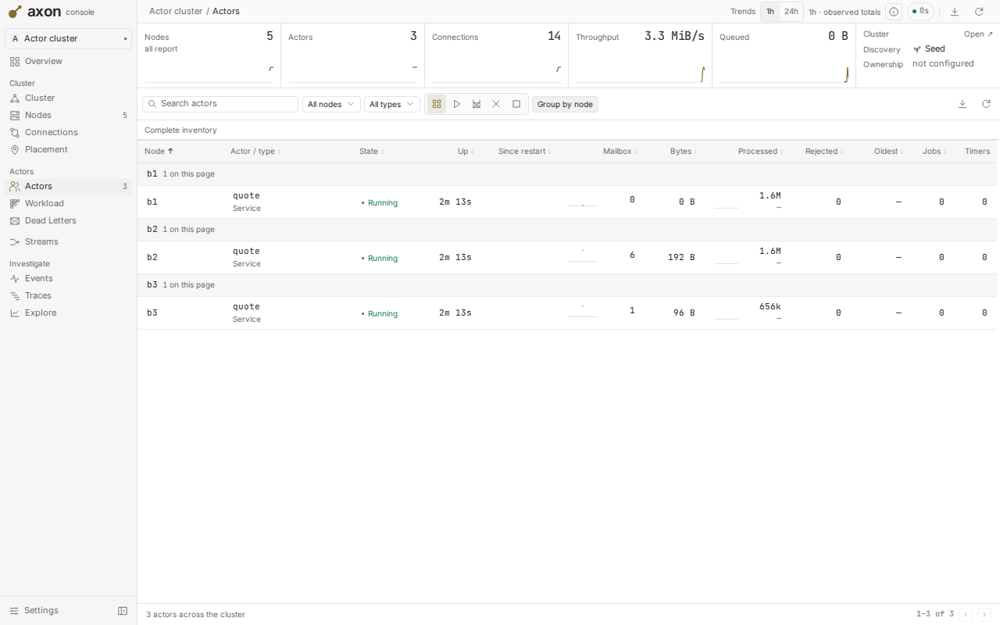
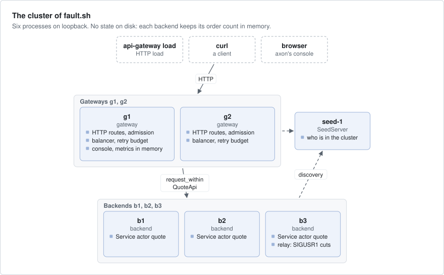
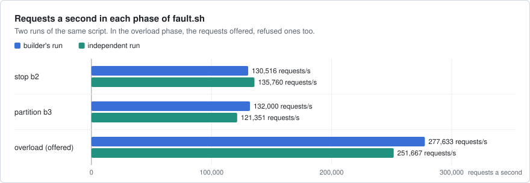
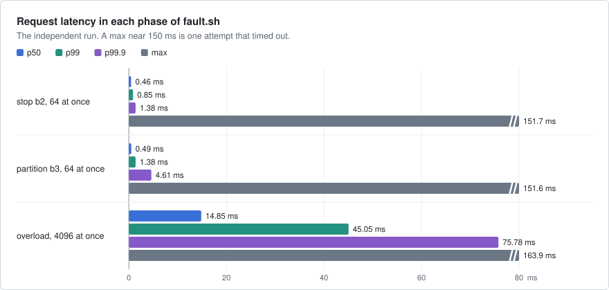
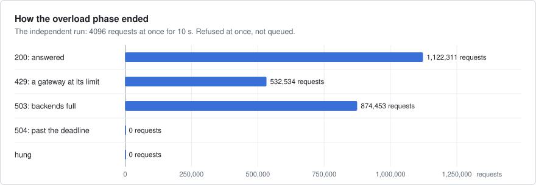

# api-gateway

An HTTP API gateway on axon, like the edge proxy of a service mesh such as Envoy. Gateways on several nodes call
backend actors on other nodes. A gateway sheds load instead of queueing it, retries a call only when axon says it is
safe and only within a budget, gives every request a deadline, and routes around a backend that is slow, paused or cut
off.



Load on both gateways while backend b3 is cut off from 4 s to 14 s: 6 of 867,878 requests fail, each with 504 at
the 150 ms attempt timeout, and gateway g1 drops b3 from its list and adds it back after the heal. One run of main
`1e52123` on an EPYC 4484PX box with other jobs on it, to show the behaviour; the measured
numbers are in [Numbers](#numbers).

## What it shows

- **`request_within` and `reply.is_abandoned()`**: each attempt carries the time its caller has left, and a backend
  skips a call whose caller gave up (`src/gateway.rs`, `src/service.rs`).
- **`err.retry()`**: axon tells, for each failed call, if it is safe to try again. The gateway's decision is one match
  of four arms. A write is never sent again once its outcome is unknown (`judge` in `src/gateway.rs`).
- **Bounded mailboxes and `Rejected(Full)`**: a full backend refuses at once, so overload is a fast 503, not a queue
  (`src/service.rs`, `--mailbox` in `src/main.rs`).
- **Membership events and node metadata**: a backend sets `serves=quote` after it publishes. The gateway follows
  membership and looks up each new backend with `resolve_on` (`follow` and `reconcile` in `src/gateway.rs`).
- **`SeedDiscovery` and `advertise`**: nodes find each other through a seed server. b3 advertises a relay in place of
  its own port, so a signal can cut it off (`src/main.rs`).
- **axon-testkit's `Simulator`**: the balancer and the retry budget on virtual time, 100 seeds in each of two tests
  (`tests/sim.rs`).
- **`Telemetry`, `MetricsService` and `Dashboard`**: axon's console on g1, with the history kept in memory
  (`src/main.rs`).

## Run it

Every node binds port 0 unless told otherwise. There is no TLS between the nodes, so each one starts only with
`--plaintext`: use it on loopback or a private network only. From the repository root:

```bash
cargo build --release -p api-gateway
B=target/release/api-gateway
$B seed --plaintext --id seed-1 --bind 127.0.0.1:7000  # prints "seed 127.0.0.1:7000"
$B backend --plaintext --id b1 --seeds 127.0.0.1:7000  # prints "ready b1"; start b2 and b3 the same way
$B gateway --plaintext --id g1 --seeds 127.0.0.1:7000 --http 127.0.0.1:8080 --dashboard 127.0.0.1:8081
export G1=http://127.0.0.1:8080                       # the gateway prints "listening http://127.0.0.1:8080"
$B load --url $G1 --concurrency 64 --secs 10 --orders-every 10   # a line per second, then a summary
```

Then call g1 with curl (a capture from the same box):



axon's console is at the `--dashboard` address. On loopback it asks for no sign-in. To see a backend cut off, start
b3 with `--cuttable true` and send it `kill -USR1 <pid>` (heal it with `kill -USR2 <pid>`).

| | |
|---|---|
| <br>axon's console on g1 while b3 is cut off: its links are dashed, and Attention names it unreachable. | <br>axon's console, Topology: the sessions from g1 and g2 to b1, b2 and b3 under load. |
| <br>axon's console, Actors: the `quote` service actor on each backend. | |

The fault run starts a seed, b1 to b3, g1 and g2, then stops b2, cuts b3 and overloads both gateways. It builds
nothing, so build first. It prints PASS or FAIL and stops every node it started, also when it fails:

```bash
DASHBOARD=127.0.0.1:0 examples/api-gateway/fault.sh       # DASHBOARD serves axon's console on g1
```

## How it works



- **The gateway** (`src/gateway.rs`) admits a request or answers 429 at once. It gives the request a deadline
  (header `x-deadline-ms`, default 500 ms, at most 5 s) and each attempt `min(time left, 150 ms)` as its
  `request_within`. It maps each outcome to an HTTP status. `GET /stats` shows its counters.
- **The balancer** (`src/balancer.rs`) picks a backend by power of two choices on calls in flight. After 3 failures
  in a row it ejects a backend for 500 ms, doubling up to 8 s, but never more than half the backends. It has no I/O and
  takes the time as an argument, so the simulator drives it.
- **The retry budget** is a token bucket in the balancer: each request earns 0.2 retries, it holds at most 50 tokens
  and starts with 10. A retry happens only when `err.retry()` allows it, another backend is left untried and a token
  is left.
- **The backend list** follows membership: a backend is an available member with metadata `serves=quote`. A lookup
  that fails is tried again 1 s later. A call that finds its backend gone (`Retry::Resolve`) drops it at once.
- **A backend** (`src/service.rs`) runs one `Service` actor named `quote`, served as `QuoteApi`: `Quote(sku)` is a
  read, `Order(sku)` a write. A read hashes the SKU `--work` times. The actor keeps its order count in memory. With
  `--delay-ms` it holds answers behind one timer, as a slow dependency would.
- **The relay** (`cuttable` in `src/main.rs`): with `--cuttable true`, peers dial a relay in front of the backend.
  SIGUSR1 stops every byte both ways with the sockets left open, as a network partition does; SIGUSR2 heals it.

What a client is promised:

- A request ends by its deadline. When the deadline runs out first, the answer is 504.
- Past `--max-in-flight` requests on a gateway, the answer is 429 with `Retry-After: 1`, at once.
- When every backend tried is busy or gone, or none is there, the answer is 503 with `Retry-After: 1`.
- A write is never sent again once its outcome is unknown: it ends with 504 after a timeout, or 502.
- Retries stay at or below 10 + 0.2 × requests, however bad it gets.

## Numbers

Two runs of `fault.sh`, each with a release build, every node and the load generator on one box over loopback. The
builder's run was on "a shared 24-thread machine". The
independent run was on a dev box (EPYC 4484PX, 24 threads). Both check commit
`939de06` of the axon repository (dated 2026-09-25); neither run records its own date. The stop and partition phases
run 64 requests at once for 30 s with writes mixed in (`--orders-every 10`), with the fault from 8 s to 18 s. The
overload phase runs 4096 at once for 10 s.







| What | Builder's run | Independent run |
|---|---|---|
| stop b2: requests/s, errors | 130,516; 15 × 504, 0 hung | 135,760; 16 × 504, 0 hung |
| stop b2: p50 / p99 / max | 0.46 / 0.99 / 152 ms | 0.46 / 0.85 / 151.7 ms |
| partition b3: requests/s, errors | 132,000; 15 × 504, 0 hung | 121,351; 9 × 504, 0 hung |
| partition b3: p50 / p99 / max | 0.46 / 1.01 / 152 ms | 0.49 / 1.38 / 151.6 ms |
| overload: offered/s; 429, 503, 504 | 277,633, about 123,000 ok/s; 457,236, 1,103,558, 0 | 251,667, 1,122,311 ok; 532,534, 874,453, 0 |
| overload: p50 / p99 / max | 13.6 / 37.9 / 230 ms | 14.85 / 45.05 / 163.9 ms |
| success while the fault was on, after it | 1.0000, 1.0000 | 1.0000, 1.0000 |
| the faulted backend | ejected a second into the fault; out of membership 5.5 s after it began, back 0.1 s (b2) and 0.3 s (b3) after it ended | ejected a second into the fault |

The 504s are writes whose 150 ms attempt timed out: their outcome is unknown, so they were not sent again. That
attempt timeout is also where the maximum of about 152 ms comes from.

What they do not show: these are smoke numbers, with the nodes and the load generator on the same cores of a shared
box and no real network. They were recorded before the example moved to `request_within` and `reply.is_abandoned()`
(commit `d19955b` of this repository), and no run since is recorded.

## Faults

| Layer | Where | What it does |
|---|---|---|
| Unit | `src/balancer.rs` | 3 tests: the less-loaded backend is picked, a backend is ejected and let back, retries stay in the budget |
| In process | `tests/gateway.rs` | 7 tests of a gateway and backends in one process over real sessions: a slow backend, 429, a full mailbox, a backend that leaves or joins, writes not retried, an abandoned order, the statuses |
| Simulation | `tests/sim.rs` | a gateway and three backends on virtual time, a request a millisecond for 8 s, cut from 1 s to 3 s: one backend cut (100 seeds), every backend cut (100 seeds), a seed replays |
| Fault run | `fault.sh` | real processes: SIGSTOP b2, cut b3, then overload. It checks that nothing hangs, no connection fails, success is at least 95 % during a fault and 99 % after it, the backend serves again, retries stay in the budget, and overload sheds with 429 and 503 |

```bash
cargo test -p api-gateway                     # all of the above but fault.sh
examples/api-gateway/fault.sh                 # PASS or FAIL
```

The last independent check, at `939de06`: 3 unit, 6 in-process and 3 simulation tests
passed, and five more runs of `tests/gateway.rs` and `tests/sim.rs` under `taskset -c 0,1` passed too; `fault.sh` was
PASS and left no process behind. The check is older than the test
`an_order_whose_caller_gave_up_in_the_mailbox_is_not_placed`. It found two weak spots in `fault.sh`: the retry-budget
check reads only g1's `/stats`, and the 95 % floor would pass a much worse balancer.

## Left out

- TLS: the cluster runs in plaintext on loopback.
- One service and two routes: no routing by path to many services, no sign-in, no limits per client, no reload of
  the settings.
- A backend that answers `Retry::Never` (for example `SchemaMismatch` in a rolling upgrade) stays in rotation, and
  each call to it is a 502 with nothing logged.
- An answer a backend already holds for `--delay-ms` is still sent after its caller gave up.
- The simulator drives the balancer and the retry policy, not the gateway's async attempt loop; the in-process tests
  cover that loop.

## Files

| Path | What |
|---|---|
| `src/service.rs` | `QuoteApi`, the wire contract, and the `Service` backend actor |
| `src/balancer.rs` | the choice of backend, ejection and the retry budget, without I/O |
| `src/gateway.rs` | the HTTP routes, admission, deadlines, retries and the backend list |
| `src/main.rs` | the modes `seed`, `backend`, `gateway` and `load`, and the relay |
| `src/lib.rs` | the transport, the seed timings and the `serves` metadata key |
| `tests/gateway.rs`, `tests/sim.rs` | the in-process tests and the simulation |
| `fault.sh` | the fault run |
