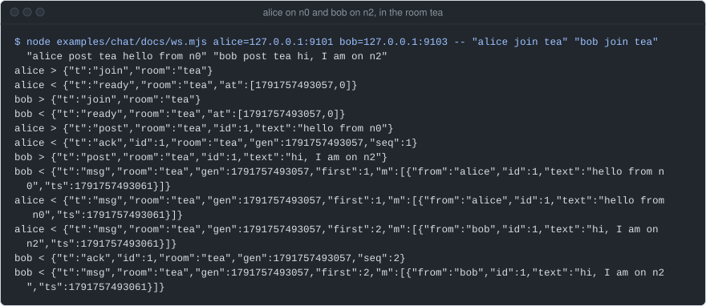
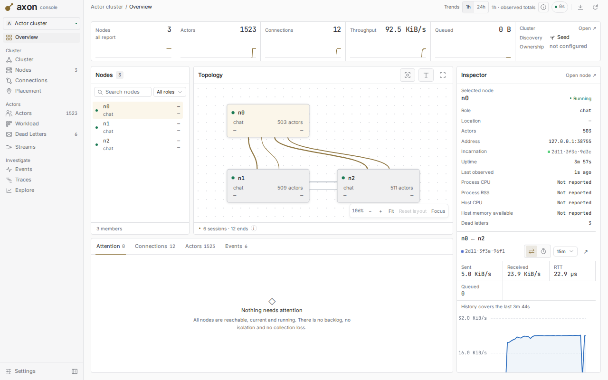
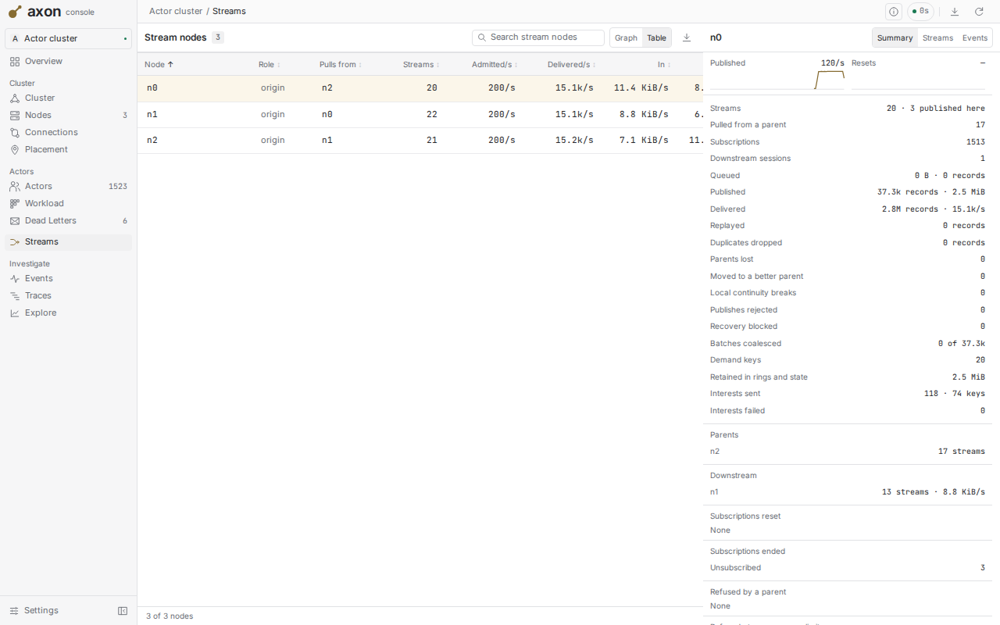
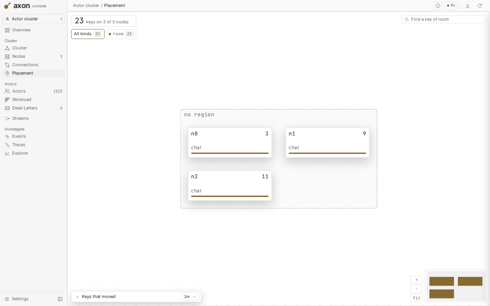
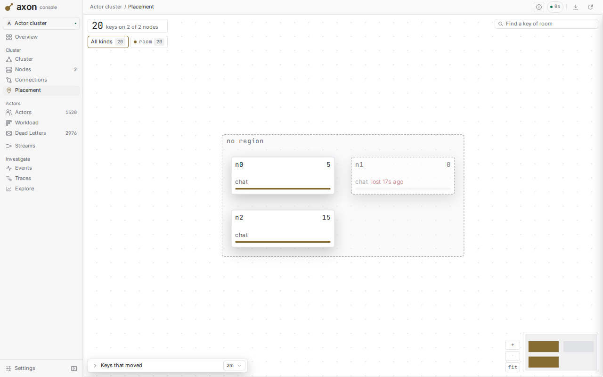
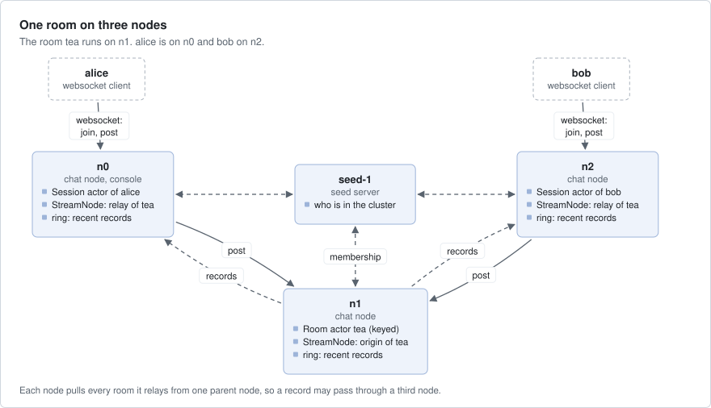
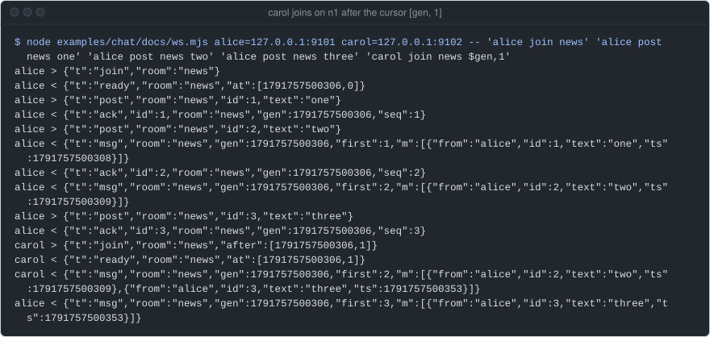
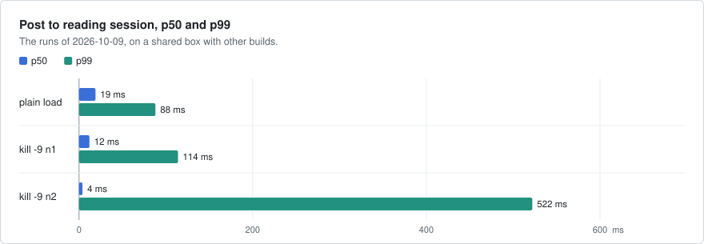
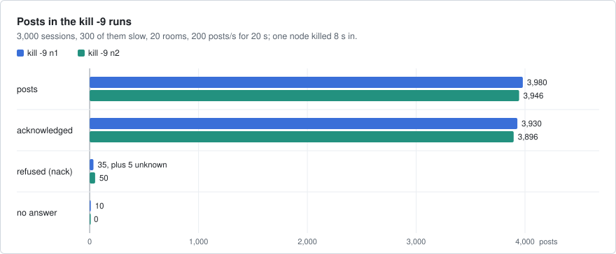

# chat

Chat rooms and websocket sessions spread over several axon nodes, with no central broker: the backend of a group chat
such as Slack or Discord, cut down to rooms and messages. Each room is one actor in the cluster that owns an ordered
stream, and a session on any node follows the rooms it joined. A client that reconnects, to the same node or another,
resumes after its last message with no gap and no duplicate, and a client that stops reading does not slow the room.



Two websocket clients, alice on n0 and bob on n2, in the room `tea`. Each post is acknowledged with its generation
(the room's start time) and its sequence number, and both clients get both messages in the same order.

## What it shows

- **Keyed actors, started on first use**: one `Room` actor per room name in the cluster, registered with
  `cluster.kind("room").idle(..)`, started by `get_or_spawn::<Unaddressed>` and posted to with a `KeyedRef`
  (`src/room.rs`, `src/node.rs`, `src/session.rs`).
- **Streams with an origin and relays**: a room is the origin of the stream `room/<name>`, with its start time as the
  generation. Every node relays the rooms it does not host (`src/room.rs`, `src/node.rs`).
- **Subscriptions that resume**: `After(cursor)`, `Live` and `First`, a new `Ready` when a room restarts, and
  `OriginLost` when its node dies (`src/follow.rs`).
- **Sources and sinks**: the websocket's read half is attached to the session actor as a source, its write half as a
  sink with `try_send` and `SinkEvent::Ready`, so the socket's I/O never runs on the actor (`src/session.rs`).
- **Jobs and `err.retry()`**: posts and room starts run as `submit_future` jobs; the retry class of an error picks the
  `nack` reason (`src/session.rs`).
- **Seed discovery**: the nodes find each other through one seed server (`src/main.rs`).
- **axon's console**: node n0 can run the metrics collector and the console for the cluster (`src/node.rs`).
- **axon-testkit**: the session's follow logic on the seeded `Simulator`, 500 seeds (`tests/sim.rs`).

## Run it

A seed server and three nodes, each in its own terminal, from the repository root:

```bash
cargo build --release -p chat
B=target/release/chat
$B seed --plaintext --id seed-1 --bind 127.0.0.1:9100        # prints {"seed":"127.0.0.1:9100"}
$B node --plaintext --id n0 --seeds 127.0.0.1:9100 --http 127.0.0.1:9101 --console 127.0.0.1:9110
$B node --plaintext --id n1 --seeds 127.0.0.1:9100 --http 127.0.0.1:9102
$B node --plaintext --id n2 --seeds 127.0.0.1:9100 --http 127.0.0.1:9103
```

Each node prints `{"node", "http", "console"}` when it is up. Without `--bind` and `--http` a process takes a free
port. All processes must agree on `--secret`; `--workers` sets the worker threads. There is no TLS between the
nodes, so a seed or a node starts only with `--plaintext`: use it on loopback or a private network only.

A client connects to `ws://<http>/ws?user=<name>` on any node and sends JSON text frames. `docs/ws.mjs` (Node 22 or
later, no packages) is the client of the figures, and any websocket client works:

```bash
node examples/chat/docs/ws.mjs alice=127.0.0.1:9101 bob=127.0.0.1:9103 -- "alice join tea" "bob join tea" \
    "alice post tea hello from n0" "bob post tea hi, I am on n2"
$B load --nodes 127.0.0.1:9101,127.0.0.1:9102,127.0.0.1:9103 --sessions 1500 --rooms 20 --secs 60 --rate 200
```

`chat load` opens many sessions, posts, and prints a JSON report of what each session got.
axon's console is at http://127.0.0.1:9110, with no sign-in on a
loopback address.

| | |
|---|---|
| <br>axon's console: the three chat nodes under `chat load`. | <br>axon's console: each node is the origin of its rooms and pulls the rest from one other node. |
| <br>axon's console: which node runs each room. | <br>axon's console: 17 s after `kill -9` of n1, its rooms that had followers run on n0 and n2. |

## How it works



- **A room** (`src/room.rs`) is a keyed actor, one per name in the cluster. A hash of the name picks its node.
  When it starts it opens the stream `room/<name>` with its start time in ms as the generation. A post gets the next
  sequence number and is acknowledged with `(generation, sequence)`. A room that restarts on another node opens the
  same stream there in a higher generation.
- **A session** (`src/session.rs`) is one actor per websocket. It asks for each room it joins once, which starts the
  room, then subscribes to the room's stream on its own node. What the socket cannot take yet waits in a bounded
  outbox.
- **Follow** (`src/follow.rs`) is the session's state machine for one room, with no I/O: it keeps the cursor (the last
  message the client holds) and picks the next subscription after an end or a reset.
- **A node** (`src/node.rs`) is the same on every machine: the cluster, a `StreamNode` that pulls from the other chat
  nodes, the room kind and the `/ws` route. With `--console` it also runs the metrics collector and the console.
- **The seed server** (`src/main.rs`) tells the nodes who is in the cluster.
- **State** is in memory only: each node keeps the recent records of each room it carries in its ring. A room with no
  post for 10 minutes stops, and its history goes with it.
- **The protocol** (`src/proto.rs`): the client sends `join {room, after?}`, `leave {room}` and `post {room, id, text}`.
  The server sends `ready`, `msg`, `reset`, `ack`, `nack` and `error`.

What a client is promised:

- Within a generation, messages arrive in order with no gap and no duplicate, across pauses and reconnects. A `join`
  with `after: [gen, seq]` resumes after it, while a ring holds it (16,384 records or 16 MiB per stream by default).
- What cannot be resumed is said, never skipped: a `ready` in a new generation (the room restarted), or a `reset`,
  most often `generation_changed`, `stream_closed` or `history_unavailable`. A stream that drops a slow session's
  subscription is not a reset: the session subscribes again after the cursor.
- An `ack` means the room has put the post in its stream, and every session that follows that generation gets it.
  A `nack` means it did not. A post with no answer (its room's node died during the call) may or may not be there.
- A session's join point is its `ready` frame. Posts made before it may or may not reach that session.
- A client that reads slowly is paused: when 256 frames wait, the session drops the room's subscription, keeps the
  cursor, and subscribes again after it when the client catches up. Past 512 frames waiting, the session closes.

A join after a cursor, on another node: carol on n1 gets the messages after the first one.



## Numbers

Latency from a post to a session that reads it, from the runs of 2026-10-09 recorded in commit `d1a13dd` (axon
`ee6dcd82`), on a shared box that ran three other builds at the same time. The `kill -9` n2 run is of the code one
review fix before that commit.



| Run | Where and when | Result |
|---|---|---|
| plain load: 3,000 sessions, 3 rooms each of 20, 200 posts/s for 20 s | shared box, 2026-10-09, `d1a13dd` | p50 19 ms, p99 88 ms, max 213 ms |
| the same with 300 slow sessions and `kill -9` of n1 | the same | p50 12 ms, p99 114 ms, max 2.0 s |
| the same, with `kill -9` of n2 in place of n1 | the same, one review fix before `d1a13dd` | p50 4 ms, p99 522 ms, max 1.4 s |
| plain load, as above | shared 24-core box, 2026-09-25, axon `91c36d0` | 1.8 M deliveries (~60 k/s); p50 4 ms, p99 35 ms |
| the same with 300 slow sessions and `kill -9` of n1 | the same | 1.58 M deliveries (~53 k/s); p50 3 ms, p99 44 ms, max 2.1 s |
| `fault.sh`, 300 slow sessions, `kill -9` of n1, an independent run | a dev box (EPYC 4484PX), 2026-09-25, axon `91c36d0` | 1,583,550 received (52,670/s); p50 3 ms, p99 187 ms, max 1,981 ms |

Until 2026-09-28 the example was in the axon repository, so `91c36d0` is a commit there. In each run the seed, the
three nodes and the load client share one box and talk over loopback. Only sessions that read take latency samples,
and only while posts flow. In the kill runs, the maximum is a room that moved. These numbers say that it holds up;
they do not say how fast axon is.

## Faults

| Layer | Where | What it does |
|---|---|---|
| Real nodes | `tests/chat.rs` | real websockets on three nodes in one process: a post reaches every node; a reconnect to another node resumes after its cursor; a slow client is paused and catches up; a room whose node leaves, or crashes, starts again elsewhere and its sessions are told |
| Simulation | `tests/sim.rs` | `Follow` on the seeded simulator, 500 seeds: room restarts, slow-consumer ends, lost parents, reconnects, a ring that is too small. No duplicate, no gap, a break only where one was forced |
| Fault run | `fault.sh` | 3 nodes under `chat load`, then `kill -9` of one node 8 s after every session joined |

```bash
cargo test -p chat
SESSIONS=3000 SLOW=300 examples/chat/fault.sh /tmp/chat-out          # kill -9 n1
KILL=2 SESSIONS=3000 SLOW=300 examples/chat/fault.sh /tmp/chat-out   # kill -9 n2
KILL=none examples/chat/fault.sh /tmp/chat-out                       # no fault
SECS=40 RESTART=12 SESSIONS=1500 examples/chat/fault.sh /tmp/chat-out # n1 starts again 12 s after the kill
```

`fault.sh` prints PASS only when duplicates, gaps, lost posts in rooms that did not restart, lost posts in a restarted
room's new generation and posts a slow session lacks are all 0, and, with a kill, some sessions reconnected. The
chart and the table below are the two `kill -9` runs of 2026-10-09.



| `fault.sh`, 2026-10-09 | kill -9 n1 (`d1a13dd`) | kill -9 n2 (one fix before) |
|---|---|---|
| posts / acknowledged | 3,980 / 3,930 | 3,946 / 3,896 |
| refused (`nack`) | 35, plus 5 `unknown` | 50 |
| no answer (the node died during the call) | 10 (none of them delivered) | 0 |
| rooms restarted on another node | 7 | 10 |
| sessions reconnected (those on the killed node) | 1,000 | 1,000 |
| duplicates, gaps | 0, 0 | 0, 0 |
| acknowledged posts held by every session in the room | 3,930 of 3,930 | 3,896 of 3,896 |
| acknowledged posts a slow session lacks | 0 | 0 |

A `kill -9` loses the history of the dead node's rooms (their new generation starts at record 1) and the posts sent
to it that got a `nack` or no answer. Every acknowledged post reached every session of its room that followed that
generation, and rooms on the other nodes did not break.

The last independent check is of commit `91c36d0` on 2026-09-25, an older design in which a
room's stream name carried its node's name. Every test passed, and `fault.sh` with `kill -9` of n1 passed with 1,000
reconnects and 7 rooms restarted.

## Left out

- History on disk: a room's history is in memory only, and a client cannot page back into a dead generation.
- Sign-in and TLS: the user name is a query parameter, and the nodes talk in plain text on loopback.
- More than one post in flight per session: one at a time keeps a session's posts in order.
- Presence, typing, edits, deletes, read markers and push notifications.
- Partitions, a seed server crash, and more than one node lost at a time were not tried.

## Files

| Path | What |
|---|---|
| `src/room.rs` | the room actor: the origin of its stream |
| `src/session.rs`, `src/follow.rs` | the session actor per websocket, and its state machine per room |
| `src/proto.rs` | the websocket frames and the room's cluster protocol |
| `src/node.rs`, `src/main.rs` | one node, and `chat seed`, `chat node`, `chat load` |
| `src/load.rs`, `src/client.rs` | the load client, and the checks of what each client got |
| `tests/`, `fault.sh` | the tests, and the fault run |
| `docs/ws.mjs` | a small websocket client for the figures |
