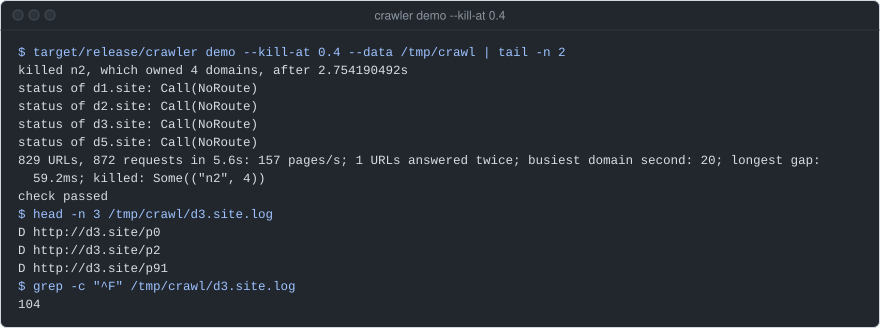
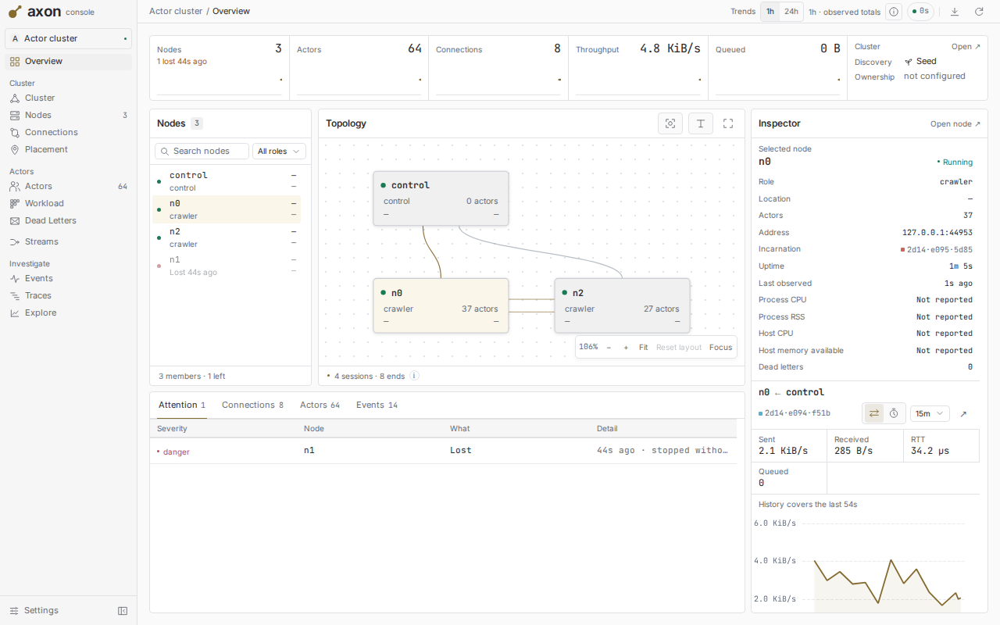
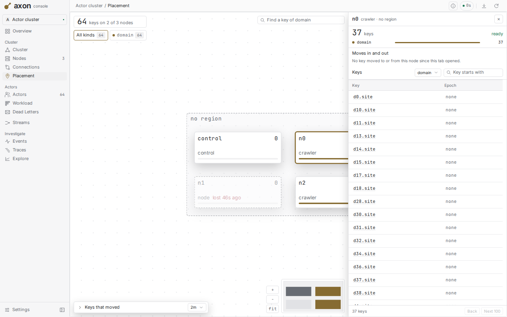
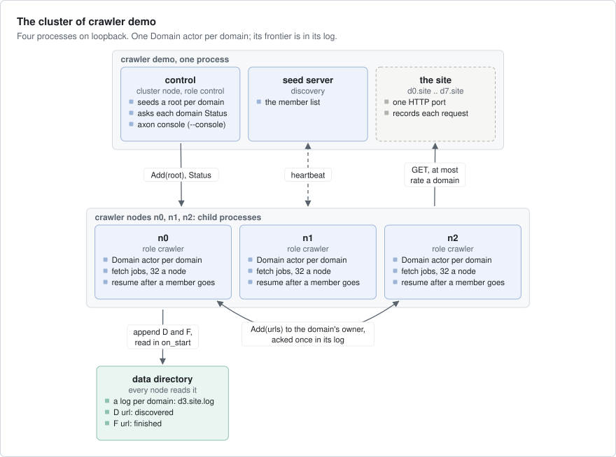
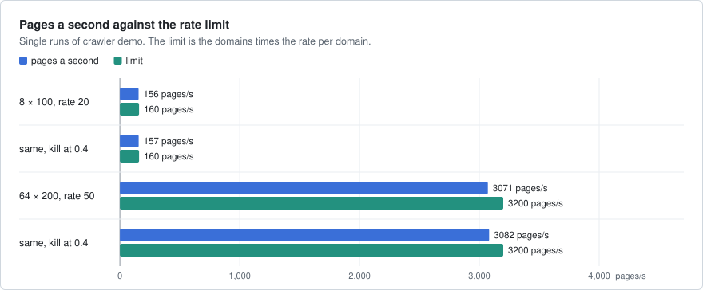
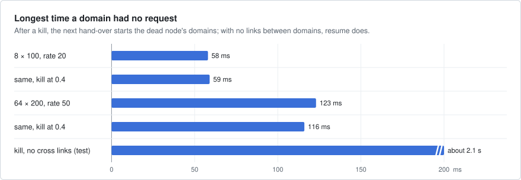

# crawler

A distributed web crawler on axon, run against a web site that it makes itself on loopback (no internet). Each domain
has one keyed actor (axon runs one actor per key, on one node of the cluster), which holds the domain's queue, the
URLs it has seen and its rate limit. You can kill a crawler node with SIGKILL during the crawl, and each URL is still
fetched, at most once more per kill.



`crawler demo --kill-at 0.4` on an EPYC 4484PX box, main `1e52123`. The demo's control node
kills the crawler node n2, which owns 4 domains. The status lines are the control node asking again while those
domains move. The crawl ends and the check passes. Each domain keeps a log: `D` for a URL found, `F` for a URL
finished.

## What it shows

- **Keyed actors**: one `Domain` actor per domain, keyed by its host, placed over the crawler nodes. A page's links to
  another domain go to that domain's actor through `cluster.keyed_refs` and `KeyedRef::request` (`src/crawler.rs`).
- **Jobs and `pause_until`**: fetches run as `cx.submit_future`, log writes as `cx.submit_io`. In `on_start`, the actor
  reads its log and takes no message until the read is done (`src/crawler.rs`).
- **Timers**: `cx.schedule_at` starts the next fetch when the rate limit lets it. The frontier takes `now` as an
  argument, so the same code runs in the actor and in the simulation (`src/frontier.rs`).
- **A mailbox weighed in bytes**: `MailboxConfig::with_weight` counts the bytes of the URLs that wait, not only the
  messages (`src/crawler.rs`).
- **Membership events and `cluster.owner`**: when a member goes, each survivor starts the logged domains that it owns
  now (`resume` in `src/crawler.rs`).
- **`err.retry()`**: a hand-over of links tries again after each error but `Retry::Never`, because adding a URL twice
  does no harm (`add` in `src/crawler.rs`).
- **Seed discovery and the console**: the nodes find each other through a seed server, and the control node serves
  axon's console when you give it `--console` (`start_node` in `src/crawler.rs`).
- **axon-testkit**: the hand-over protocol on the seeded `Simulator`, with lost, doubled and reordered messages and a
  crash (`tests/sim.rs`).

## Run it

One command starts the whole crawl: the site, a seed server, three crawler nodes as child processes and a control
node. It prints the report of each domain, a summary line, and `check passed` when the crawl kept its promises.

```bash
cargo run --release -p crawler -- demo                    # 3 nodes, 8 domains × 100 pages, 20 requests/s a domain
cargo run --release -p crawler -- demo --kill-at 0.4      # SIGKILL a node once 40 % of the site is fetched
cargo run --release -p crawler -- demo --domains 64 --pages 200 --rate 50 --kill-at 0.4
cargo run --release -p crawler -- demo --kill-at 0.5 --console 127.0.0.1:8080 --hold 60   # and watch it
```

`--nodes` sets the number of crawler nodes, and `--data DIR` the directory of the logs (by default a new temporary
directory). `--console` serves axon's console on the control node with no sign-in (loopback only), and `--hold` keeps
the cluster up that many seconds after the crawl. `crawler node` runs one crawler node against a seed server. The demo
starts its nodes that way, and a node leaves the cluster when its stdin closes.

| | |
|---|---|
| <br>axon's console after the kill: n1 lost, 64 domain actors on n0 and n2. | <br>axon's console: the domains that n0 owns now, on the placement page. |

The shots are from `crawler demo --domains 64 --pages 200 --rate 5 --kill-at 0.4 --console ADDR --hold 300`, on the
same box.

## How it works



- **The site** (`src/site.rs`) serves the hosts `d0.site` to `d7.site` (8 by default) on one port. A seeded generator
  makes the links: 30 % go to other domains, and about 1 in 25 to a page that does not exist. One page in 16 answers
  its first request with a 503. The site records each request, and the check reads that record.
- **A fetch** (`src/http.rs`) is one HTTP GET with a deadline and a body of at most 256 KiB. It gives a page with its
  links, a page that is gone (4xx), or a failure to try again (5xx, a timeout, a reset).
- **The frontier** (`src/frontier.rs`) is one domain's state, with no I/O: the URLs seen, the queue, the fetches in
  flight, the time of the next allowed request, and 3 attempts per URL.
- **The log** (`src/store.rs`) is a file per domain in a directory that each node reads: `D url` when a URL is found,
  `F url` when it is finished. A new owner reads it back. A torn last line is ignored.
- **A `Domain` actor** (`src/crawler.rs`) is the keyed actor of kind `domain`. It writes one batch to its log at a
  time, and it starts a fetch only when its frontier allows it. A node has at most 32 fetches in flight.
- **A hand-over** sends a page's links to each other domain's actor with `Add`. That actor answers only after the URLs
  are in its log. The page counts as finished only after each of its hand-overs is answered. So after a kill, the next
  owner reads the log and fetches each URL that is found but not finished.
- **Resume**: after a crash, a keyed actor starts again only when something calls its key. So each node watches the
  members, and when one goes, it starts the logged domains that it owns now. Without this, a domain that no other
  domain links to stays down.
- **The control node and the harness** (`src/harness.rs`) seed one root per domain, kill the node that owns the most
  domains when asked, wait until the site has served each URL and each domain is idle, then build the report.

What the crawl promises, as `Report::check` in `src/harness.rs` states it:

- Each reachable URL gets an answer other than 503 at least once.
- No URL gets more than `1 + kills` such answers, and no URL more than `3 × (1 + kills)` requests, 503s included.
- No domain gets more than `ceil(rate) + 1` requests in any one second, across a change of owner too.
- Each domain ends idle, with no link lost on a hand-over, and the domains together saw the reachable URLs exactly.

## Numbers





Both charts come from the table below, and the bar of about 2.1 s from the test in the last bullet under it. These
are smoke numbers: single runs of the release `crawler demo` on a shared box with 24 cores and a load average of about
8 from other work, with the site answering after 5 ms. They were recorded in axon commit f4de402 on 2026-09-25, when
this example was in the axon repository; the record does not name the box. The last row is an independent rerun,
on a dev box (EPYC 4484PX) at axon `f4de402`.

| Run | URLs | Requests | Time | Pages/s | Answered twice | Busiest domain-second | Longest gap for a domain |
|---|---|---|---|---|---|---|---|
| 8 domains × 100, rate 20 | 829 | 871 | 5.6 s | 156 | 0 | 21 | 58 ms |
| same, `--kill-at 0.4` (n2 held 4 domains) | 829 | 872 | 5.6 s | 157 | 1 | 20 | 59 ms |
| 64 × 200, rate 50 | 13271 | 14072 | 4.6 s | 3071 | 0 | 51 | 123 ms |
| same, `--kill-at 0.4` (n1 held 22 domains) | 13271 | 14072 | 4.6 s | 3082 | 0 | 51 | 116 ms |
| 8 × 100, rate 20, `--kill-at 0.4`, independent rerun | 829 | 871 | 5.6 s | 157 | 0 | 20 | 58.7 ms |

- 8 domains at 20/s is 160 pages/s, and the crawl runs at that limit. 64 domains at 50/s would allow 3200.
- The requests above the URL count are the 503s and their retries.
- With links between domains, the dead node's domains are called again within milliseconds, so the gap stays short.
  In the test with no such links, where the site answers after 30 ms, the gap was about 2.1 s: the time the survivors
  take to see the member go, plus one interval.

What they do not show: how fast the crawler can go, because the rate limit sets the speed here. When the table was
recorded, three runs with a kill answered 0, 1 and 1 URLs twice; the bound is 1 per URL per kill, not a count of URLs.

## Faults

| Layer | Where | What it does |
|---|---|---|
| Unit | `src/frontier.rs` | retries stop after 3 attempts, fetches keep the interval and the in-flight bound, a restored domain waits one interval |
| Simulation | `tests/sim.rs` | the frontier, the log and the hand-over on three nodes of the seeded `Simulator`: one message in 8 lost, one in 8 doubled, reordering, one node crashed. 200 seeds, each URL fetched once or twice and no domain faster than its interval; the same seed gives the same crawl |
| Real processes | `tests/crawl.rs` | three whole crawls: no kill; a SIGKILL with 30 % of links to other domains; a SIGKILL with no such links, where only `resume` can start the dead node's domains again |
| Demo | `crawler demo --kill-at` | the same check, `Report::check`, against the site's own record of requests |

```bash
cargo test -p crawler                     # the unit tests, the simulation and the crawls with real processes
cargo run --release -p crawler -- demo --kill-at 0.4
```

The last independent check, on that dev box at axon `f4de402` on 2026-09-25: all 8
tests passed, `tests/crawl.rs` passed 5 more runs in a row, and the kill demo printed `check passed`. With `resume`
switched off, the test with no links between domains failed, so that test guards `resume`. The simulation models the
protocol, not the actors and the cluster.

## Left out

- The real web: DNS, `robots.txt`, redirects, HTTPS, URL normalization and limits per IP address.
- Storage that a real cluster can share: the nodes read one local directory. The log goes to the page cache and is
  not synced, so it survives a killed process but not a machine crash.
- The pages themselves: nothing is stored or indexed, and nothing is crawled again later.
- A retry in `resume`: a domain that fails to start there waits until something calls it.
- A hand-over that fails for 30 s counts its links as lost, and its page is still marked finished. The check then
  fails the crawl.
- A restart policy for the `domain` kind: a `Domain` actor that fails starts again only when something calls it.

## Files

| Path | What |
|---|---|
| `src/crawler.rs` | the `Domain` actor, its wire protocol, `start_node` and `resume` |
| `src/frontier.rs` | one domain's frontier, with no I/O |
| `src/store.rs` | the log of each domain |
| `src/http.rs`, `src/site.rs` | the HTTP GET, and the generated site with its record of requests |
| `src/harness.rs`, `src/main.rs` | the whole crawl, its report and check; `crawler demo` and `crawler node` |
| `tests/crawl.rs`, `tests/sim.rs` | crawls with real processes; the protocol on the simulator |
