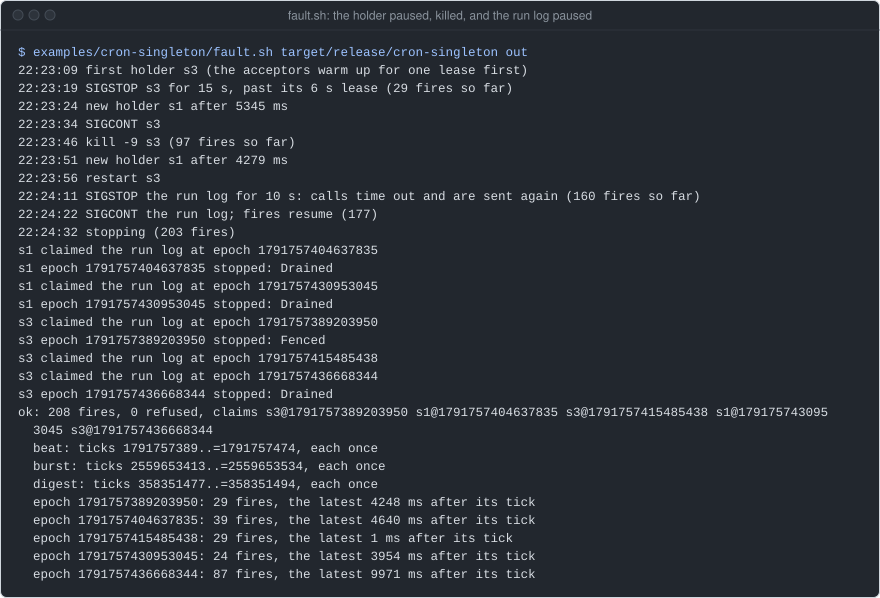
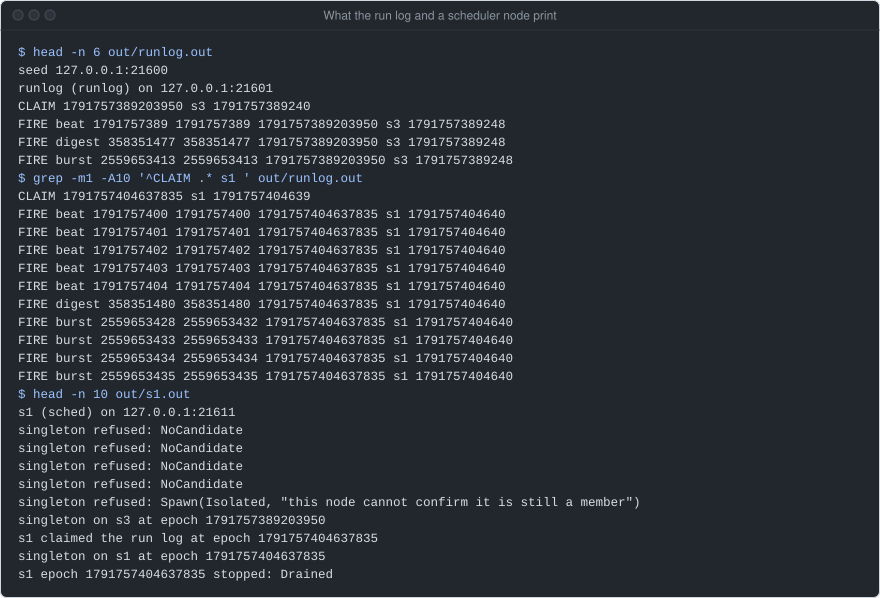
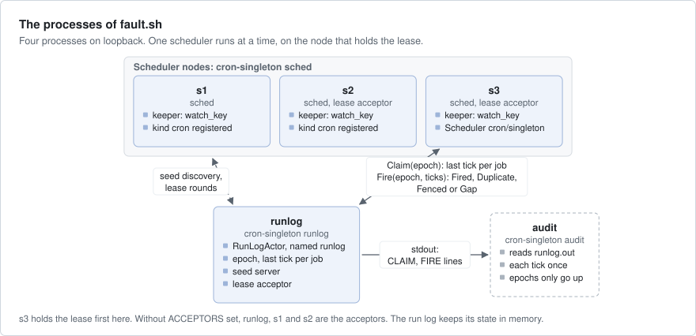
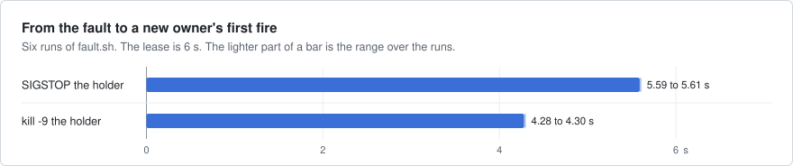
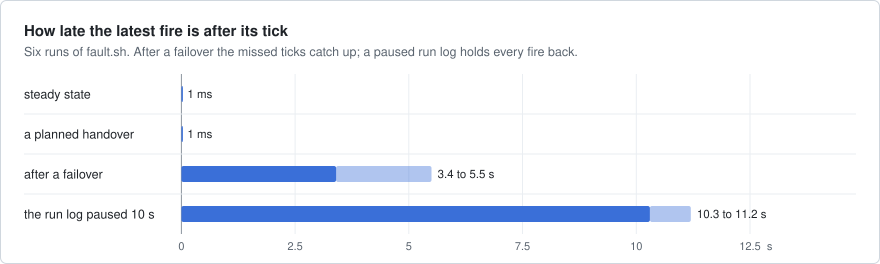

# cron-singleton

A cron for a cluster: jobs fire on wall-clock ticks from exactly one scheduler at a time, a singleton that moves to
another node when its node dies. A lease alone does not stop an old owner that was paused and wakes up, so here the
system that runs the jobs (the run log) refuses any owner older than the newest one: no tick fires twice and none is
skipped.



`fault.sh` on an EPYC 4484PX box, release build of main `1e52123`, on
2026-10-11 with other jobs on the box. The holder s3 is paused past its lease, then killed, then the run log is
paused. The audit at the end finds every tick once.

## What it shows

- **A keyed actor as a singleton, under `PaxosLeases`**: a keyed actor runs once in the cluster per key, on the node
  that holds the key's lease; `PaxosLeases` grants leases by a majority of acceptor nodes. The `Scheduler` is the one
  actor of key `cron/singleton`. It takes its lease epoch from `SpawnContext::epoch` (`register_scheduler` and
  `Settings::start` in `src/lib.rs`).
- **`cluster.watch_key` and `get_or_spawn`**: a keeper task on every scheduler node starts the singleton again when
  the watch shows it stopped (`keep` in `src/lib.rs`).
- **`cx.pause_until` in `on_start`**: the scheduler claims the run log before it handles anything else
  (`Scheduler::claim`).
- **`cluster.publish` and `cluster.named`**: the run log is published under the name `runlog`, and the scheduler calls
  it through a `NamedRef` that resolves again when the reference is stale (`src/main.rs`, `src/lib.rs`).
- **`err.retry()` and `axon::Backoff`**: a claim or fire is sent again only when the error may clear, after a
  jittered delay (`RETRY` and `KEEP` in `src/lib.rs`).
- **Seed discovery**: the run log's process runs the `SeedServer`; every node finds the others through it
  (`src/main.rs`).
- **`axon::trace::unix_micros`** as the wall clock that ticks follow (`system_wall` in `src/lib.rs`).
- **`EmbeddedDriver` with a manual clock, and axon-testkit's seeded `Simulator`** for the clock steps and handovers
  that a process test cannot hit on purpose (`tests/`).

## Run it

Four processes on loopback: the run log and three scheduler nodes. There is no TLS between them, so each starts only
with `--plaintext`: loopback or a private network only. Run from the repository root:

```bash
cargo build --release -p cron-singleton
B=target/release/cron-singleton
SEED_PORT=0 $B runlog --plaintext | tee runlog.out      # prints "seed 127.0.0.1:<port>", then CLAIM and FIRE lines
NODE_ID=s1 SEEDS=127.0.0.1:<port> $B sched --plaintext  # and s2, s3 in two more shells
$B audit < runlog.out                                    # after ctrl-c: every tick once, none skipped, epochs never down
```

The first fires come after about one lease: the lease acceptors wait that long after they start. A run log line is
`FIRE job from tick epoch node wall_ms`, where `from` is less than `tick` when missed ticks are folded into one run.



These lines are from the fault run at the top. At the start, the nodes do not see each other yet: `NoCandidate` means
that no node that can run the scheduler is known, and `Isolated` that this node cannot confirm it is a member. The
keeper tries again.

The environment:

| Variable | Default | What |
|---|---|---|
| `ACCEPTORS` | `runlog,s1,s2` | the lease acceptors, the same on every node |
| `LEASE_MS`, `SECRET` | `6000`, a fixed secret | the lease and the cluster's secret, the same on every node |
| `JOBS` | `beat:1000:0:1024,digest:5000:0:1` | `name:every_ms:offset_ms:max_runs,...`, the same on every scheduler node |
| `NODE_ID`, `HOST`, `PORT` | the role, `127.0.0.1`, `0` | this node; port 0 picks a free port |
| `SEED_PORT`, `SEEDS` | `7001`, `127.0.0.1:7001` | the run log's seed server port; where the schedulers find it |

The fault run starts all four processes itself:

```bash
examples/cron-singleton/fault.sh target/release/cron-singleton /tmp/cron-out
```

## How it works



- **Ticks come from the wall clock, not from timers.** Tick `t` of a job starts at `t * every_ms + offset_ms` ms
  since the Unix epoch, so every node numbers ticks the same way without talking. Timers only wake the scheduler to
  read the wall clock again, at the next due tick and at least once a second (`Scheduler::wake` in `src/lib.rs`).
- **The scheduler** is a keyed actor on the node that holds the lease of `cron/singleton`. It keeps the next tick of
  each job in memory, and gets the last fired ones from the run log at each start (`src/lib.rs`, `Plan` in
  `src/core.rs`).
- **The claim.** A new owner first claims the run log with its lease epoch, a number that is larger for each new
  holder of the lease. The claim returns the last tick fired per job, which is where the new owner goes on.
- **The run log** refuses a fire from an older epoch (`Fenced`), a tick it has fired already (`Duplicate`) and a fire
  that would skip ticks (`Gap`). So a fire sent again after a lost answer does no harm. It keeps the newest epoch and
  the last tick per job in memory (`RunLog` in `src/core.rs`, `RunLogActor` in `src/lib.rs`).
- **Missed ticks.** After an outage the latest `max_runs - 1` missed ticks fire one by one, late, and every older one
  is folded into the first run (`from..=tick`). With `max_runs = 1` an outage costs one run; with 1024 every tick
  fires late. A job the log has never fired starts at the tick the claim finds the clock in.
- **Clock steps.** A step back owes nothing until the clock passes the last fired tick again. A step forward owes the
  ticks it jumped, under the rule above.
- **Failover.** When the holder's node dies or is paused past its lease, the lease runs out. The keeper on each
  scheduler node sees the key stopped and calls `get_or_spawn`, which starts the scheduler on another node under a
  larger epoch. A woken old holder's actor is stopped before it handles anything, and a fire it sent before the pause
  that lands late is refused by the run log.

The run log here is an actor that prints one line per claim and fire. It stands for a table with a unique
`(job, tick)` and the epoch check in the same transaction.

What the system behind the run log is promised:

- Each tick of a job fires once: none twice, none skipped. Missed ticks may come folded into one run, as a range.
- No tick fires before its start, also when the wall clock steps.
- After a newer owner has claimed the run log, no fire of an older owner is taken.

## Numbers

Six runs of `fault.sh` on the shared 24-core dev box, on loopback, with other builds running, recorded on 2026-09-25
in the axon repository at `ec848c52`, where the example lived then. Smoke only, not a benchmark. The charts and the
table are drawn from those runs.





| What | Measured |
|---|---|
| audit, every run | ok: 159 to 202 fires, no tick twice, none skipped, no run log refusal needed |
| SIGSTOP the holder: a new owner's first fire | 5.59 to 5.61 s after the SIGSTOP (lease 6 s) |
| kill -9 the holder: a new owner's first fire | 4.28 to 4.30 s |
| latest fire after a failover | 3.4 to 5.5 s after its tick (the missed ticks catching up) |
| planned handover (the key moving back to s3) | the latest fire 1 ms after its tick |
| steady state | fires 1 ms after their tick |
| the run log paused 10 s | fires resume within about 2 s of SIGCONT (retry backoff); the latest 10.3 to 11.2 s late |
| first owner's first fires | up to one period late: a never-fired job starts with the tick the claim finds the clock in |

What they do not show: how many jobs or fires one scheduler can carry, or a run log that writes to disk. The keeper
and the retry delays changed after these runs, and the capture at the top is a later run on another box, so its times
differ a little.

## Faults

| Layer | Where | What it does |
|---|---|---|
| Unit | `src/core.rs` | the policy folds missed ticks; the log refuses old epochs, repeats and holes; a never-fired job's first fire, its answer lost, is sent again for the same tick |
| Embedded | `tests/embedded.rs` | the real `Scheduler` on `EmbeddedDriver` with a manual clock: the wall clock steps back 7.5 s and forward 42 s, every tick once and none early; a fire held in flight while the next owner claims lands `Fenced`, and the handover loses no tick |
| Real node | `tests/keep.rs` | the keeper starts again a singleton that ends before the watch sees it running |
| Simulation | `tests/sim.rs` | the real `Plan` and `RunLog` on axon-testkit, 200 seeds: loss, duplicates, reordering, the lease moving among 3 nodes with the deposed owner acting for up to 3 s, wall-clock steps on each node; a seed gives the same run twice |
| Fault run | `fault.sh` | SIGSTOP the holder for 15 s, past its 6 s lease; kill -9 the holder and start it again; SIGSTOP the run log for 10 s; then `audit`. Exits non-zero when the audit fails or no new holder fires within 30 s |

```bash
cargo test -p cron-singleton
SEEDS=100000 cargo test --release -p cron-singleton --test sim   # more seeds (30 s); SIM_SEED=n reruns one
examples/cron-singleton/fault.sh target/release/cron-singleton /tmp/cron-out
```

The simulation runs 200 seeds in 0.3 s (debug build) and 100,000 in 30 s (release), on the dev box above. At 5,000
seeds it found a bug in this example (seed 460): a job's first fire whose answer was lost was sent again for a later
tick, and the log refused it as a gap. A never-fired job's first tick is now fixed at the claim.

The last independent check, on the dev box at axon `918f1908`: the 7 tests then in the
example passed, the simulation passed 20,000 seeds, and `fault.sh` exited 0 with 202 fires and 0 refused. A new
owner fired 5602 ms after the SIGSTOP and 4287 ms after the kill -9. `tests/keep.rs` came later and is not in that
check.

## Left out

- A durable run log. This one keeps its state in memory, so a restart of the run log forgets the epoch and the last
  ticks. A real one keeps them in the table the side effects write.
- The jobs themselves: a fire is a line in the run log, not work done.
- Cron expressions and time zones: a job is a period and an offset in ms.
- Changing the jobs while it runs: every scheduler node is started with the same `JOBS`.
- A sticky singleton: placement moves the key back to its first node when that node returns, so each recovery is two
  handovers.
- A console: the example does not run axon's dashboard.

## Files

| Path | What |
|---|---|
| `src/core.rs` | jobs and ticks, the `Plan` of what a scheduler owes, the `RunLog` and its fencing, the audit; no I/O |
| `src/lib.rs` | the run log's contract and actor, the `Scheduler` actor, the keeper, a node's cluster settings |
| `src/main.rs` | the `runlog`, `sched` and `audit` commands |
| `tests/` | the embedded tests, the keeper test and the simulation |
| `fault.sh` | the fault run |
