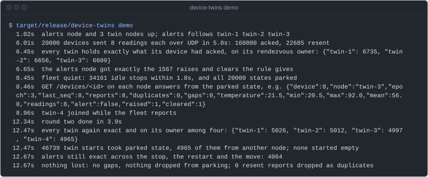
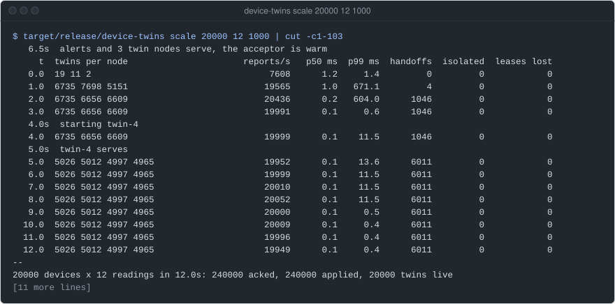
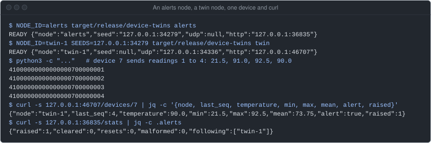
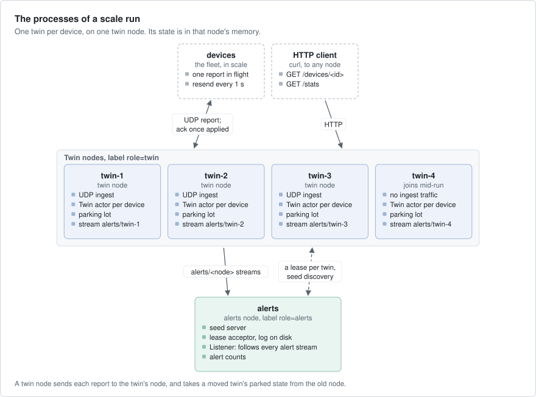
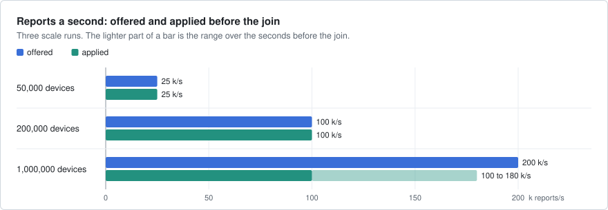
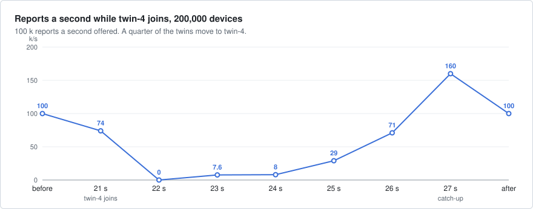
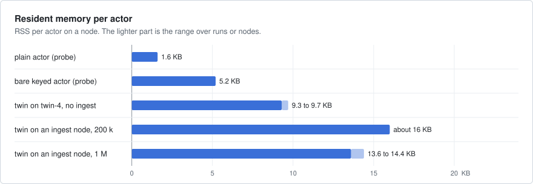

# device-twins

A digital twin per IoT device, like AWS IoT Device Shadow or Azure Digital Twins. Devices send readings over UDP to
any node, and each reading goes to the one actor in the cluster that holds that device's state and raises its
alerts. It shows keyed actors that stop when idle and move to a new node, and keep their state across both.



`device-twins demo` on an EPYC 4484PX box, main `1e52123`, 2026-10-11, with other jobs
on the box. Each line is a check that passed: 20 000 devices report, every twin stops when the fleet goes quiet,
the fleet reports again while twin-4 joins, and no reading or alert is lost.

## What it shows

- **Keyed actors under a lease**: one `Twin` actor per device id. A hash of the id picks its twin node, and a lease
  makes sure only one copy runs. `.idle(..)` stops a twin that hears nothing (`src/twin.rs`, `TwinNode` in
  `src/lib.rs`).
- **`KeyedRefs` and `request_until`**: the UDP ingest keeps a reference per device and acks a reading only after the
  twin applied it (`Ingest` in `src/lib.rs`).
- **`submit_future` and `pause_until`**: a starting twin with no state on its node fetches it from the other twin
  nodes, and its reports wait until the fetch is back (`src/twin.rs`).
- **Raw endpoints**: `cluster.serve` and `cluster.request` carry `twins.parked`, which hands out the states that
  stopped twins left on a node (`src/lib.rs`, `src/twin.rs`).
- **Streams**: each twin node publishes alerts on `alerts/<node>`, and the alerts node follows every one from its
  first record (`Listener` in `src/lib.rs`).
- **`cluster.nodes(..).changes()`**: the alerts node follows each twin node that joins (`src/lib.rs`).
- **Seed discovery and `PaxosLeases`**: the nodes find each other through a seed server, and take leases from one
  acceptor, both on the alerts node. The one-process demo uses `MemoryDiscovery` and `MemoryLeases` instead
  (`src/main.rs`, `src/demo.rs`).

## Run it

The whole story in one process, checked as it goes (the capture above):

```bash
cargo build --release -p device-twins
target/release/device-twins demo                    # 20 000 devices; `demo 5000` for fewer
```

The scale run starts one alerts and three twin processes on free loopback ports, plays the devices itself, and
starts twin-4 a third of the way in. It prints a line a second, and fails unless every reading was applied once,
every alert arrived and no twin started without its state:

```bash
target/release/device-twins scale 200000 30 2000    # devices, readings each, ms between readings
```



A small run on the same box, main `1e52123`, cut at 103 columns. The rest of each line is the late and resent
counts and each node's memory.

To talk to it yourself, start the nodes by hand, each in its own terminal. Each prints `READY` with the ports the
system gave it; put them in place of `<seed>`, `<udp>` and `<http>`. Ctrl-C stops a node.

```bash
NODE_ID=alerts target/release/device-twins alerts
NODE_ID=twin-1 SEEDS=<seed> target/release/device-twins twin
python3 -c "import socket,struct,time; s=socket.socket(type=socket.SOCK_DGRAM)
for seq,temp in enumerate([21.5,91.0,92.5,90.0],1):
    s.sendto(b'R'+struct.pack('>QIQf',7,seq,time.time_ns()//1000,temp),('127.0.0.1',<udp>)); print(s.recv(13).hex())"
curl -s 127.0.0.1:<http>/devices/7
```



Each ack is `A`, the device and the seq. The twin of device 7 holds the window and the alert. The alerts node
counts the raise it got on twin-1's stream.

## How it works



- **A twin** (`src/twin.rs`) is a keyed actor, one per device. Its `State` is the last sequence number (seq), the
  counts, the last 16 readings and the alert. It lives in the node's memory. Three readings above 80.0 in a row
  raise an alert, and three at 80.0 or below clear it.
- **A device** (`src/load.rs`) keeps one reading in flight and sends it again every second until it is acked. It
  sends each reading to the next twin node in turn. A report is 25 bytes, the ack 13 (`src/wire.rs`).
- **The ingest** (`Ingest` in `src/lib.rs`) on each twin node reads the UDP socket, sends each report to the twin
  wherever it lives, and acks it once the twin applied it. A twin drops a seq it has seen, so each reading is
  applied once and in order. At most 2 048 reports are in flight per node.
- **The parking lot** (`Parking` in `src/twin.rs`): a twin that stops parks its `State` on its node. A starting twin
  takes it from its own node's lot, or else asks the other twin nodes over `twins.parked`, one at a time.
- **Alerts**: a twin publishes each raise and clear to its node's stream `alerts/<node>`. The alerts node's
  `Listener` follows the stream of every twin node and counts (`src/lib.rs`).
- **The alerts node** (`src/main.rs`) is also the seed server and the only lease acceptor, with its log of lease
  holders on disk. It hosts no twins, so a twin node's restart never takes the lease vote away.
- **HTTP**: every node answers `GET /devices/<id>`, which starts a stopped twin, and `GET /stats` with its counters.
- **Idle**: a twin stops after `IDLE_SECS` with no report (30 s; 2 s in the demo, 600 s in the scale run).

What a device's state survives, and what it does not:

- **An idle stop: kept.** The twin parks its state, and its next start on the same node takes it back.
- **A move to a node that joins: kept.** The old twin parks and releases its lease before the new owner can start
  it, and the new twin takes the state from the old node's lot.
- **A stop while a twin fetches its state: kept.** The reports it held are not acked, so the devices send them again.
- **A node that crashes or leaves: lost.** Its twins and its lot are in its memory only: those devices start empty
  on their new owner, and the twin counts the gap in seqs.
- **Alerts: kept**, each published once and followed from the first record. An alerts node that restarts gets only
  what each twin node's stream still holds in memory.

## Numbers

Three scale runs on a dev box (EPYC 4484PX, 24 threads, 93 GB), shared with other builds, all on loopback:
`device-twins scale 50000 30 2000`, `scale 200000 30 2000` and `scale 1000000 12 5000`. The 50 000 run was
recorded at axon `9d901d12` (2026-09-25); the 200 000 and 1 000 000 runs at axon `129ceca7` (2026-09-24), before
later fixes in axon, and were not repeated. The example was in the axon repository
then.





In the 50 000 run, after the fixes, reports a second stayed at 25 k through the join.



The plain and keyed actors are a scratch probe on the same box.

| Run | Result |
|---|---|
| 50 000 devices, 30 readings each, 25 k/s offered | 1 500 000 acked and applied, 21 091 of 21 091 alerts, 0 gaps |
| the same, twin-4 joins | 12 396 twins moved, all from their parked state, 0 `handoffs_failed`; p99 33 ms for one second |
| 200 000 devices, 30 each, 100 k/s offered | 6 000 000 acked and applied, 84 373 of 84 373 alerts, 0 gaps |
| the same, before the join | p50 0.1 ms, p99 0.5 ms |
| the same, twin-4 joins | 49 991 twins moved, all from their parked state; p50 / p99 up to 4.2 / 8.4 s |
| 1 000 000 devices, 12 each, 200 k/s offered | 12 000 000 acked and applied, 140 624 of 140 624 alerts; 94 k/s over the run |
| the alerts node's memory | 406 MB for 200 000 leases, 911 MB for a million |

Latency is from a device's first send of a reading to the twin applying it, resends included. The histograms had
log2 buckets then, so a p99 of 0.5 ms means between 0.26 and 0.5 ms. What they do not show: a real network, a node
crash, the most one twin node can take (the UDP socket and the shared box gave out first), and a 1 M fleet at 200 k
reports a second, which did not keep up.

## Faults

| Layer | Where | What it does |
|---|---|---|
| Unit | `src/twin.rs`, `src/wire.rs` | the alert rule, duplicate and skipped seqs, the window, datagrams and junk |
| One process | `tests/demo.rs`, `the_demo_holds_at_every_step` | the demo with 4 000 devices: idle stops, a join, every twin and alert checked |
| Processes | `tests/demo.rs`, `the_scale_run_as_processes_loses_nothing` | `scale 2000 12 500`: seed discovery, `PaxosLeases`, twin-4 joins, nothing lost |
| Scale run | `device-twins scale` | the same checks at the end of a run of any size |

```bash
cargo test -p device-twins
```

On an EPYC 4484PX box, main `1e52123`, 2026-10-11: `demo` and `scale 20000 12 1000` passed every check (the captures
above). The disruptions are idle stops and a node that joins; devices send again what is not acked. No test
crashes a node or cuts the network.

## Left out

- Persistence. Twin state lives in memory: a crash or a leave loses the twins on that node. The fencing `epoch`
  each twin gets is shown in `GET` but written nowhere.
- A real device protocol: no authentication, no encryption. The cluster runs plaintext on loopback.
- Ingest on twin-4: the fleet does not send to it, as its UDP port joins no target list mid-run.
- Telemetry and axon's console (`axon-obs`): `/stats` is this example's own JSON.
- Node crashes and partitions: the demo shows idle stops and a join; the paxos example shows lease failover.
- Clock skew between devices and twins: latency uses the device's wall clock, which here is the twin's.

## Files

| Path | What |
|---|---|
| `src/twin.rs` | the `Twin` actor, its `State` and alert rule, the parking lot, the state fetch, the wire contract |
| `src/lib.rs` | `Settings`, `TwinNode` (cluster, stream, ingest, HTTP), `AlertsNode` and its `Listener`, `/stats` |
| `src/wire.rs` | the datagram format and each simulated device's readings |
| `src/load.rs` | the fleet: UDP senders, one report in flight per device, sent again until acked |
| `src/demo.rs`, `src/scale.rs` | the one-process story and its checks; the scale run as processes |
| `src/main.rs` | the roles: `demo`, `scale`, and the `alerts` and `twin` processes |
