# edge-workers

A platform for JavaScript functions on axon, like Cloudflare Workers. You deploy a worker, an ES module with a
`fetch` handler, and every runner node of the cluster can run it, with versions, a canary and rollback. Durable
Objects are axon keyed actors under leases: one instance per id in the cluster, and the store refuses a write made
under an older lease.

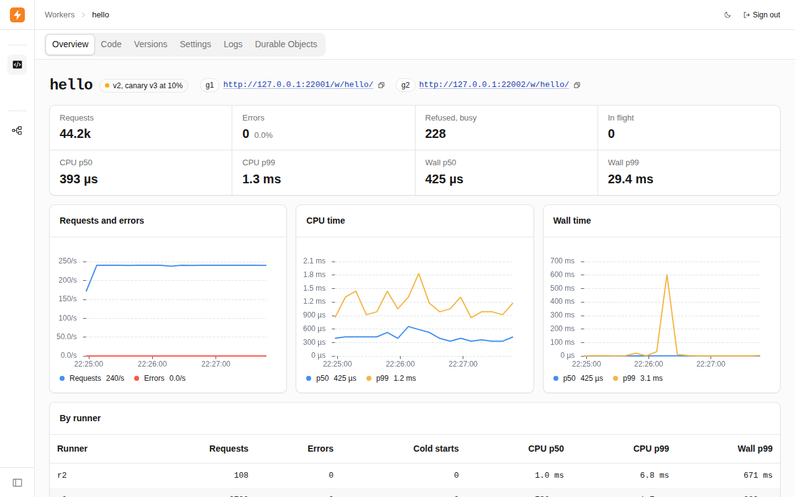

The example's own console, on the cluster of `scripts/run.sh` under load: the worker `hello` sends 10 % of its
requests to the canary version 3. The charts show its requests, CPU time and wall time, and the table under them
splits them by runner.

## What it shows

- **Actors, jobs and `pause_until`**: the registry writes one change at a time to its log; a follower fetches,
  loads and only then switches; the invoker runs JavaScript as a job off axon's threads (`src/registry.rs`,
  `src/follower.rs`, `src/invoker.rs`).
- **A compacted stream kept on disk, read `SnapshotThenLive`**: the manifest of each worker goes from the control
  node to every gateway and runner (`src/wire.rs`, `src/follower.rs`).
- **Remote calls with a deadline and `err.retry()`**: gateway to runner. The deadline travels, and the whole retry
  policy is one `match` (`src/gateway.rs`).
- **`request_parts`**: a 12 MB built version goes to a runner as one reply in parts (`src/follower.rs`).
- **`Quotas`**: a rate per account and permits per worker, across both gateways (`src/gateway.rs`).
- **A stream per node**: each runner's log of calls, read by the control node (`src/invoker.rs`, `src/observer.rs`).
- **Keyed actors under `PaxosLeases`, `KeyedRef`, `.idle` and `hosted_keys`**: a Durable Object is one actor per id
  in the cluster, and every write of its storage carries the lease's epoch (`src/object.rs`, `src/durable.rs`).
- **axon-testkit's World**: a cluster of five or six nodes on virtual time, faults by seed, with a fake engine
  (`tests/sim.rs`, `tests/world.rs`, `tests/world_objects.rs`).

## Run it

The engine binaries (10 MB) are not in the repository. Fetch them once; the script checks their sha256.

```bash
examples/edge-workers/scripts/fetch-engine.sh       # into examples/edge-workers/engine/
cargo build --release -p edge-workers
export EDGE_BIN=target/release/edge-workers         # run.sh takes the debug build without it
R=examples/edge-workers/scripts/run.sh
$R up               # a seed, c1 (control), g1 g2 (gateways on 7701, 7702), r1 r2 r3 (runners)
$R edge init hello hello.js                         # `edge templates` lists the six templates
$R edge deploy hello.js --var GREETING=hi
curl 'localhost:7701/w/hello/?name=you'             # hi, you (a 503 for about 2 s while the runners load it)
$R down
```

`$R edge ..` is `edge`, the command line, pointed at c1 and signed in. The console is at `http://127.0.0.1:7703/`.
The password is `edge-dev` (`EDGE_PASSWORD` on a new `EDGE_DIR` sets another). There is no TLS between the nodes, so
each `edge-workers` process starts only with `--plaintext`, which `run.sh` passes: loopback or a private network only.

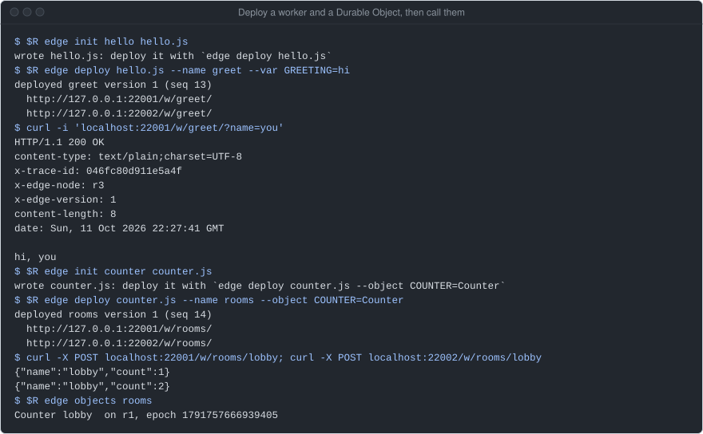

A run on the box with `EDGE_PORT=22000`, so g1 and g2 are on 22001 and 22002 (7701 and 7702 by default). The two
POSTs to `rooms/lobby` go through different gateways and reach the one object.

| | |
|---|---|
| 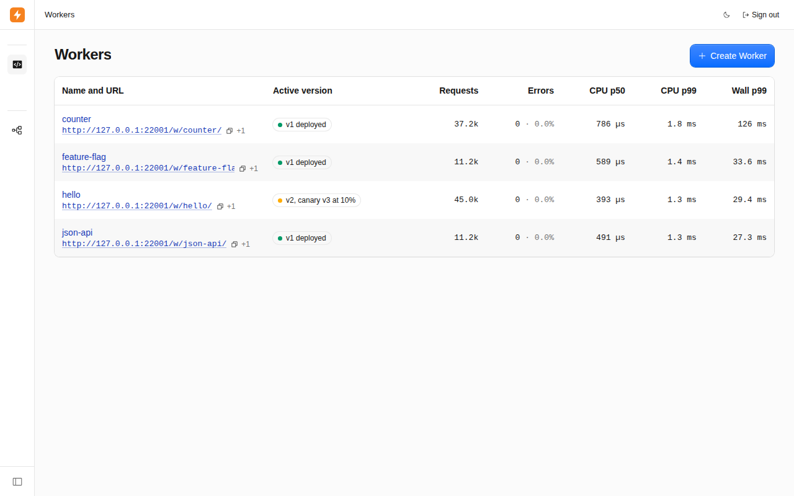<br>Workers: each one's URLs and its requests, errors and CPU time. | 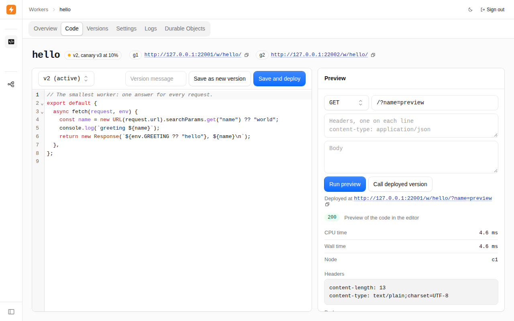<br>Code: the editor, and a preview of the unsaved code run once on c1. |
| 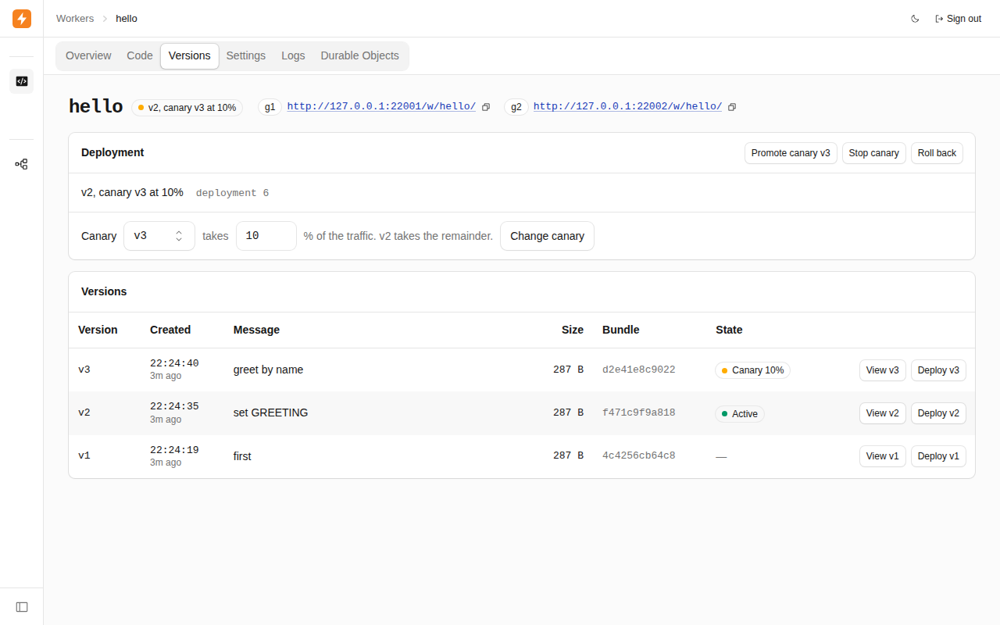<br>Versions: the deployment, with version 3 as a 10 % canary. | 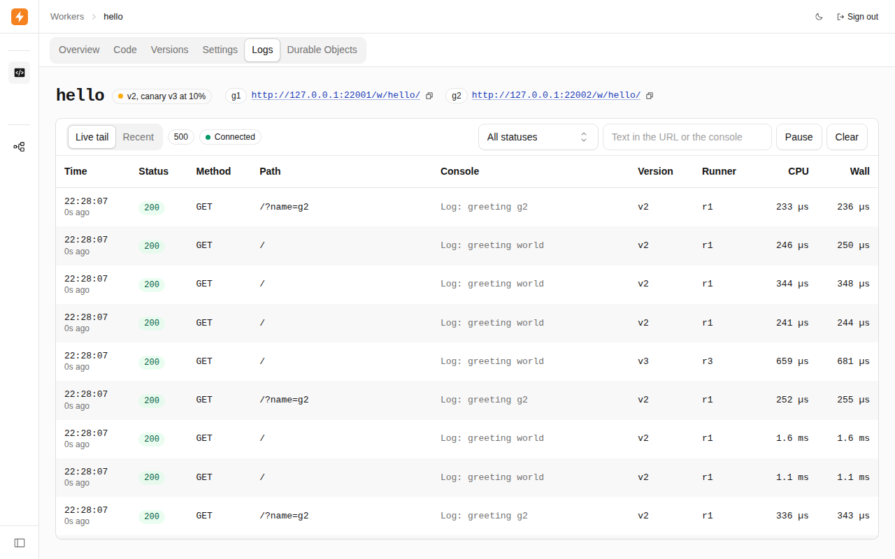<br>Logs: each call as it ends, with its version, runner and console lines. |
| 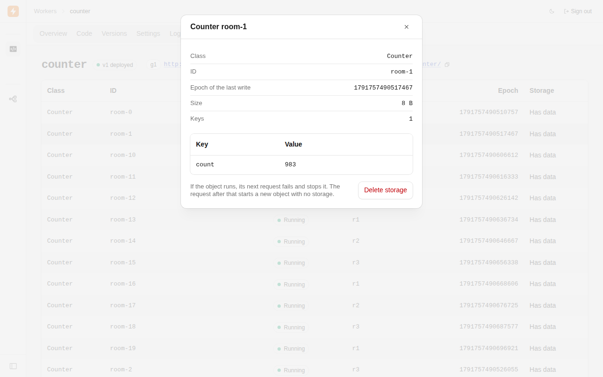<br>Durable Objects of `counter`: where each runs, and what one stores. | 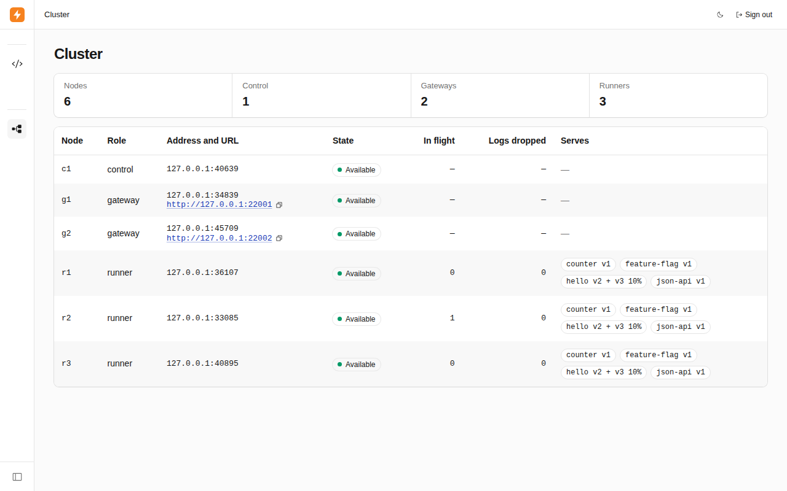<br>Cluster: each node, its roles, and what each runner serves. |

## How it works

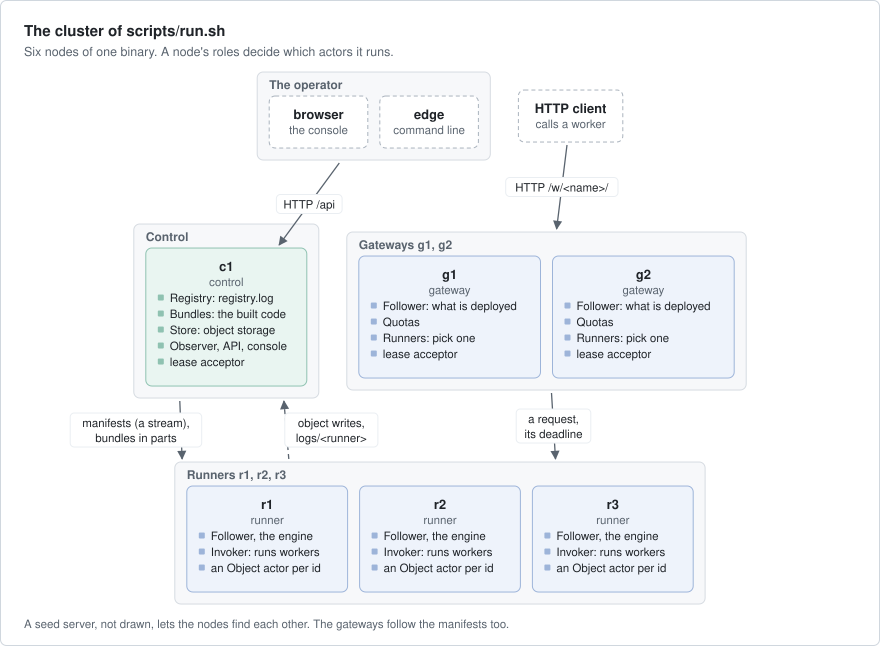

- **One binary.** A node's roles are a flag and its axon labels. A node may have several roles.
- **The registry** on c1 keeps workers, their numbered versions and one deployment each. It syncs every change to
  `registry.log` before it answers. A deploy compiles the code on c1, so code that does not load is refused there.
- **A deployment** takes the next `seq`, one counter for the whole registry. A rollback is a later deployment of an
  older version. The manifest, what a worker's deployment is (its versions and their limits), goes out on the
  stream `deploy/manifests`.
- **A follower** on each gateway and runner takes a manifest only over a lower `seq`. A runner fetches the built
  version, loads it, then switches, and keeps it in its cache, so it serves while c1 is down.
- **A gateway** finds the worker in its table, checks the quotas, and asks one of the worker's first two runners in
  rendezvous order (an order by hash, the same on every gateway): the one with fewer of its requests in hand. A full
  runner is passed. Nothing waits in a queue.
- **A runner** runs each request in a new instance of the engine: JavaScript on StarlingMonkey 0.3.0 under wasmtime
  49, from a snapshot made at deploy. CPU, memory and wall time have limits per version.
- **A Durable Object** is a keyed actor on a runner, under a lease from c1, g1 and g2. It runs one request at a time
  and keeps a copy of its storage in memory.
- **The store** on c1 keeps one file per object. It refuses a write of an older epoch (`Fenced`) or onto another
  version than the actor read (`Stale`). It syncs a request's writes before the object answers.
- **The operator's side**: a JSON API and the console on c1 behind one admin password, and `edge` over the API
  (`src/admin.rs`, `src/bin/edge.rs`, `ui/`).

What a client is promised:

- What a node serves never goes back to an older deployment.
- A request ends on the version it started on, also when its runner switches.
- A request that may have run is not sent again, unless it is a GET, HEAD or OPTIONS. Any other one is a 502
  `outcome_unknown`.
- An object runs in one place at a time, and the store refuses a write made under an older lease. A response
  leaves the object only after the store has synced its writes.

## Numbers

All on a box with an AMD EPYC 4484PX (12 cores, 24 threads), one NVMe, Linux 6.8, release build; not build-1. The
numbers were recorded on 2026-10-03 and 2026-10-04, in the commits named below. The example has changed since
then (for example how a cold start waits, 2026-10-09), and it was not measured again.

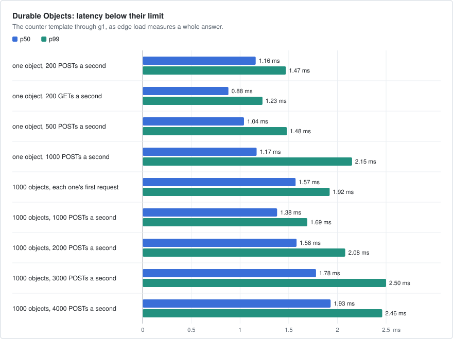

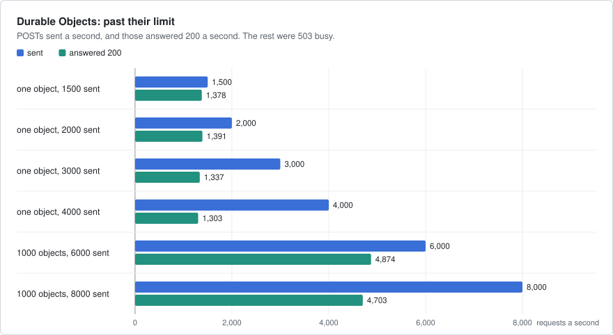

The two charts above: `scripts/objects-bench.sh` on the cluster of `run.sh` (six processes on loopback), the counter
template, `edge load` through g1 over 64 accounts, recorded in 1f904f4. The second of three runs.

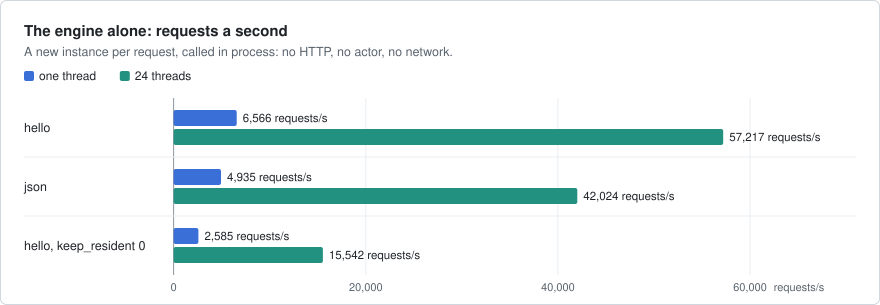

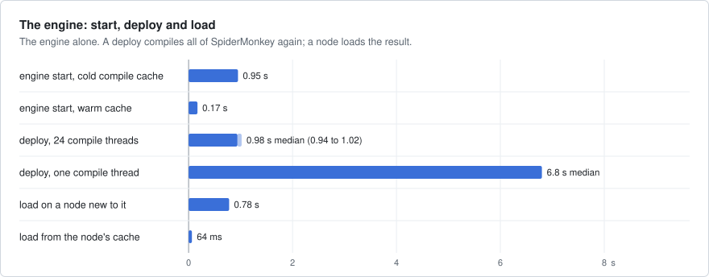

The two charts above: `cargo run --release -p edge-workers --example engine-bench`, the engine called in process,
recorded in 9d5d7e0; the deploy with one compile thread in 08f3511.

| What | Measured |
|---|---|
| `fault.sh`, a runner killed: GETs through g1 (9d5d7e0) | 6000 sent, 6000 answered 200; p50 0.33 ms, p99 0.44 ms, max 58 ms |
| `fault.sh`, a runner killed: POSTs through g2 (9d5d7e0) | 6000 sent, 5999 answered 200, one 502 |
| `fault.sh`, c1 killed (9d5d7e0) | 6000 GETs and 6000 POSTs, all answered 200 |
| An object away after its runner is killed (`fault.sh`, 80d3b10 and 1f904f4) | 4.50, 4.71, 4.50, 4.52 s |
| One object, 1500 to 4000 POSTs a second sent (1f904f4) | 1378, 1391, 1337 and 1303 a second answered 200 |
| 1000 objects, 4000 POSTs a second (1f904f4) | all 200; p99 2.46 ms |
| The rate limit of 1000 a second, 2000 a second sent for 10 s (9d5d7e0) | 8978 answered 200, 11 022 answered 429 |
| The engine alone, hello, one thread (9d5d7e0) | p50 156 µs, p99 165 µs |

What they do not show: every node was on one machine and one disk, so there is no network latency between the
runner, the acceptors and the store. A SIGKILL on loopback closes the sockets at once, so `fault.sh` does not show a
machine that goes silent; the World does.

## Faults

| Layer | Where | What it does |
|---|---|---|
| Unit | `src/` | the registry, codecs, canary share and objects' store without I/O: fences, versions, limits, torn files |
| Engine | `tests/engine.rs`, `tests/fake.rs` | JavaScript on the real engine: limits, no shared state, `fetch` refused to private addresses |
| Real nodes | `tests/cluster.rs`, `tests/gateway.rs`, `tests/admin.rs`, `tests/objects.rs` | nodes on loopback: bundles in parts, every response code, the API and `edge`, objects across runner kills |
| One node | `tests/node.rs`, `tests/object_gate.rs` | panics, a disk that fails, a cache that cannot be read, the output gate |
| World | `tests/world.rs`, `tests/sim.rs`, `tests/world_objects.rs` | five or six nodes on virtual time, 8 to 64 seeds a test: kills, cuts, a control node lost, suspended runners |
| Fault run | `fault.sh` | the cluster of `run.sh` under 200 GETs and 200 POSTs a second: SIGKILL a runner, c1, an object's runner |
| Mutations | by hand, in the tests above | each rule weakened in turn: the test that must catch it fails |
| Browser | `ui/tests`, `ui/tests-live` | the console's pages on a mock API, and on a real cluster |

```bash
cargo test -p edge-workers --all-features           # 104 tests, about 2 min unoptimised
SEEDS=0..400 cargo test -p edge-workers --all-features --test sim -- --nocapture
examples/edge-workers/fault.sh                      # PASS or FAIL, after the release build
```

A failed seed prints `SIM_SEED=n`; it replays the same run only with `RUSTFLAGS="--cfg tokio_unstable"`. Recorded
results: the object stories passed seeds 0 to 399 with tokio seeded (1200 runs, 1f904f4); the fault stories ran
seeds 0 to 399 on an earlier commit (f3d9945); `fault.sh`'s counts are the first rows of the table above.

## What differs from Cloudflare Workers

- No JIT: SpiderMonkey runs as an interpreter inside WebAssembly, so code that computes much is slower than on V8.
- A new instance for every request, an object's request too: no state lives in the module between requests.
- Only `fetch`. Bindings are strings or Durable Objects: no KV, R2, D1, queues, cron or WebSockets.
- One ES module; no `import` of another file, no npm.
- An object's storage is on the one control node, not beside the object. While c1 is down, no object answers.
- An object is away for 4 to 6 s when its runner dies: the rest of its lease.

## Left out

- Streaming: a request body over 512 KiB is refused, and a response must fit in one frame.
- Authentication of callers: the account is the `x-account` header, which anyone can set.
- A second control node: while c1 is down nothing deploys, and a runner with a cold cache cannot fetch.
- Durable logs and metrics: a runner's log is a ring in memory, and the charts are in c1's memory.
- Encryption of secrets at rest, compaction of `registry.log`, TLS on the admin listener, roles.
- Balancing by the runners' load: a gateway counts only its own requests in hand.

## Files

| Path | What |
|---|---|
| `src/main.rs`, `src/node.rs` | a node: its roles, flags and actors |
| `src/registry.rs`, `src/store.rs` | the registry, its log and blobs |
| `src/follower.rs` | what is deployed: the manifest stream, bundle fetch, the table a request reads |
| `src/gateway.rs` | HTTP in, quotas, picking a runner, the deadline and retries |
| `src/invoker.rs` | a runner: runs requests, counters, its log stream |
| `src/engine.rs`, `src/engine/` | the engine contract; StarlingMonkey under wasmtime, and a fake for tests |
| `src/object.rs`, `src/durable.rs` | Durable Objects, and their store with the epoch fence |
| `src/admin.rs`, `src/auth.rs`, `src/observer.rs` | the API, the login, the calls' logs and metrics |
| `src/bin/edge.rs` | `edge`, the command line |
| `src/wire.rs` | the protocols between nodes |
| `templates/` | the six templates, built into both binaries |
| `scripts/`, `fault.sh`, `workers/hello.js` | `run.sh`, the engine fetch, the object bench; the fault run and its worker |
| `ui/` | the console; its pages and tests in [ui/README.md](ui/README.md) |
