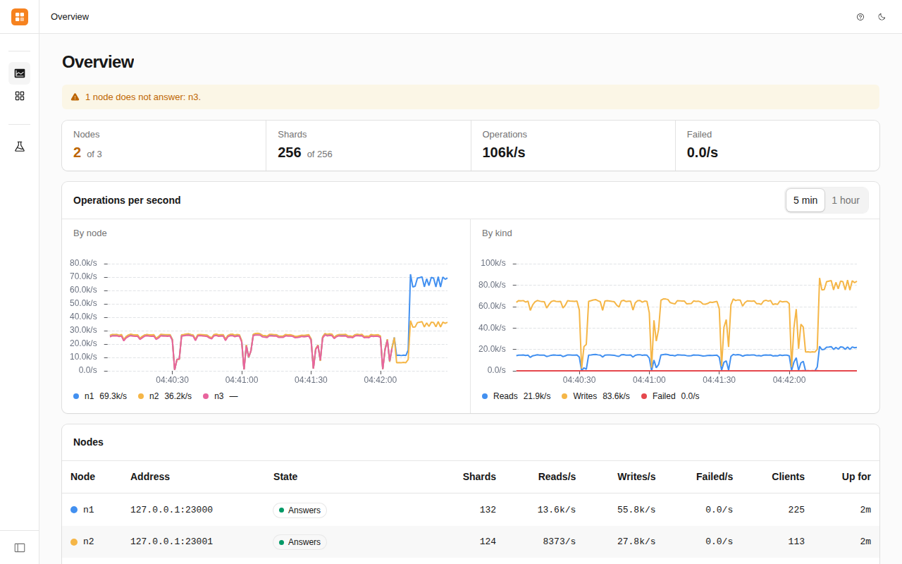
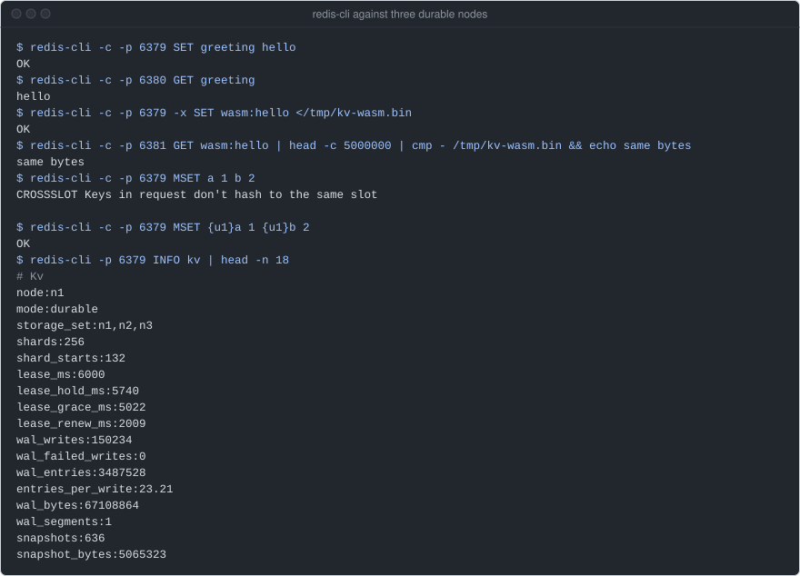
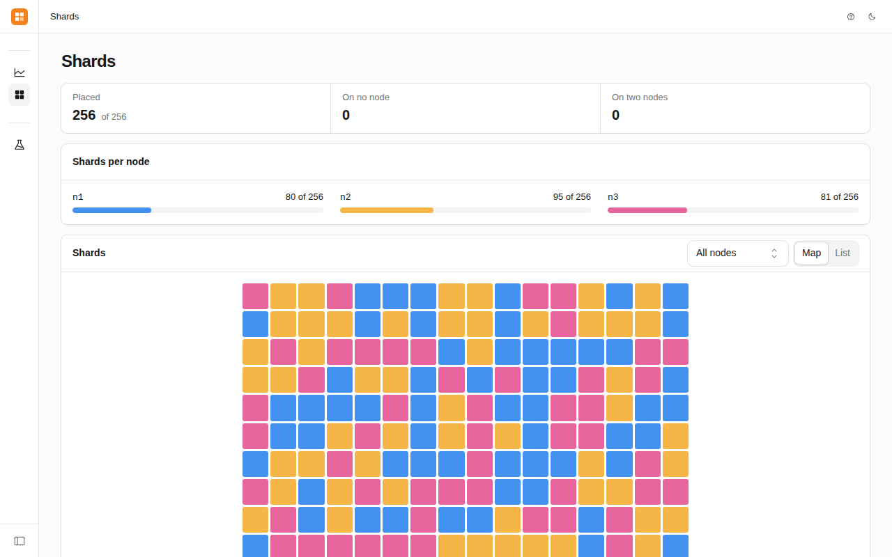
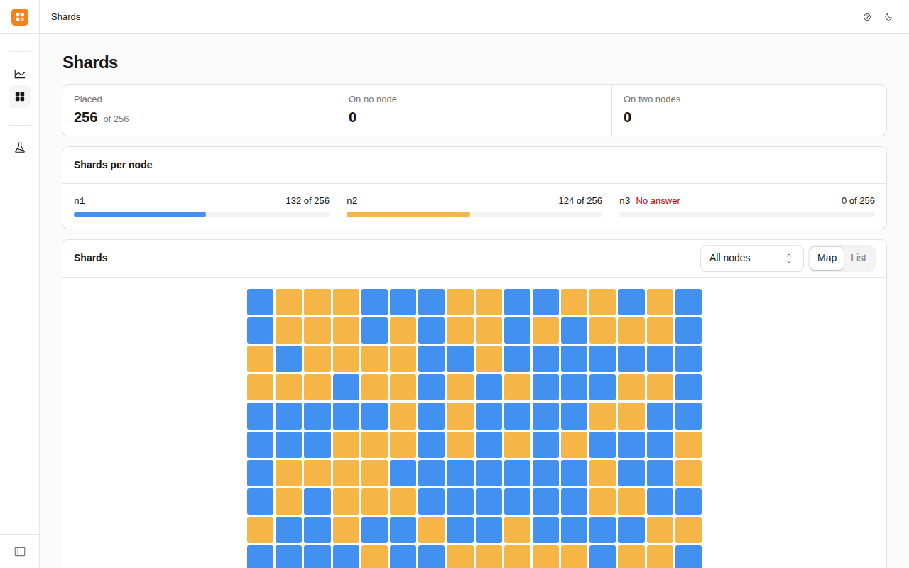
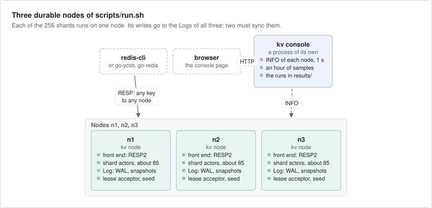
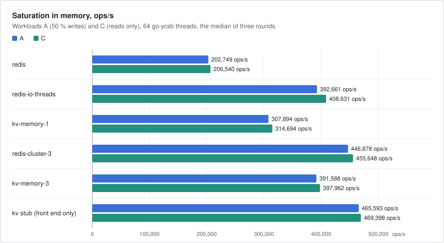
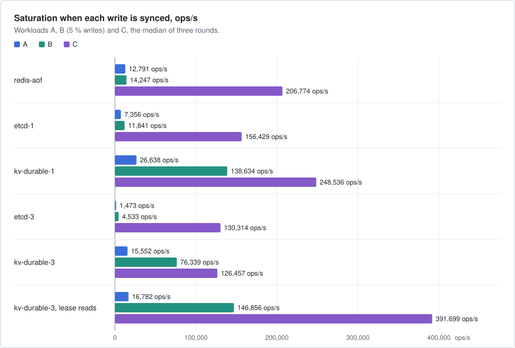
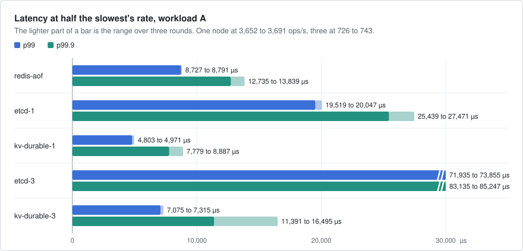

# kv

A sharded key-value store on axon that speaks the Redis protocol (RESP2), shaped like Redis Cluster. Stock
`redis-cli`, `redis-benchmark` and go-ycsb's Redis driver work with it unchanged. In durable mode each write is on the
disks of a majority of the nodes before the client gets its answer, through a replicated log built on axon's
`files::Log`.



`kv console` in front of three durable nodes under `kv check`'s load, on an EPYC 4484PX box.
n3 was killed with SIGKILL, and its shards started on n1 and n2. The short drops before the kill are 1 s pauses
of all three nodes at once: a snapshot round freed every entry held since the last one. Fixed since.

## What it shows

- **Keyed actors of an eager kind under `PaxosLeases`**: each of the 256 shards is one actor in the cluster. When its
  node dies, a survivor starts it with no caller (`src/node.rs`, `src/shard.rs`).
- **`KeyedRef::request_until` and `err.retry()`**: any node takes any key and calls the shard. It tries again until
  the deadline only a call that did not run, or a read (`src/front.rs`).
- **`upload`, `request_parts_within` and `send_parts`**: values up to 32 MiB, larger than a frame, by the same path
  whether the shard is on this node or another (`src/front.rs`, `src/shard.rs`).
- **`axon::files::Log`**: one write-ahead log (WAL) per node for all 256 shards. Each write and sync takes what every
  shard sent while the last one was out (`src/log.rs`).
- **`cx.pause_until`**: a shard's start is its recovery. `ready()` returns once a majority of the Logs opened it
  (`src/shard.rs`).
- **`cluster.owner`, `set_metadata` and `cluster.hosted`**: `CLUSTER SLOTS`, `NODES` and `SHARDS` for cluster
  clients, and `INFO kv` (`src/front.rs`).
- **axon-testkit**: the replication core on a seeded simulation, and one and three durable nodes on the World with
  machine crashes, full disks, suspended owners and partitions (`tests/`).

## Run it

```bash
cargo build --release -p kv
R=examples/kv/scripts/run.sh
$R up durable 3       # n1 n2 n3, RESP on 6379-6381; waits for /readyz, then asks every shard once
redis-cli -c -p 6379  # any node takes any key
$R console            # the console on http://127.0.0.1:7380/, no sign-in (loopback only)
$R kill n3            # SIGKILL; `$R start n3` starts it again with its WAL
$R down
$R up memory 3        # no disk: a shard that moves starts empty
```

`target/release/kv check --addrs $($R addrs) --secs 60` puts load on it and checks every answer. One node alone:
`KV_SECRET=$(openssl rand -hex 16) target/release/kv node --plaintext` (RESP on 6379, data under `./kv-data/n1`).
kv has no TLS between nodes, so a node starts only with `--plaintext`: keep its ports on loopback or a private
network.



A 5 MB value set through n1 and read through n3, on three durable nodes on the same box (ports shown as 6379 to
6381).

| | |
|---|---|
| <br>Shards: each of the 256 on its node, 80, 95 and 81. | <br>The same after n3 was killed: n1 holds 132, n2 124. |

## How it works



- **The front end** (`src/front.rs`) reads RESP2, one command at a time per connection, and answers in order. A key's
  slot is CRC16 mod 16384, as in Redis Cluster; 64 slots make a shard (`src/slot.rs`).
- **A node forwards** any key to its shard's actor and never answers `MOVED`, so a client with one address works too.
- **A shard** (`src/shard.rs`) holds its keys in memory. In memory mode that is all: a shard that moves starts empty.
- **In durable mode** a shard is the owner of its part of the replicated log. It opens its ballot on all three Logs,
  goes on from a majority, and acknowledges a write once a majority has synced it (`src/repl/core.rs`, no I/O).
- **The Log** of a node (`src/log.rs`) keeps every shard's replica in one `axon::files::Log`, with a snapshot file
  per shard so the WAL can be trimmed. A node never runs without its Log.
- **The other nodes' Logs** are reached through `kv.log`, an actor each node publishes (`src/wire.rs`).
- **Reads** wait until a majority answers an Append sent after the read came in (`--reads quorum`, the default).
  `--reads lease` answers from the owner's map at once.
- **The console** (`kv console`, `ui/`) is a process of its own that asks each node `INFO` once a second.

What a client is promised, in durable mode:

- An acknowledged write is on the disks of a majority, and survives any minority of crashed nodes.
- A read gives at least the last write acknowledged before it was sent (quorum reads).
- A write that failed with `ERR outcome unknown` may or may not have happened. kv never sends a write again by itself.

## Numbers

All from one full bench run on build-1 (AMD Ryzen 9 9900X, governor `performance`, two NVMe without power-loss
protection in an md RAID0, fio's `fsync` p50 4,227 µs). A sync there is slow: `redis-aof` does 12,791 ops/s of
workload A. [results/2026-10-13-build-1-full](results/2026-10-13-build-1-full/summary.md).







| What (median of three rounds unless a range) | Redis or etcd | kv | 2026-10-11, EPYC 4484PX |
|---|---|---|---|
| Workload A, one node in memory | `redis` 202,749 ops/s, `redis-io-threads` 392,661 | `kv-memory-1` 307,894 ops/s | 123,935 / 243,695 |
| Workload A, three nodes in memory | `redis-cluster-3` 446,878 ops/s | `kv-memory-3` 391,588 ops/s | 319,216 / 290,314 |
| Workload A, operations per CPU-second, one node | `redis` 202,784, `redis-io-threads` 98,619 | `kv-memory-1` 30,750 | 123,949 / 24,175 |
| Workload A, each write synced, one node | `redis-aof` 12,791 ops/s | `kv-durable-1` 26,638 ops/s | 80,863 / 96,248 |
| Workload A, each write synced on two of three nodes | `etcd-3` 1,473 ops/s | `kv-durable-3` 15,552 ops/s | 40,506 / 52,754 |
| Acknowledged writes per sync, three nodes, one round | `etcd-3` 2.53 | `kv-durable-3` 7.86 | 1.44 / 3.49 |
| p99.9 of workload A, three nodes, at 726 to 743 ops/s | `etcd-3` 83,135 to 85,247 µs | `kv-durable-3` 11,391 to 16,495 µs | at 20,131 to 20,416 ops/s: 5,595 to 9,599 / 24,895 to 52,799 µs |
| 10 MB values, workload A, one round | `redis` 2,004 MB/s | `kv-memory-1` 1,878 MB/s, `kv-durable-3` 654 MB/s (131 errors) | 1,697 / 1,676, 239 (485 timeouts) |

`examples/kv/bench.sh full`: 3 rounds of 60 s phases, 1M records of 10 fields of 100 bytes, go-ycsb with 64 threads
on one CCD of the CPU and the servers on the other. kv `922c691`, axon `b07417b3`, started 2026-10-13 07:46 UTC, the
box's first full load after its power supply was changed. Nothing else ran on it. `kv-durable-3`'s large values and
the syncs per write are from a second part of the run at kv `9bf9886`, which bounds what a shard keeps for a Log that
is behind: in the first part a node grew to 20.6 GiB under 10 MB values and was stopped.

The last column is the earlier full run on another box (EPYC 4484PX, governor `powersave`, one NVMe, `fsync` p50
24 to 25 µs, kv `fe8e709`, axon `ee925dc7`), Redis or etcd first, then kv. On build-1 the memory targets are faster
and the durable ones slower, as a sync takes about 170 times as long. When a sync is slow, the writes that share
one count for more: `kv-durable-3` does 10.6 times `etcd-3`'s workload A on build-1, and 1.3 times on
the EPYC.

What they do not show: a network. The three nodes of each 3-node target are processes on one box and one disk, over
loopback. kv uses about 6.6 times Redis's CPU for an operation in memory; the front end alone (`kv stub`, 159,186
operations per CPU-second) is about a fifth of that. The fixed rates are half the slowest target's saturation, so on
build-1 they are about 27 times lower than on the EPYC, and the p99.9 of the two runs do not compare. axon
`b07417b3` fills a new WAL segment 256 KiB ahead of its frames, which took kv's update p99.9 at 20,000 ops/s from 146
to 156 ms down to 3.02 to 3.15 ms on another EPYC 4484PX box ([axon's benchmarks, § Which
`fill_ahead`](https://github.com/AR1011/axon/blob/main/crates/axon/guide/benchmarks.md#which-fill_ahead)).
The 485 errors of `kv-durable-3` with 10 MB values on the EPYC were timeouts, not refusals or lost writes; the
131 on build-1 were not sorted into kinds.

## Faults

| Layer | Where | What it does |
|---|---|---|
| Simulation | `tests/repl_sim.rs` | three logs and up to three owners: lost, doubled and reordered messages, crashes with torn records, zombies. 10,000 seeds before a merge; 12 weakened rules, each fails within 64 seeds |
| Log | `tests/log.rs` | no answer before its write lands; one write for all shards; failed and panicking writes written again |
| Real nodes | `tests/durable.rs`, `tests/replicated.rs`, `tests/cluster.rs` | one and three durable nodes: values of 5 and 32 MiB, a crash, every acknowledged write read back, the Logs' digests equal |
| Redis's bytes | `tests/conformance.rs` | kv's replies to 22 command sequences, byte for byte against Redis 7.4.11 in cluster mode |
| World | `tests/world.rs`, `tests/world3.rs` | 4 stories on one durable node and 12 on three, 64 seeds each: machine crashes, a full disk, suspended and paused owners, a partition, two Logs down, a clock stepped back |
| Fault run | `fault.sh` | three real nodes under `kv check`: SIGKILL, SIGSTOP, a follower down, all restarted, two down, a partition (Linux) |
| Soak | `fault.sh soak 60` | an hour of workload A at half its saturation, with a kill or stop every 2 to 5 minutes |
| Browser | `ui/tests`, `ui/tests-live` | every page on a mock API, and on `run.sh up durable 3` a kill of n3 and its shards moved |

```bash
SEEDS=8 cargo test -p kv --all-features                           # everything, the World stories on 8 seeds
SEEDS=0..10000 cargo test -p kv --release --test repl_sim          # the simulation on 10,000 seeds
examples/kv/fault.sh all all                                      # every phase twice: PASS or FAIL
```

The last independent check, on an EPYC 4484PX box with one NVMe at kv `05b689a` on 2026-10-11
and 12: every test passed; the simulation's 10,000 seeds gave the recorded counts and each
weakened rule failed at its recorded seed; `fault.sh all all partition` passed every phase, with 0 acknowledged writes
lost and 0 stale reads in the durable phases. The soak at kv `7e583fb` on the same box passed: 17 checks, 44.2
million acknowledged writes, 0 lost.

## Left out

- Hashes, lists, TTLs, `MULTI`, Lua, pub/sub, `KEYS` and `SCAN`, RESP3, and YCSB's workload E (it needs a scan).
- Resharding: 256 shards is a constant.
- Replicas in memory mode: a shard that moves starts empty, as a Redis Cluster master with no replica loses its data.
- TLS, on the RESP port and between the nodes, and users or ACLs: one optional password for every client.
- Numbers over a network, on a dedicated bench box.
- A history in the console past an hour, or across a restart of the console.

## What differs from Redis

- One command in flight per connection. A pipelined client is answered in order, but `redis-benchmark -P 16` is far
  slower than on Redis.
- A node forwards and never answers `MOVED` or `ASK`. A cluster client that follows `CLUSTER SLOTS` saves the hop.
- Keys up to 1 KiB and values up to 32 MiB; Redis takes 512 MB for each.
- A durable write is acknowledged once it is on a majority's disks. A Redis replica gets a write after the master
  answers it, and `appendfsync always` syncs on the master alone.

## Files

| Path | What |
|---|---|
| `src/front.rs`, `src/resp.rs`, `src/slot.rs` | the RESP front end, its parser and limits, slot hashing |
| `src/shard.rs`, `src/node.rs` | the shard actor; a node's actor system, cluster and leases |
| `src/repl/` | durable mode's replication core: `Owner` and `Replica`, no I/O |
| `src/log.rs`, `src/wire.rs` | a node's Log: WAL, snapshots, the other nodes' calls to it |
| `src/check.rs`, `src/client.rs` | `kv check`, the history checker, and its client |
| `src/console.rs`, `ui/` | `kv console` and its page ([ui/README.md](ui/README.md)) |
| `src/main.rs` | the `kv` command line |
| `scripts/run.sh`, `fault.sh`, `bench.sh` | the cluster on loopback, the fault run and soak, the bench against Redis and etcd |
| `results/` | the summary of the full run above; `bench.sh` writes each new run here |
| `tests/runs/` | two earlier runs, which the console's tests read |
