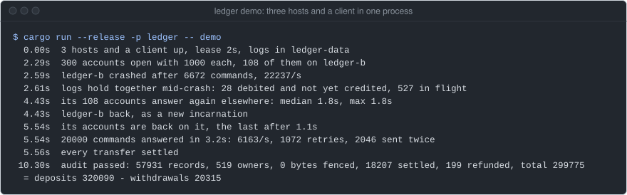
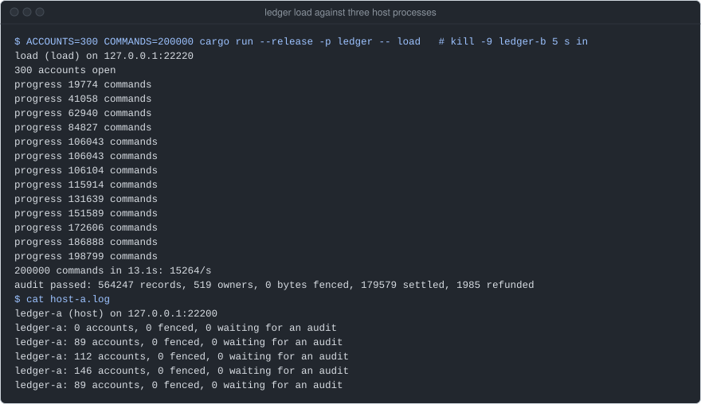
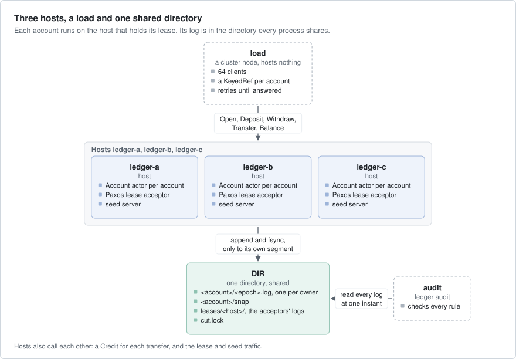
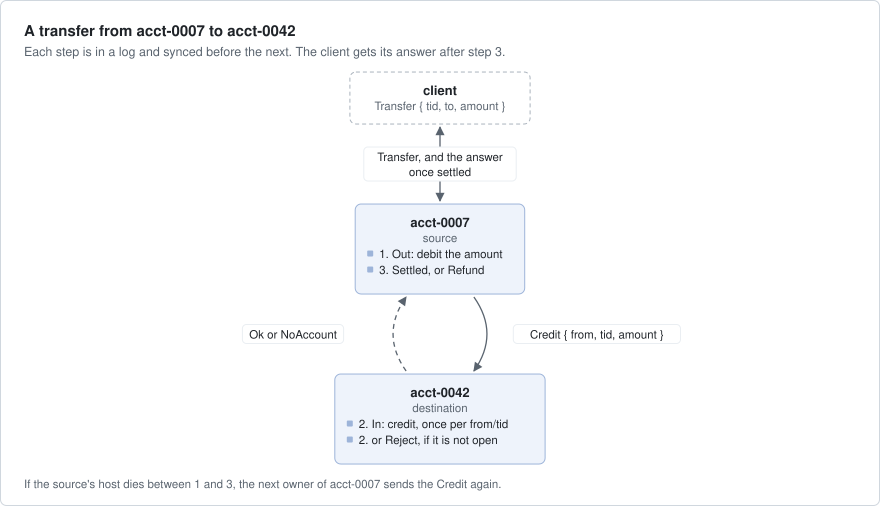
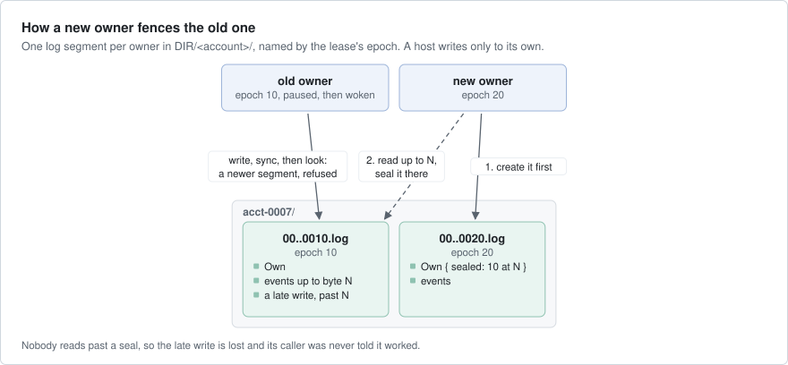
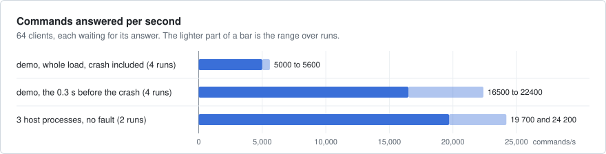
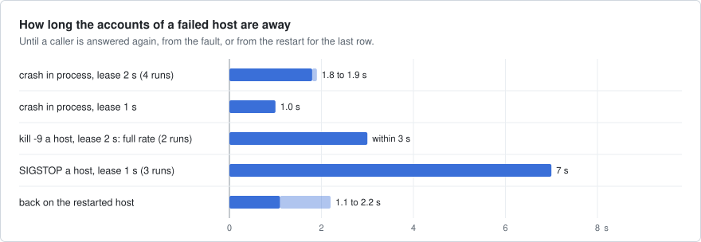

# ledger

An event-sourced account ledger: the books of a small bank, where every change to an account is an event in a log.
Each account is one actor, run by whichever of three hosts holds its lease, and a retried command never applies
twice. A host can crash or stop in the middle of a transfer, and the logs on disk still add up.



`ledger demo` runs the whole story in one process: three hosts and a client, 300 accounts and 20,000 commands. A third
of the way in, host ledger-b crashes. Its accounts answer on the other two, then move back when it starts again, and
the audit checks the logs on disk. A run on an EPYC 4484PX box, main `1e52123`,
2026-10-11, with other jobs on the box.

## What it shows

- **Keyed actors under `PaxosLeases`**: one `Account` actor per account id, started on the host that holds the
  account's lease. A lease is the right to run an account for a short time (2 s by default). A majority of the three
  hosts grants it, so the hosts are the lease acceptors (the voters) and nothing else runs: no Consul, no database
  (`src/lib.rs`).
- **`SpawnContext::epoch` as a fencing token**: the epoch is a number that grows with each new owner of a lease. Each
  owner of an account writes only to its own log segment, named by its epoch, and seals the older segments where it
  read them, so an old owner's later writes do not count (`src/store.rs`).
- **Jobs and `on_turn_end` for group commit**: disk work runs in `cx.submit_io` jobs (work off the actor's thread),
  one write at a time per account. The commands of a turn (the messages the actor handles in one go) go to disk in
  one append and are answered after its `fsync` (`src/account.rs`).
- **A `Reply` held as a value**: kept until its write is durable, or until a transfer has settled on the other
  account. When the account's queue is full (1024 commands), the reply is dropped and the caller retries
  (`src/account.rs`).
- **`KeyedRefs` and `err.retry()`**: the client keeps one reference per account, which finds the account again after
  it moves, and retries each command until it is answered (`src/lib.rs`).
- **Calls between actors from a job**: a transfer credits the other account with `submit_future` and a `KeyedRef`
  (`src/account.rs`).
- **Seed discovery**: each process finds the others through seed servers (fixed addresses that know the members).
  Each host runs a `SeedServer` too (`src/main.rs`).

## Run it

The whole story in one process, checked at each step. It empties its directory first:

```bash
cargo run --release -p ledger -- demo     # 300 accounts, 20000 commands, a 2 s lease, logs in ./ledger-data
cargo run --release -p ledger -- demo 200 3000 1 /tmp/ledger    # accounts, commands, lease in s, directory
```

As processes on one machine, each in its own terminal, over an empty directory. There is no TLS between them, so a
host or the load starts only with `--plaintext`: loopback or a private network only.

```bash
export SEEDS=127.0.0.1:7001,127.0.0.1:7002,127.0.0.1:7003 DIR=/tmp/ledger-data    # in every terminal
NODE_ID=ledger-a PORT=7400 SEED_PORT=7001 cargo run --release -p ledger -- host --plaintext
NODE_ID=ledger-b PORT=7401 SEED_PORT=7002 cargo run --release -p ledger -- host --plaintext
NODE_ID=ledger-c PORT=7402 SEED_PORT=7003 cargo run --release -p ledger -- host --plaintext
ACCOUNTS=300 COMMANDS=200000 cargo run --release -p ledger -- load --plaintext
cargo run --release -p ledger -- audit    # at any time: it reads every log at one instant
```



The load prints its progress each second, and the audit at the end. ledger-b was killed with `kill -9` 5 s after the
load started, and started again 6 s later. The load stops for a few seconds, ledger-a takes over part of ledger-b's
accounts, then gives them back. The same box and commit as above.

A host prints a line when its counts change: the accounts it runs, its writes that were fenced (refused), and its
writes that wait for an audit. `kill -STOP` a host instead, and its accounts move once the others count it as
unreachable; `kill -CONT` then shows its late writes refused. `LEASE_SECS` (default 2), `HOSTS` and `SECRET` must be
the same on every process. The load's command keys are `c0`, `c1`, and so on, so a second load over the same
directory would be all retries: start from an empty one.

## How it works



- **A host** (`ledger host`) is a cluster node, a lease acceptor and a seed server. It registers the keyed kind
  `account` (`src/lib.rs`, `src/main.rs`).
- **An account** is an `Account` actor on the host that holds its lease. It decides each command against its state,
  then appends the events and answers once they are synced (`src/account.rs`).
- **The log** of an account is in `DIR/<account>/`: one segment per owner, one JSON event per line, and a snapshot of
  the state every 32 events (`src/store.rs`). `DIR` stands in for shared storage, so an account that moves recovers
  from the same files.
- **The lease logs** of the acceptors are in `DIR/leases/<host>/`, one directory per host.
- **The load** (`ledger load`) is a cluster node that hosts nothing. It opens and funds the accounts, runs 64 clients
  that send random commands, waits until every transfer has settled, and audits the logs (`src/demo.rs`).
- **The audit** (`ledger audit`) checks every log against the rules that must always hold (`src/audit.rs`). Every
  append holds `DIR/cut.lock` shared, and the audit takes it alone, so it reads every log at one instant.

A transfer touches two accounts, which can be on two hosts. Each step is synced before the next:



A host that is paused, not dead, may wake up still sure that it owns its accounts. It cannot do harm:



What a client is promised:

- A command is answered only after its events are synced to disk.
- Each command carries a key the client chooses (its idempotency key). A command whose key was seen before gets the
  first answer and changes nothing, refusals included.
- A transfer is answered only after it is settled on both accounts or refunded. Money can be in flight, but it is
  never lost or counted twice.
- No balance goes below zero: a withdrawal or transfer that would overdraw is refused.
- A write of an old owner is never acknowledged after a new owner has started.

## Numbers

Measured on a dev box (EPYC 4484PX, 24 threads, NVMe, logs in `/tmp`), release build, loopback, with other work on the
box. The example was then in the axon repository: the numbers were recorded at its commit `ef07c2b4` on 2026-09-24,
and the `SIGSTOP` row at `4568238e` the same day. The two charts are drawn from the table below them.





| What | Result |
|---|---|
| in-process demo above, 4 runs | 5000 to 5600 commands/s over the whole load, crash included; 16500 to 22400/s in the 0.3 s before it |
| three host processes and a load, 300 accounts, 200 000 commands, no fault, 2 runs | 19 700 and 24 200 commands/s |
| a crashed host, lease 2 s | in-process (system dropped): its accounts answer elsewhere after 1.8 to 1.9 s, 4 runs; 1.0 s at a 1 s lease. As processes (`kill -9`): the load is back at full rate within 3 s, 2 runs |
| a stuck host (`SIGSTOP`), lease 1 s | its accounts answer elsewhere after 7 s, 3 runs (the hosts print once a second) |
| back on the restarted host | 1.1 to 2.2 s after it starts |
| a woken host's leftover writes | 4 to 28 refused per run, 0.1 to 1.2 KB past the seals |

A deposit or a withdrawal is one append, and a transfer three (debit, credit, settle). Each waits for an `fsync` that
the other commands of its account's turn share. The load is closed-loop: 64 clients, each waiting for its answer.

What they do not show: while one host is stuck, every client soon waits on one of its accounts, so the whole load
stops; the times above are what a caller of a moved account waits. A stuck host's accounts move when the others count
it as unreachable, not when its lease ends. No later measurement is recorded, and the captures on this page are single
runs on a busy box, not measurements.

## Faults

| Layer | Where | What it does |
|---|---|---|
| The story in one process | `tests/demo.rs`, `the_demo_holds_at_every_step` | the demo with 200 accounts, 3,000 commands and a 1 s lease: a crash, the move, the restart, the move back. Each step checks what it prints, and the audit ends it |
| Processes, a paused host | `tests/demo.rs`, `a_paused_host_is_fenced_when_it_wakes` | the binary as three hosts and a load. A host is stopped with `SIGSTOP` while it has writes waiting, and woken once the others run every account. Each of those writes must be refused, and the audit must pass over their bytes. Linux only |
| The store alone | `tests/demo.rs`, `a_second_owner_fences_the_first` | an old owner's write after a new owner started is refused; an older epoch cannot take an account back; a writer stuck in an append does not keep the next owner out |
| The audit | `src/audit.rs` | at the end of every demo and load, and in `ledger audit`: each rule over every log, up to the seals |
| Lost answers | `src/demo.rs` | a tenth of the commands are sent again after their answer and must get the same answer; one in a hundred is a transfer to an account nobody opened, and must be refunded |

```bash
cargo test -p ledger                          # the three tests
cargo run --release -p ledger -- audit        # the audit, over DIR
```

No test result or independent check is recorded for this example. Each capture on this page ends with
`audit passed`.

## Left out

- Compaction. Segments are never deleted, and a snapshot keeps every idempotency key an account has seen, so both
  grow with the history. A real ledger would drop keys after a retry window, and old segments behind a snapshot.
- Real shared storage. The fence needs what one machine's file system gives: an exclusive create, a directory listing
  that shows it at once, and `fsync`. A network file system may not give them. A store with conditional writes (on
  the epoch) would replace the segment check. There is no directory `fsync` after a snapshot's rename, so a power
  cut can lose a snapshot, but never the log.
- Closing accounts, limits, fees and authentication: the idempotency keys are the clients' own strings, and trusted.
- TLS: the nodes talk plaintext with a shared secret, for a private network only
  ([cluster guide § Security](https://github.com/AR1011/axon/blob/main/crates/axon/guide/cluster.md#security)).
- The console: add `Telemetry` and a `Dashboard` as [market-data](../market-data/README.md) does.
- Clients that give up. A client retries a transfer until it is settled. A client with a shorter deadline would ask
  for the outcome later with the same key, which works but is not shown.

## Files

| Path | What |
|---|---|
| `src/lib.rs` | the node: Paxos leases over the hosts, the `account` kind, and `Client`, which keeps references in `cluster.keyed_refs` and retries |
| `src/account.rs` | the commands, the wire contract and the `Account` actor |
| `src/store.rs` | segments, seals, snapshots and recovery |
| `src/audit.rs` | the rules, checked against the logs |
| `src/demo.rs` | the load, the settle and the in-process story |
| `src/main.rs` | `demo`, `host`, `load` and `audit` |
| `tests/demo.rs` | the three tests |
