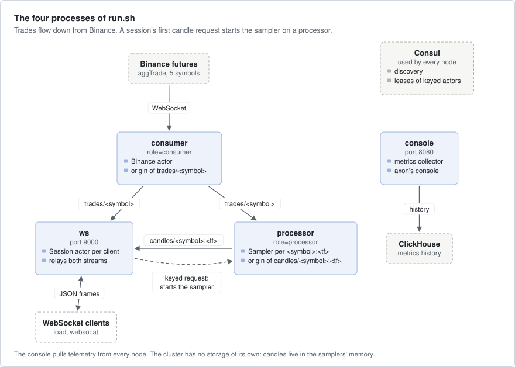

# market-data

Live futures trades from Binance, folded into OHLCV candles (open, high, low, close, volume) at any timeframe, and
sent to WebSocket clients, like the market-data feed of an exchange. It is small, but it uses the cluster as a real
deployment does: Consul for discovery and key ownership, and ClickHouse behind axon's console.



Trades come in on one process and go out as streams. A candle sampler starts on a processor the first time a client
asks for its symbol and timeframe. The example holds no state on disk.

## What it shows

- **Streams across nodes**: the consumer is the origin of `trades/<symbol>`, a processor of `candles/<symbol>:<tf>`;
  the ws node pulls each from the role that publishes it with `upstream_for` (`src/main.rs`).
- **Keyed actors started on first use**: one `Sampler` per `<symbol>:<tf>` in the cluster, on a node labelled
  `role=processor`, found or started by `cluster.keyed(..).request_until(..)` (`src/ws.rs`, `src/processor.rs`).
- **Consul for discovery and leases**: `ConsulDiscovery` and `ConsulLeases` on every node (`src/main.rs`).
- **A socket owned by an actor**: the read half is an attached source (`cx.attach`), the write half an attached sink
  (`cx.attach_sink`), in the Binance actor and in each client session (`src/consumer.rs`, `src/ws.rs`).
- **Jobs and timers**: the Binance connect runs as a job; timers send pings and publish changed candles
  (`src/consumer.rs`, `src/processor.rs`).
- **Supervision of keyed actors**: a sampler that fails is started again in place under `RestartPolicy::default()`,
  and its clients keep their reference (`src/processor.rs`).
- **axon's console with ClickHouse**: `Telemetry` on every node, and on the console node `MetricsService` with a
  `ClickHouseProvider` and a `Dashboard` (`src/main.rs`).

## Run it

It needs Docker for Consul and ClickHouse, and a network path to `fstream.binance.com`. From the repository root:

```bash
docker compose -f examples/market-data/compose.yml up -d   # Consul on 18500, ClickHouse on 18123
examples/market-data/run.sh                                # debug build; consumer, processor, ws, console
cargo run -p market-data -- load 10                        # in a second terminal: ten clients
```

`run.sh` writes the logs to `target/market-data/` and stops the four nodes on Ctrl-C. `load` starts ten sessions,
each on one symbol's trades and one timeframe's candles, and prints the message rate each second and the newest
record the first session got. axon's console is at http://127.0.0.1:8080, with no sign-in: it has no users and
listens on loopback only. Its streams page shows the stream graph, and its actors page lists every sampler and
session with timings per message.

Talk to the ws node yourself, for example with `websocat`:

```bash
websocat ws://127.0.0.1:9000
{"op":"subscribe","stream":"trades","symbol":"BTCUSDT"}
{"op":"subscribe","stream":"candles","symbol":"BTCUSDT","tf":"5m"}
{"op":"unsubscribe","stream":"candles","symbol":"BTCUSDT","tf":"5m"}
```

Each request gets `{"ok":"<name>"}`, for example `{"ok":"candles:BTCUSDT:5m"}`, or `{"error":..}`. Then the records
come as the streams carry them:

```json
{"s":"BTCUSDT","t":1758540000123,"p":112345.6,"q":0.012,"b":true}
{"s":"BTCUSDT","tf":"5m","t":1758540000000,"o":112340.0,"h":112350.1,"l":112330.0,"c":112345.6,"v":18.3,"n":412,"x":false}
```

The symbols are `BTCUSDT ETHUSDT SOLUSDT BNBUSDT XRPUSDT`. A timeframe is `<n><unit>` with the unit `s m h d w M y`,
from `1s` to `1y`.

To run one process per terminal: `cargo run -p market-data -- consumer`, `-- processor`, `-- ws [port]` and
`-- console [port]`. The environment: `CONSUL` (default `http://127.0.0.1:18500`), `CLICKHOUSE`
(`http://127.0.0.1:18123`), `CLICKHOUSE_USER`, `CLICKHOUSE_PASSWORD`, and `NODE_ID` (the role by default; set it to
run a second node of one role, for example two ws nodes).

## How it works

The figure at the top shows the processes, the streams between them and the services they use.

- **consumer** runs one `Binance` actor. It connects to Binance in a job, subscribes to the five symbols' trades,
  and publishes each trade to `trades/<symbol>`. It pings every 10 s. When it gets nothing for 30 s it connects
  again, because a dead connection can stay open and silent (`src/consumer.rs`).
- **processor** hosts the keyed kind `candles`: one `Sampler` per `<symbol>:<tf>`. A sampler subscribes to
  `trades/<symbol>`, folds the trades into candles in memory, and publishes the open candle every 250 ms while it
  changes, and once more when it closes (`src/processor.rs`).
- **ws** runs one `Session` actor per client connection. A trade subscription goes straight to the stream node. A
  candle subscription first asks the cluster for the sampler of that key, which starts it on a processor if there
  is none, then subscribes to its stream (`src/ws.rs`).
- **console** runs the metrics collector, which keeps history in ClickHouse, and axon's console (`src/main.rs`).
- **Consul** holds each node's record and the lease of each sampler, so every later session for the same key finds
  the same sampler.

What a client is promised:

- A candle subscription starts with the sampler's current candle (`null` before its first trade), so the client has
  state before the next trade.
- A candle closes when a trade for the next one arrives, or one second after its end in a quiet market. A trade
  that arrives after that is dropped; a closed candle does not change.
- A live subscription follows its key. When the consumer restarts, or a processor leaves and its samplers start
  elsewhere, the records start again once the key is back.
- A client more than 1,024 records behind its socket is disconnected. A subscription that ends for its own reasons
  is reported as `{"error":"<name>: ended (<why>)"}`. The client can then subscribe again.

## Faults

The unit tests in `src/processor.rs` check the timeframe parser and how trades fold into candles (late trades, a
closed candle that stays closed):

```bash
cargo test -p market-data
```

This example has no fault test and no recorded run. To see a key move by hand, kill the consumer or the processor
while `load` runs, and watch the rate come back.

## Left out

- Clients that connect again by themselves.
- Stopping idle samplers: they are never stopped, so their number is the symbols times the timeframes asked for.
- Replay of candles from before a subscription.
- TLS between nodes, and authentication on the WebSocket.
- Months and years on the calendar: here a month is 30 days and a year 365.

## Files

| Path | What |
|---|---|
| `src/main.rs` | the roles of a node: Consul discovery and leases, telemetry, the stream node, the console |
| `src/consumer.rs` | the Binance actor |
| `src/processor.rs` | timeframes, candle folding and its tests, the sampler and its wire contract |
| `src/ws.rs` | the listener and the session actor |
| `src/load.rs` | the demo clients of `load` |
| `run.sh`, `compose.yml` | the four nodes in the background; Consul and ClickHouse in Docker |
