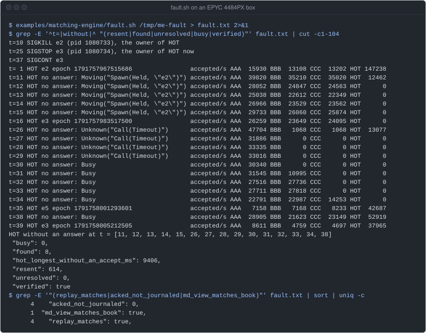
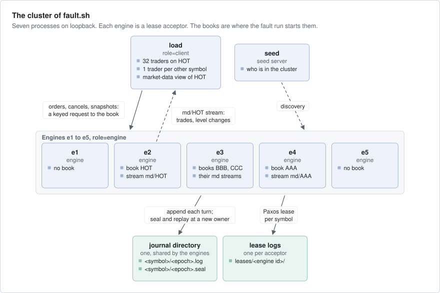
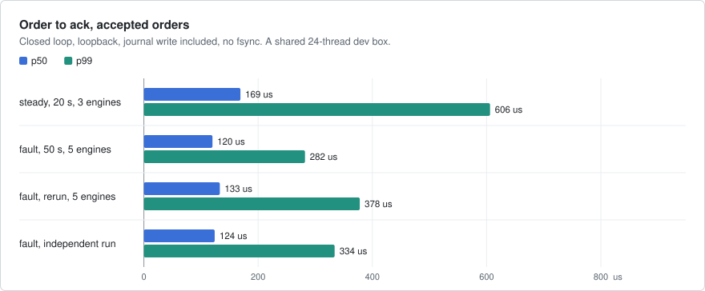
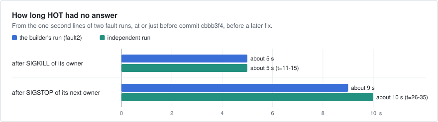

# matching-engine

The order books of an exchange on axon: one book per symbol, which matches buy and sell orders by price, then by
time. Each book is an actor that writes every order to a journal before it answers, and that moves to another node
when its node dies. A client gets an answer or a clear refusal, and nothing queues without a limit.



`fault.sh` on an EPYC 4484PX box, release build of main `1e52123`, 2026-10-11.
At t=10 the script kills e2, the owner of the symbol HOT, and HOT is back on e3 at t=16. At t=25 it stops e3: HOT
moves to e5, then back to e3 when e3 continues. At the end, each book replayed from its journal is the same as the
live book.

## What it shows

- **Keyed actors under `PaxosLeases`**: axon runs one `book` actor per symbol (its key) on one of the nodes with the
  label `role=engine`. A lease, agreed by the engines with Paxos, says which node owns it. A new owner gets a higher
  lease epoch (`src/engine.rs`, `src/main.rs`).
- **A bounded mailbox as backpressure**: a full mailbox makes the call fail at once with `Rejected(Full)`, and the
  client reports `Busy`. The order did not reach the book (`src/engine.rs`, `src/client.rs`).
- **`on_turn_end`, `submit_io` and `pause_until`**: the orders of one turn go to the journal in one write, with one
  write in flight. The answers and market data go out after it lands (`src/engine.rs`).
- **The epoch as a fence**: each owner writes its own journal file, named by its epoch. A new owner seals the older
  files before it writes, so a stale owner's late writes are never replayed (`src/journal.rs`).
- **Streams**: each owner publishes trades and price-level changes on the stream `md/<symbol>`. A view on the
  client node follows it across owners (`src/md.rs`).
- **`err.retry()` and safe resends**: the client resends an order that did not arrive, or whose answer was lost,
  with the same order id. The book refuses an id it has seen as `Duplicate` (`src/client.rs`, `src/book.rs`).
- **The seeded `Simulator` of axon-testkit**: order entry over lossy links with a crash, on 100 seeds
  (`tests/sim.rs`).

## Run it

Build on a Linux box. The release build is slow the first time.

```bash
cargo build --release -p matching-engine
cargo test -p matching-engine                       # unit, cluster and simulator tests
examples/matching-engine/fault.sh /tmp/me-fault     # 50 s; exit 0 when every check holds
```

`fault.sh` uses `target/release/matching-engine`, or the binary in `BIN`. `SECS` sets how long the load runs.

By hand, each line in its own terminal:

```bash
B=target/release/matching-engine
$B seed --plaintext                                                               # {"seed":"127.0.0.1:PORT","pid":..}
$B engine --plaintext id=e1 seeds=127.0.0.1:PORT acceptors=e1,e2,e3 dir=/tmp/me  # and e2, e3
$B load --plaintext id=load seeds=127.0.0.1:PORT symbols=HOT,AAA,BBB,CCC hot=HOT secs=20 window=32 dir=/tmp/me
```

`seed` and each `engine` print their address as JSON. `load` starts `window` traders on the hot symbol and one on
each other symbol. Each trader sends its next order when the last one is answered. `load` prints one JSON line a
second: orders accepted per symbol, `Busy` refusals, resends, the node that has HOT, and the market-data view. At
the end it checks every book, and exits non-zero when a check fails. The transport secret is `ME_SECRET` (a dev
default otherwise), with no TLS, so each process starts only with `--plaintext`: use it on loopback or a private
network only.

## How it works



- **The book** (`src/book.rs`) is pure and deterministic: limit, market (what does not fill at once is dropped)
  and cancel orders, price-time priority. It keeps at most 100,000 resting orders (`BookFull` past that) and
  remembers the last 100,000 order ids (`Duplicate`). `Flow` makes a seeded stream of orders.
- **The book actor** (`src/engine.rs`) reads and seals the older journal files in a job at start, and handles no
  order until that job ends. Then it opens `md/<symbol>` with its epoch as the stream's generation, and publishes the
  whole book. It matches each order in the handler and journals what it accepted at the end of the turn. With 4,096
  orders not yet written, it stops taking messages, so its mailbox (1,024) fills and refuses.
- **The journal** (`src/journal.rs`) is `<dir>/<symbol>/<epoch>.log`, one JSON command per line. Before a new owner
  writes its own file, it seals each older file: a `<epoch>.seal` beside it holds its length. Readers stop at a seal.
  There is no fsync.
- **Order entry** (`src/client.rs`): `classify` turns a call's error into `Busy` (refused, nothing happened),
  `Moving` (the book is moving or starting), `Unknown` (the answer was lost) or `Failed`. `submit_known`
  resends `Moving` and `Unknown` with the same id, every 20 ms doubling to 500 ms, until a deadline.
- **The market-data view** (`src/md.rs`) subscribes to `md/<symbol>`. At each new generation it asks the book for a
  snapshot, and applies the records numbered after it.
- **The processes** (`src/main.rs`): `seed`, `engine` and `load`. The engines and `load` find each other
  through the seed server. Each engine is a lease acceptor and keeps its lease log in `<dir>/leases/<id>`.
- **The checks** at the end of `load`: the journal replayed gives the book's digest and sequence number, every
  order that was acked is in the journal, and the market-data view of HOT equals the book.

What a client is promised:

- An order is answered only after the journal write of its turn has landed.
- `Busy` means the book never saw the order.
- A resent order that the book accepted before comes back `Duplicate`, and is not matched again.
- After a new owner seals a journal file, nothing a stale owner writes to it is replayed.

## Numbers

Smoke runs. All ran on a shared
24-thread dev box (EPYC 4484PX), on the code of axon repository commit `cbbb3f4` (2026-09-25) or the commits
just before it. Other builds and tests ran on the box at the same time: the load average was 5 to 9 in the builder's
runs. The latency is order to ack on a closed loop,
for accepted orders that were answered on the first try, journal write included, with no fsync.



The fault runs are `fault.sh`: five engines for 50 s. The steady run is three engines for 20 s.



The seconds come from the fault runs' one-second lines.

| Run | Engines | Orders accepted | HOT accepted/s | p50 | p99 | max |
|---|---|---|---|---|---|---|
| steady, 20 s | 3 | 2 528 547 | 73 000 to 142 000 | 169 us | 606 us | 94 ms |
| fault, 50 s | 5 | 5 951 831 | 0 to 150 000 | 120 us | 282 us | 88 ms |
| fault, rerun | 5 | 5 403 718 | 0 to 155 000 | 133 us | 378 us | 92 ms |
| fault, independent run | 5 | | | 124 us | 334 us | 91797 us |

What they do not show: these are smoke numbers on a loaded, shared box. The fault runs' percentiles are lower than
the steady run's because the box was less loaded then, not because a fault helps. The traders are closed loops, so
the latency is at the load they reach, not at a fixed rate. Refusals are counted apart from accepted orders and are
not journaled: in the independent run, 1.85 M of the 9.0 M orders sent were refused because the book was full.

## Faults

| Layer | Where | What it does |
|---|---|---|
| Unit | `src/book.rs` | price-time priority, limits and market orders, cancels and duplicates, the bounds, quantity kept over a long flow |
| Simulation | `tests/sim.rs` | three gateways, 300 orders each, 16 in flight, over links that drop every 7th message, send every 5th twice, reorder and delay them. The sequencer crashes once and comes back from its journal. Seeds 0 to 99 |
| Real actor | `tests/engine.rs` | 2,000 seeded orders across nodes get the pure book's answers, and every trade is on the stream |
| Backpressure | `tests/engine.rs` | a burst of 3,000 orders into a mailbox of 16: each order is answered or refused `Busy`, and a refused one never reaches the book |
| Crash | `tests/engine.rs` | three engines on a 1 s lease, eight traders, the owner dropped: the book comes back on another node with a higher epoch, every acked order journaled |
| Processes | `fault.sh` | SIGKILL of HOT's owner, then SIGSTOP of its next owner for 12 s, under load; then the checks of `load` |

```bash
cargo test -p matching-engine
examples/matching-engine/fault.sh /tmp/me-fault
```

The simulation checks that every order is acked, that no order id is accepted twice, and that the same seed gives the
same journal and trades. A mutation that restarts the sequencer without its journal fails it ("accepted twice").
The backpressure test printed "2062 of 3000 refused busy, 938 accepted" on the dev box above.

The last independent check, at `cbbb3f4` on the same box: all 10 tests passed, the crash
test 5 times of 5, and `fault.sh` passed with `"verified": true`, 533 resends, 0 unresolved and 0 acked orders
missing from the journal. Every sealed file's length equals its seal, 7 of 7. The run at the top of this page, on
main `1e52123`, passed too.

## Left out

- No fsync: an acked order survives a killed or stopped process, not a lost machine.
- No book snapshots: a new owner replays every command since the symbol's first, so a move takes longer as the
  history grows. The fault run's last move replayed about 2.5 million commands.
- The book remembers the last 100,000 order ids only. A resend that comes after 100,000 other orders is matched
  again.
- A market-data record that the stream refuses is only counted (`md_refused`). A follower sees no gap until the next
  owner sends a snapshot.
- No accounts, risk checks, order types past limit, market and cancel, or a client protocol such as FIX.

## Files

| Path | What |
|---|---|
| `src/book.rs` | the pure order book, and `Flow`, a seeded order stream |
| `src/engine.rs` | the `book` kind: the actor, its journal writes and its market data |
| `src/journal.rs` | one journal file per owner epoch, and the seals |
| `src/wire.rs` | the order-entry contract (`BookApi`, JSON) and the market-data records |
| `src/client.rs` | what a refusal means, and resends until an order is known |
| `src/md.rs` | the market-data view |
| `src/main.rs` | the processes `seed`, `engine` and `load` |
| `tests/`, `fault.sh` | the tests above and the fault run |
