# mdpad

A collaborative Markdown editor on axon, like HedgeDoc or HackMD. Each document is one actor on its home, the node
that keeps it on disk. The actor writes every edit to a log on that disk before it tells the editor "saved", and the
web nodes relay each document's state to every open tab.

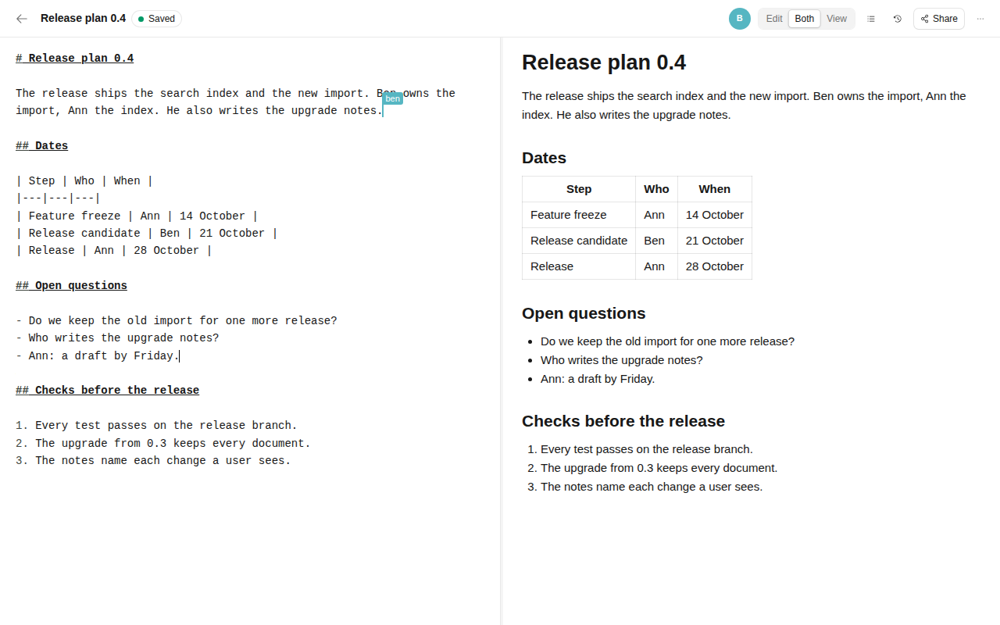

Ann and Ben edit the same document on the cluster of `scripts/run.sh`. Ben's caret shows his name for a moment after
it moves. The preview on the right follows the text.

## What it shows

- **Keyed actors placed by a label**: one `Doc` actor per open document, on the home its id names. No lease decides
  where it runs, only the node's `home` label (`src/doc.rs`, `src/node.rs`).
- **`axon::files::Log`**: one log per home holds every document's records, checkpoints and versions, so one sync
  covers all the documents that changed (`src/journal.rs`, `src/core/pipeline.rs`).
- **Compacted streams, relays and `SnapshotThenLive`**: a document's state is a compacted stream; each web node relays
  every home's streams, so a home sends a state once per web node, not once per tab (`src/doc.rs`, `src/session.rs`).
- **Supervised actors found by label**: each home's catalog and the accounts, called with `named(..).among(..)`
  (`src/keeper.rs`, `src/catalog.rs`, `src/accounts.rs`).
- **`cx.attach`, `cx.attach_sink`, `submit_future` and `pause_until`**: the two halves of a websocket on its `Session`
  actor, and loads and writes kept off the handler (`src/session.rs`, `src/doc.rs`).
- **`watch_key`, `nodes(..).changes()` and `cx.watch`**: the "unreachable" banner, the cursors of a web node that
  left, and a disabled user's sessions closed on every web node (`src/session.rs`, `src/doc.rs`, `src/gate.rs`).
- **`Telemetry`, `Health`, `MetricsService` and `Dashboard`**: `/healthz`, `/readyz` and `/metrics` on each node,
  and axon's console on one (`src/node.rs`).
- **axon-testkit**: the protocol's pure cores on the seeded `Simulator`, and seven fault stories on the World
  (`tests/sim.rs`, `tests/world.rs`).

## Run it

One process with every role:

```bash
cargo build -p mdpad --release
target/release/mdpad user add name=ann password=secret-pw dir=data   # while no node uses dir
target/release/mdpad serve dir=data http=127.0.0.1:8080              # prints a JSON line: node h1, pid, addresses
```

Open http://127.0.0.1:8080 and sign in as `ann`. The binary embeds the page from `ui/dist`, which the repository
keeps built. In a second terminal, `mdpad load` runs bots that type and checks that nothing was lost:

```bash
target/release/mdpad load http=127.0.0.1:8080 user=ann password=secret-pw docs=20 editors=4 viewers=4 secs=30 rate=5
```

`mdpad` is also the command line for a user and an operator (`mdpad help` lists it all):

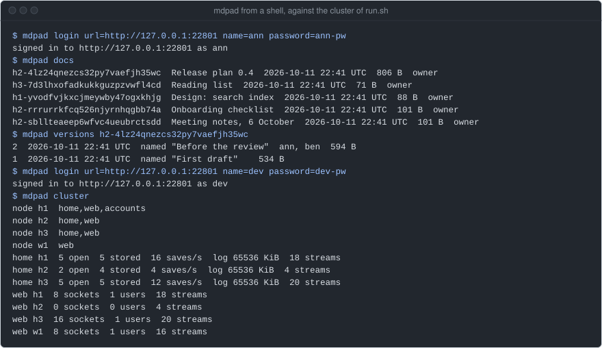

The cluster, five processes on loopback, with no TLS between them (`run.sh` starts each with `--plaintext`, for
loopback or a private network only):

```bash
cargo build -p mdpad --release
export MDPAD_BIN=target/release/mdpad          # run.sh takes the debug build without it
R=examples/mdpad/scripts/run.sh
$R up                                          # a seed; h1 h2 h3 (home and web, h1 the accounts too); w1 (web)
$R kill h2; $R start h2                        # SIGKILL a node, then start it again with what it kept
target/release/mdpad load http=$($R http) user=load password=load-pw docs=6 run=target/mdpad/run
target/release/mdpad check target/mdpad/run    # nothing lost, every copy the server's, every cursor gone
$R down
```

The web nodes h1, h2, h3 and w1 are on ports 7301 to 7304. Sign in as `ann` or `ben` (passwords `ann-pw`,
`ben-pw`); `/admin` is for the operator `dev` (`dev-pw`). axon's console runs on h1 at port 7400, and each node's
`/healthz`, `/readyz` and `/metrics` are on 7321 to 7324. `MDPAD_PORT=n` (default 7300) moves them all: the seed is
on n, the web nodes on n+1 to n+4, the console on n+100.

| | |
|---|---|
| 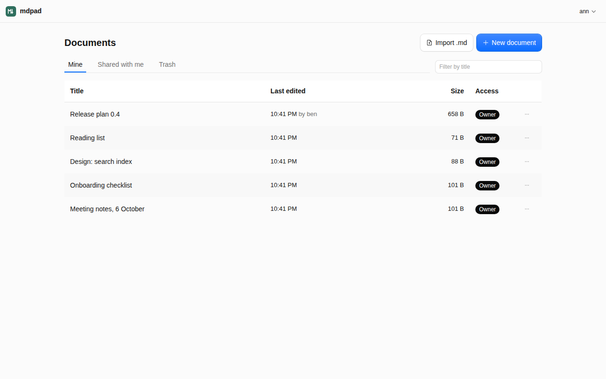<br>Documents: mine, shared with me, and the trash. | 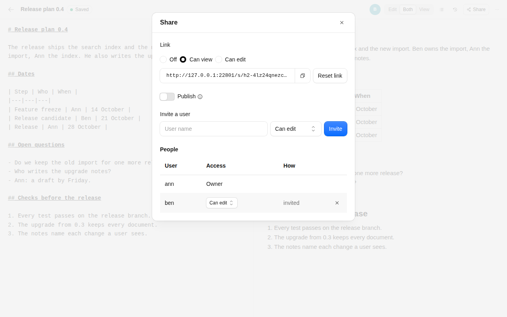<br>Share: a link to view or edit, publish, invite a user, the people. |
| 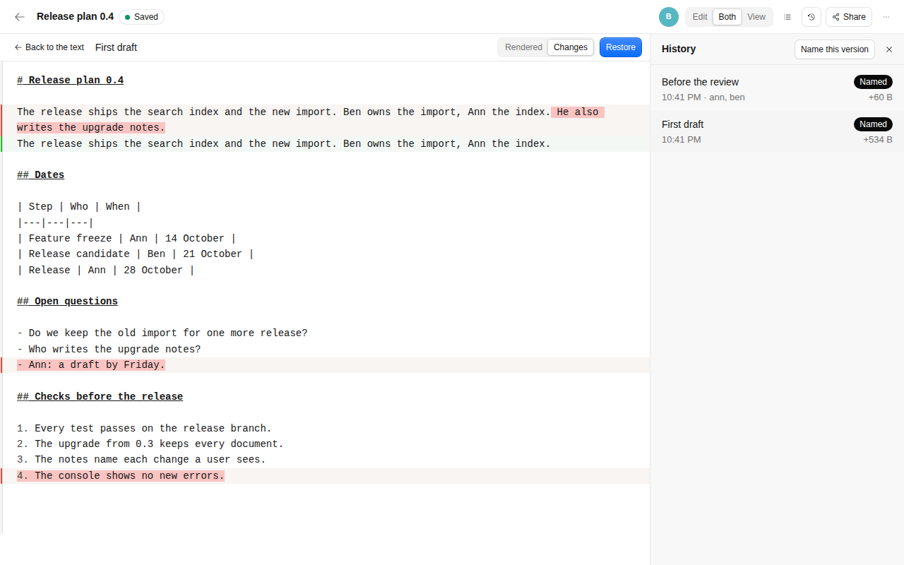<br>History: a named version's changes against the text now, and Restore. | 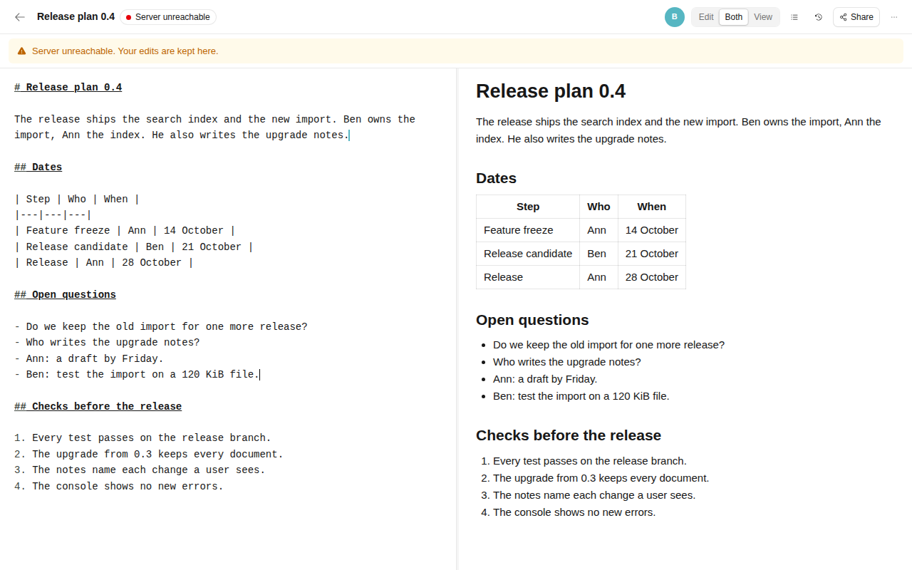<br>The document's home, h2, killed: the banner, and typing goes on. |
| 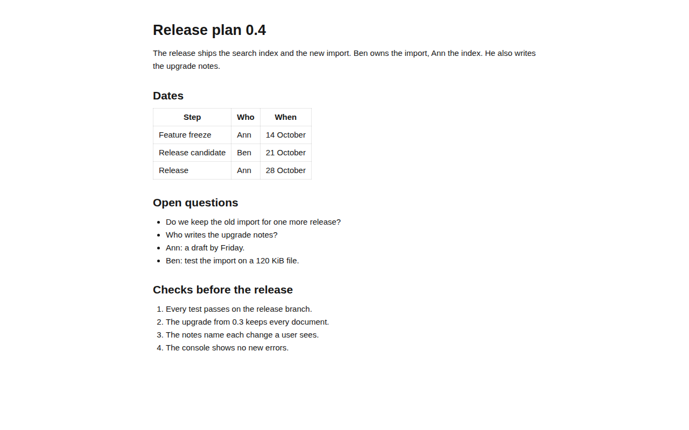<br>A published document at `/p/<id>`: read-only, no sign-in. | 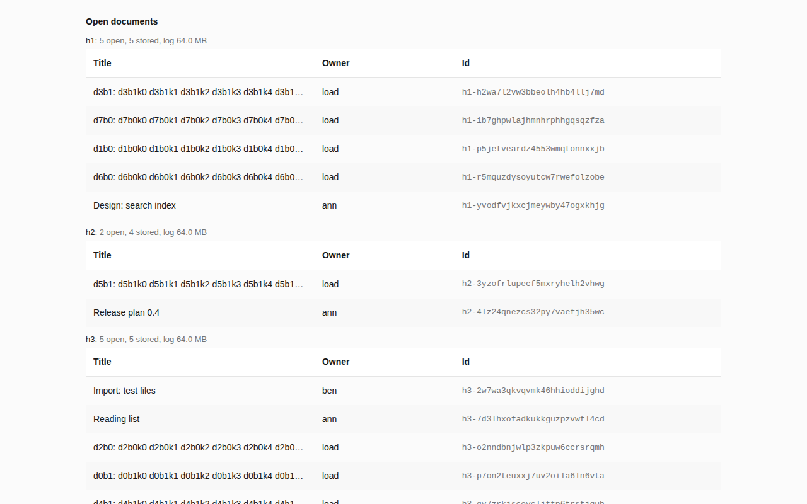<br>Admin, as `dev`: each home's open documents. Most are the load's. |
| 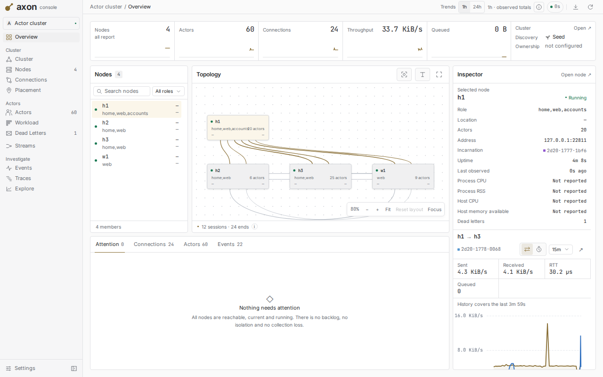<br>axon's console on h1: the four nodes, their roles and links. | |

## How it works

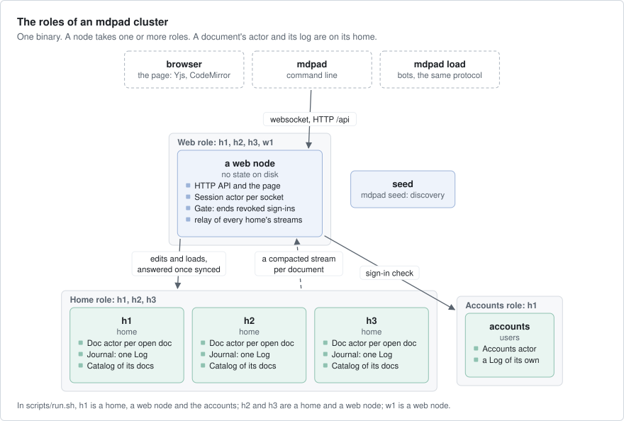

- **A document** (`src/doc.rs`, `src/core/doc.rs`) starts on its first call. It reads its records from the log under
  a new epoch, which fences out an older start, and opens its stream with that epoch as the generation, so a client
  sees each start as new. An edit is checked against the sharing and applied to the server's copy in yrs (the Rust
  port of Yjs, the library that merges edits in the page). It is written with the turn's other changes in one write.
  Once that write is synced, the records go on the stream and the editor is told `saved`. A document nobody calls
  stops after `idle` (900 s).
- **The journal** (`src/journal.rs`) is one `files::Log` in the home's `docs/`, kept by one actor: one write out at a
  time with everything queued meanwhile. Every document, its versions and the home's catalog are keys of it.
- **Streams.** A document's stream is compacted (it keeps the last record of each key): `acl` (the sharing), `base`
  (the state), and one `u/<n>` per update. Once the updates pass the size of `base` (at least 32 KiB), the state
  is a checkpoint in the log and a new `base`. Cursors are on a second stream, never on disk.
- **A session** (`src/session.rs`, `src/follow.rs`) holds one websocket. It sends the client the snapshot and then
  live updates, and sends the client's edits to the document one call at a time. What the socket cannot take waits
  in a bounded outbox. When the document's home is out of reach, the client is told `unreachable`.
- **The catalog** (`src/catalog.rs`) is each home's list of its documents: owner, title, size, members, trash. A
  list asks every home at once and says `partial` when one does not answer.
- **The accounts** (`src/accounts.rs`, `src/auth.rs`) keep users with argon2id hashes. Sign-ins, invites, share
  links and guests are values signed with HMAC under the node's `key`, so a web node checks them with no call.
- **The gate** (`src/gate.rs`): when the accounts end a user's sign-ins, every web node's gate closes that user's
  sockets at once.
- **Versions** (`src/core/versions.rs`) are the Markdown at a moment, kept in the log and thinned as they age. A
  restore is one new edit to the version's text.
- **The page** (`ui/`) is React with Cloudflare's Kumo components: CodeMirror bound to the Yjs text, a markdown-it
  preview, and a copy of each document in IndexedDB, so a page reloaded with no network still opens with its unsaved
  edits.

What a client is promised:

- `saved` means the edit is synced on its home's disk. It survives a crash of the process or of the machine.
- Every client ends with the server's text.
- A client that may not edit and sends an edit is closed with 4403 within 1 s, and the text does not change.
- A restore keeps an edit that a user typed offline before it.
- Cursors are never on disk, and go when their web node leaves.

## Numbers

Most of the numbers ran on build-1: a Ryzen 9 9900X with 12 cores,
`docs/` on a software RAID 1 of two Samsung MZVL2512 NVMe drives, where one `fdatasync` takes 4.3 ms. Every node,
the bots and the browser ran on the box over loopback, with axon `ee925dc7`, release builds, while other builds
shared it. The quiet box is an AMD EPYC 4484PX, measured on
2026-10-11 with a load under 1 and an `fdatasync` of 0.10 ms at p99. The busy box is a second box of the same type,
measured later that day while other jobs loaded it, after the web nodes and the bots set `TCP_NODELAY`. The runs on
build-1 and the quiet box are from before that change.

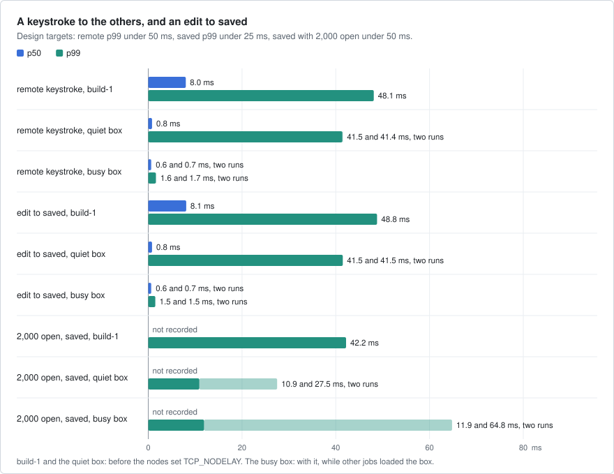

`scripts/measure.sh` on 2026-10-11. Remote and saved: 10 editors of one document at 5 keys a second through the
four web nodes. Open: 2,000 documents of 20 KiB, one editor each at 1 key a second through w1.

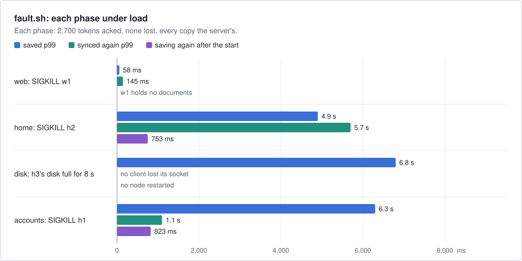

`fault.sh` on build-1: six documents, three editors and one viewer each and 500 more viewers, 5 keys a second for
30 s in each phase.

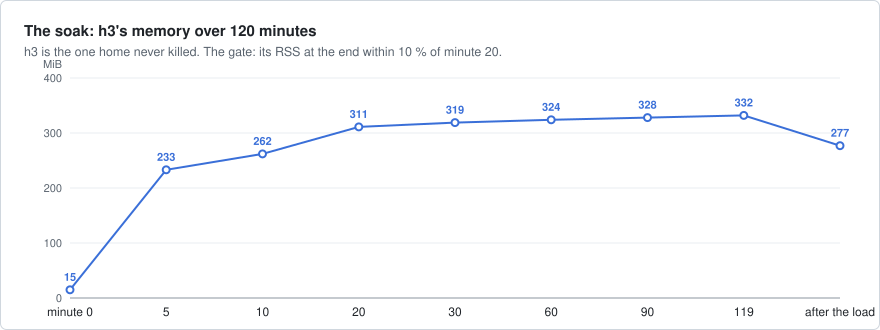

`scripts/soak.sh` on build-1 for 120 minutes: 200 documents, 5 editors and 5 viewers each. Every 10 minutes w1, h2
and h1 are killed and h3's disk is full for 8 s. PASS.

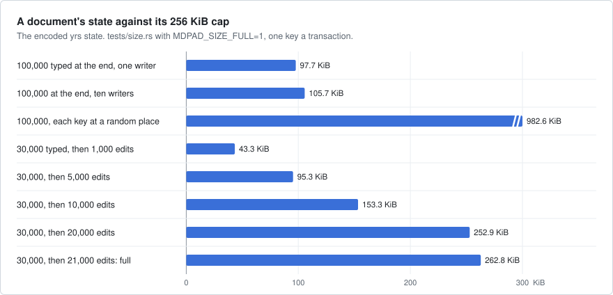

`tests/size.rs` with `MDPAD_SIZE_FULL=1`. Typing at the end costs about 1 byte a character; each edit inside the text
adds about 12 bytes that stay.

| Design target | Measured | Met |
|---|---|---|
| Remote keystroke, 10 editors at 5 keys/s: p99 < 50 ms | busy box p99 1.6 and 1.7 ms; before `TCP_NODELAY`, build-1 48.1 ms | yes |
| Edit to `saved`: p99 < 25 ms | busy box p99 1.5 and 1.5 ms; before `TCP_NODELAY`, build-1 48.8 ms, quiet box 41.5 ms | yes |
| Cold open of 100,000 characters: server < 150 ms, editor < 1 s | 12.1 ms; the text in the browser 410 ms after navigation | yes |
| One document, 50 editors and 500 viewers for 10 min: remote p99 < 100 ms | p99 58.6 ms; no socket closed and no reset | yes |
| 100,000 documents a home: start < 2 s, list p99 < 200 ms | 1.81 to 1.85 s to the ready line; list p99 23.9 ms | yes |
| A home SIGKILLed: nothing lost over 100 kills, saving again < 2 s | 43,200 tokens acked, none lost; 907 ms at p99 | yes |
| 500 clients synced again < 3 s after a restart | 25 ms at the stream; not measured with 500 clients | in part |
| Offline merge < 1 s; idle < 1 KB/s a client | 5,000 updates merged in 51 ms; 693 B/s | yes |

What they do not show: it is one box over loopback, and the bots are Rust clients of the same protocol, not browsers.
The p99s of 41 to 49 ms before `TCP_NODELAY` were Nagle's algorithm with TCP's delayed acknowledgement, not the
sync. On the busy box the saved p99 of 2,000 open documents was 11.9 and 64.8 ms in two runs: on a shared box it
changes much from run to run, and the second run is over its 50 ms target. The soak's texts stay near 6 KB, and two
hours do not show whether h3's slow growth stops.

## Faults

| Layer | Where | What it does |
|---|---|---|
| Pure cores, no I/O | `src/` | the ACL, the catalog, versions, the write pipeline, the document core, presence, the frames |
| Simulation | `tests/sim.rs` | four yrs clients and one document over the seeded `Simulator`: drops, duplicates, reordering and crashes, 500 seeds |
| One node, real sockets | `tests/ws.rs`, `tests/stall.rs`, `tests/stream.rs` | a crash with writes in flight, access, limits, a client that reads nothing, 500 subscribers through a relay |
| Real nodes | `tests/cluster.rs`, `tests/api.rs`, `tests/cli.rs`, `tests/admin.rs` | the roles, the permission table over HTTP, `mdpad` as a process, the operator's routes |
| World | `tests/world.rs`, `tests/world_isolation.rs` | seven stories, 64 seeds each: a home or a web node crashed, a partition, a home cut off, a slow client, a full disk, a restore while offline |
| Yjs and yrs | `tests/yrs.rs`, `ui/tests-node` | updates from the pinned Yjs apply in yrs with the same text, and back |
| Browser | `ui/tests`, `ui/tests-live` | every state of the editor on a mock API; on `run.sh`, the user journeys and a home killed |
| Fault run, soak | `fault.sh`, `scripts/soak.sh` | SIGKILL of a web node, a home and the accounts, and a full disk, under load; two hours of it |

```bash
cargo test -p mdpad --all-features            # 104 tests, about 2 minutes unoptimised (SEEDS=8)
examples/mdpad/fault.sh                       # PASS or FAIL; target/release/mdpad, and sudo for h3's tmpfs
```

`fault.sh` passed on build-1 in every phase: 2,700 tokens acked, none lost, every copy the server's, no cursor left.
The soak passed: 1,440,000 tokens typed and acked, none lost. Each of nine rules was weakened in turn, and a test
failed each time. The last independent check, of `19c1ef1` on the quiet box, then busy
with other builds, on 2026-10-11: every test passed, `fault.sh` PASS in 159 s, 22 of 22 live
browser tests, and both mutations it ran failed their stories.

## Left out

- Quotas: sockets per account, edits a second, creates an hour, sign-ins a minute. Only the bounded queues limit one
  user.
- A home keeps at most 120,000 documents. The accounts fit about 6,000 users; nothing stops the next one, and past
  it the accounts cannot write.
- No lease decides where a document runs, only the `home` label. Two nodes started as one home at the same time, or
  on the two sides of a partition, both run its documents.
- One operator flag and no other roles. axon's console has no sign-in, so it binds loopback only.
- Nothing lists the invites given or takes one back before it expires (7 days).
- A published page may be 10 s old in a reader's cache, and does not update while open.

## Files

| Path | What |
|---|---|
| `src/doc.rs`, `src/core/doc.rs` | the `Doc` actor and its pure core |
| `src/journal.rs`, `src/keeper.rs`, `src/core/pipeline.rs` | the log's actor, a supervised keeper of one key, the write pipeline |
| `src/session.rs`, `src/follow.rs`, `src/wire.rs` | a websocket's session, the client's stream position, the frames |
| `src/catalog.rs`, `src/accounts.rs`, `src/auth.rs`, `src/gate.rs` | the catalog, the accounts, signed tokens, the gate |
| `src/core/` | the pure cores: ACL, catalog, versions, presence, accounts |
| `src/crdt.rs` | yrs at the browser's UTF-16 offsets |
| `src/node.rs`, `src/remote.rs`, `src/main.rs` | a node and its roles, the calls between roles, the binary |
| `src/web.rs`, `src/page.rs` | the HTTP API, the page served from `ui/dist` |
| `src/cli.rs`, `src/load.rs`, `src/client.rs` | the command line, the load bots, a Rust client of the protocol |
| `scripts/run.sh`, `fault.sh`, `scripts/measure.sh`, `scripts/soak.sh` | the cluster on loopback, the fault run, the measurements, the soak |
| `ui/` | the page: React, Kumo, CodeMirror, Yjs |
