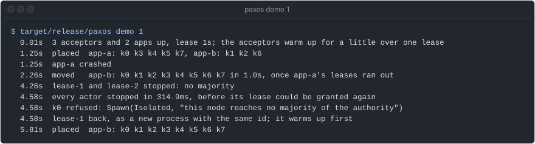
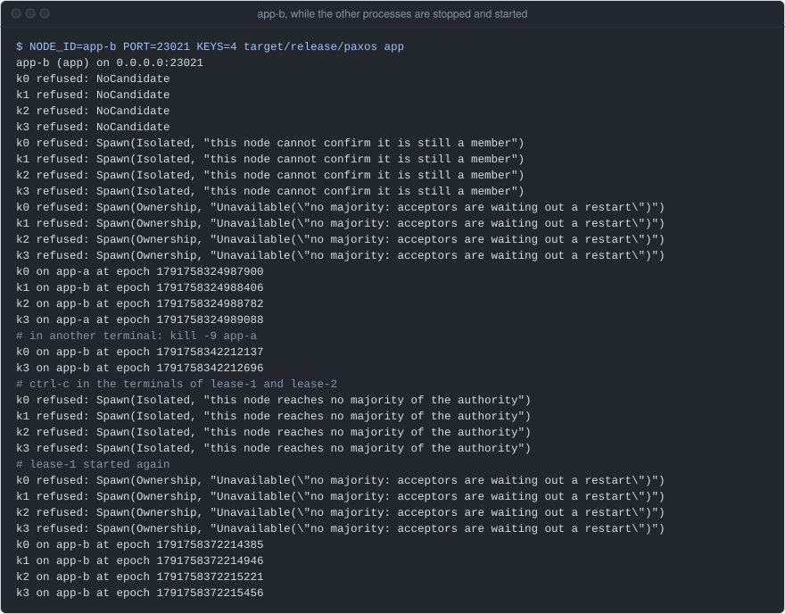
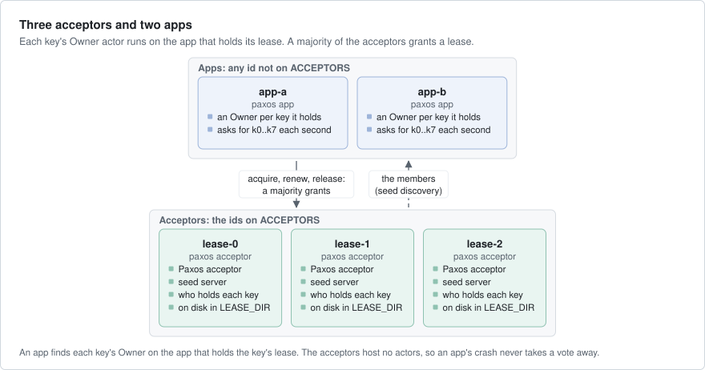

# paxos

One actor per key, run by whichever app process holds the key's lease. Three acceptor processes of the cluster
decide the leases with Paxos, so the cluster needs no lock service such as etcd, ZooKeeper or Consul. It is the
smallest example of axon's `PaxosLeases`, with each step of a crash and of a lost majority shown and checked.



`paxos demo 1` runs three acceptors and two apps in one process with a 1 s lease. app-a crashes and its keys move to
app-b. Two acceptors stop, so every actor stops and new starts are refused. One acceptor comes back, and the keys run
again. A release build of main `1e52123` on an EPYC 4484PX box, 2026-10-11, with other jobs
on the box.

## What it shows

- **`PaxosLeases` with acceptors in processes of their own**: the same acceptor list and lease on every node, and a
  directory per acceptor where it logs who holds each key (`Settings::start` in `src/lib.rs`).
- **Keyed actors**: the kind `owner` is registered on the apps only, and `get_or_spawn` starts or finds the one
  `Owner` of a key (`Settings::start_app` in `src/lib.rs`, the loop in `src/main.rs`).
- **The epoch of a lease**: each `Owner` gets its key's epoch from `SpawnContext`, and a key that moves gets a larger
  one (`src/lib.rs`).
- **A remote protocol**: `OwnerApi`, a `WireProtocol` and `ActorProtocol` with one request, "where do you run?"
  (`src/lib.rs`).
- **Seed discovery**: each acceptor process also runs a `SeedServer`, and every node finds the others through
  `SeedDiscovery` (`src/main.rs`).
- **A node without a majority**: it refuses new starts with `Isolated`, and its actors stop before their leases can
  be granted to another node (`demo` in `src/lib.rs`).

## Run it

The whole story in one process, checked at each step:

```bash
cargo build --release -p paxos
target/release/paxos demo 1        # a 1 s lease; with no number, 6 s
```

The same as five processes on one machine, each in its own terminal. Two nodes on one machine need two ports. There
is no TLS between them, so each starts only with `--plaintext`: loopback or a private network only.

```bash
export SEEDS=127.0.0.1:7001,127.0.0.1:7002,127.0.0.1:7003
NODE_ID=lease-0 PORT=7400 SEED_PORT=7001 target/release/paxos acceptor --plaintext
NODE_ID=lease-1 PORT=7401 SEED_PORT=7002 target/release/paxos acceptor --plaintext
NODE_ID=lease-2 PORT=7402 SEED_PORT=7003 target/release/paxos acceptor --plaintext
NODE_ID=app-a PORT=7410 target/release/paxos app --plaintext
NODE_ID=app-b PORT=7411 target/release/paxos app --plaintext
```

An app asks for the keys `k0` to `k7` once a second and prints a line for each key whose place changed. An acceptor
prints its lease counters when they change. Then:

- Kill `app-a` with `kill -9`. A lease later, its keys print on `app-b` with a larger epoch.
- Stop two acceptors with ctrl-c. The apps print `refused` for each key.
- Start one of them again with the same `NODE_ID`. After a little over one lease, the keys run again.



That run, with the ports moved to 23000 to 23021, 4 keys and the 6 s lease. The lines that start
with `#` mark what was done in the other terminals. Before the first placement, the app refuses each key while the
cluster forms and the acceptors warm up. An epoch is a time in microseconds since 1970, from the clock of the app
that asked for the lease, and always larger than the key's epoch before it.

Across machines, set `HOST` to the address the others reach this machine at, and `SEEDS` to the seed servers of the
three acceptor machines. `ACCEPTORS`, `LEASE_SECS` and `SECRET` must be the same on every node.

## How it works



- **An acceptor** (`paxos acceptor`) is a cluster node whose id is on `ACCEPTORS` (`lease-0`, `lease-1`, `lease-2`:
  ids of the role, not of the machine). It votes on leases and logs who holds each key in its own directory under
  `LEASE_DIR`. It hosts no actors, so an app's crash or deploy never takes a vote away.
- **A seed server** runs in each acceptor process, on `SEED_PORT`. Every node finds the others through the three.
- **An app** (`paxos app`) is a cluster node with any id not on the list. It can host an `Owner` for any key.
- **An `Owner`** is one actor per key. It runs on the app that holds the key's lease, and answers with its key, its
  node and its epoch. It keeps no other state.
- **A lease** is granted when a majority of the acceptors accept it, and lasts `LEASE_SECS` (6 s). The holder renews
  it while the actor runs. When the holder dies, the lease runs out and the next `get_or_spawn` starts the key on
  another app.
- **A started acceptor** refuses every request for a little over one lease (it warms up), so that whatever it
  promised before has run out.

What an app is promised:

- No key starts without a majority of the acceptors.
- A key that moves to another app gets a larger epoch than before.
- An app that can reach no majority stops its actors before their leases can be granted again. The demo checks it.

## Faults

- **The demo** (`the_demo_holds_at_every_step` in `tests/demo.rs`) runs the demo above with a 1 s lease. Each
  `Owner` must name the node and epoch the cluster gave. A moved key must have a larger epoch. Every actor must stop
  within two leases of losing the majority, and `k0` must be refused. The keys must run again once one acceptor is
  back.
- **The processes** (`an_acceptor_and_an_app_as_processes_place_a_key` in `tests/demo.rs`) start the binary as above:
  an app finds one acceptor through its seed server and places `k0` on itself.

```bash
cargo test -p paxos
```

The demo at the top of this page is a run of the release build that passed every check: it exits with an error when
one fails.

## Operating it

- Replace an acceptor machine by starting the new one with the same `NODE_ID`, after the old one is gone. Never run
  two processes with one id. Replace one at a time, and wait until each one has warmed up.
- Changing `ACCEPTORS` means stopping every node, then starting them all with the new list.
- The acceptors answer a node whose `ACCEPTORS` or `LEASE_SECS` differ only with `Unavailable`, so it gets no lease.
  Its starts are refused, and callers go on to the next node. Change these settings on every node at once.
- The rest is in
  [axon's guide, § One owner per key](https://github.com/AR1011/axon/blob/main/crates/axon/guide/cluster.md#one-owner-per-key)
  and [spec/paxos-leases.md](https://github.com/AR1011/axon/blob/main/spec/paxos-leases.md).

## Left out

- TLS. The nodes talk plaintext with a shared secret, which is for a private network only. Across the internet, set
  `ClusterConfig::tls`, and `CertificateIdentity` so that only a machine with its certificate can claim an acceptor's
  id ([axon's guide, § Security](https://github.com/AR1011/axon/blob/main/crates/axon/guide/cluster.md#security)).
- A store that checks the epoch. An `Owner` knows its epoch; a real one passes it with every write, so that a store
  can refuse a holder that lost its lease before it noticed.
- Keys that start again with no caller (`.eager`). Here a key moves only when an app asks for it.
- A console. Add `Telemetry` and a `Dashboard` as [market-data](../market-data/README.md) does.

## Files

| Path | What |
|---|---|
| `src/lib.rs` | the `Owner` actor, `OwnerApi`, `Settings` (how a node starts) and the `demo` |
| `src/main.rs` | `paxos acceptor`, `paxos app` and `paxos demo`, and their environment variables |
| `tests/demo.rs` | the two tests |
