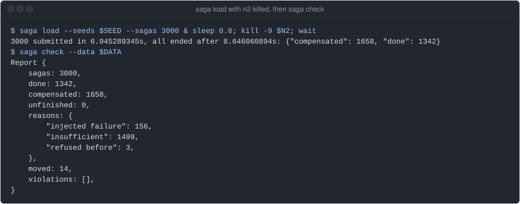
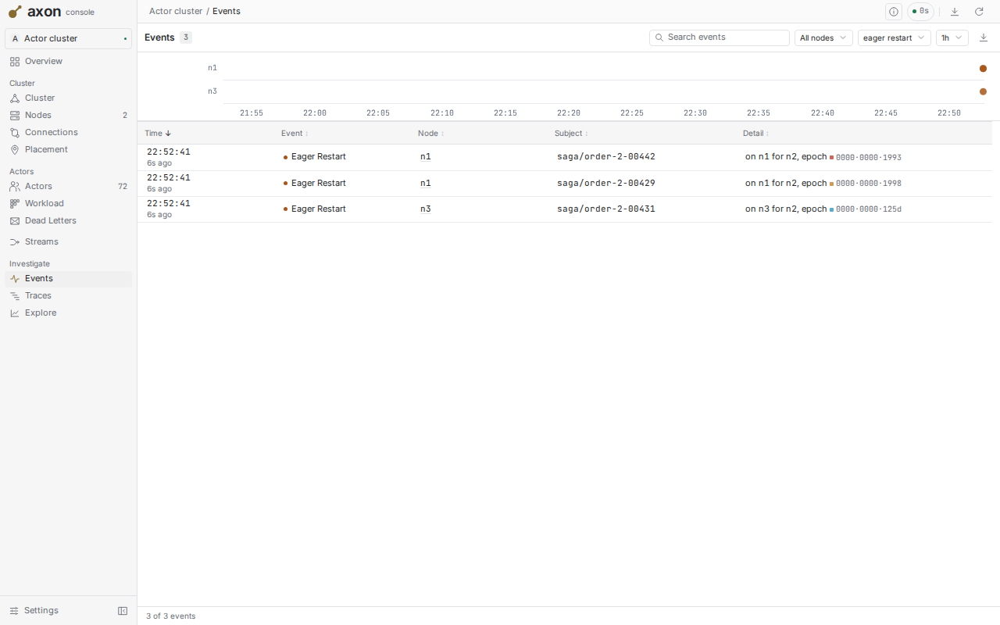
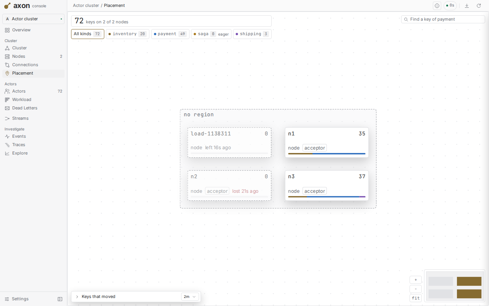
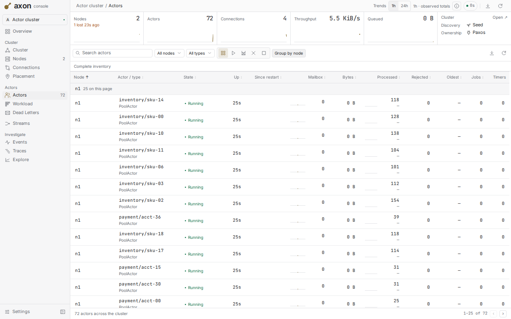
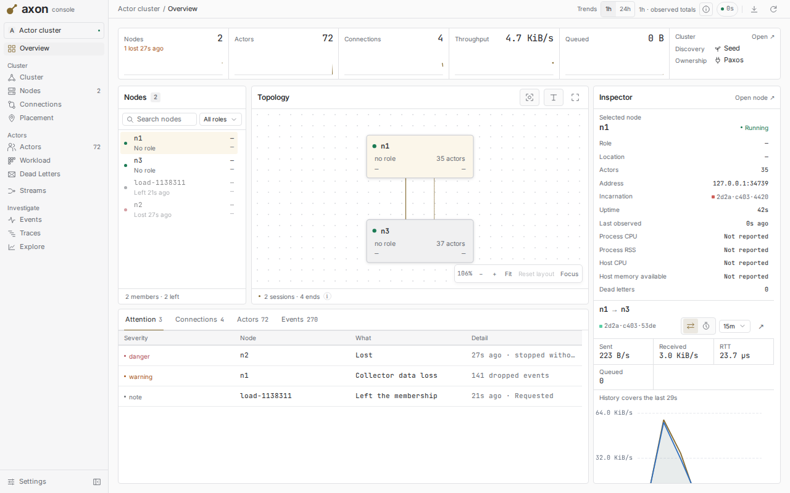
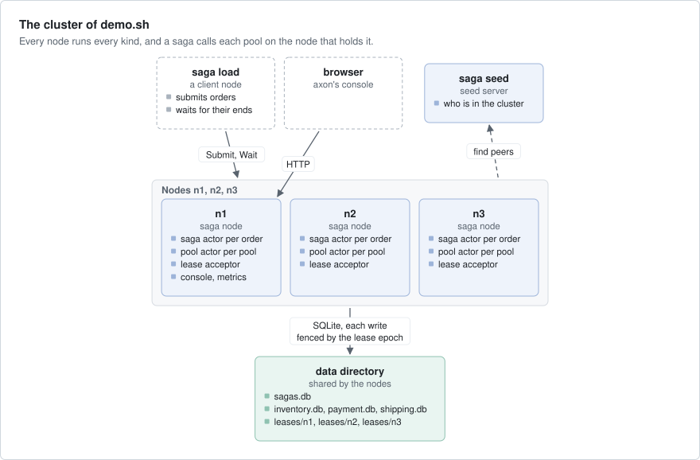
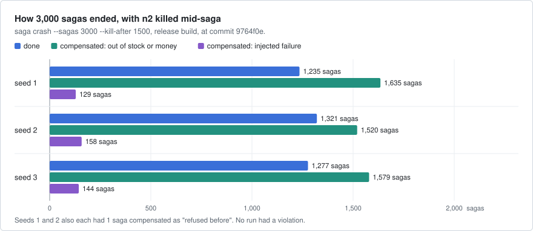
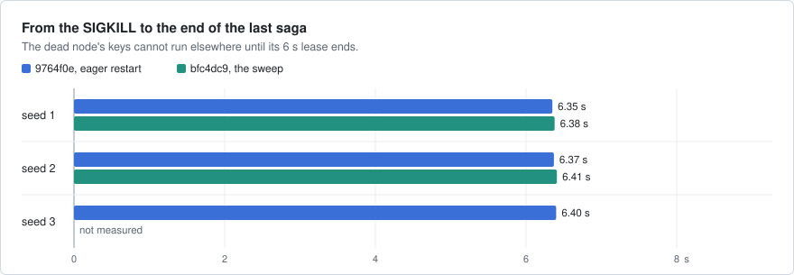

# saga

Order fulfilment on axon with the saga pattern: an order is a chain of steps, and each step has an undo. Each order
reserves stock for its lines, charges an account and books a shipping slot; when a step is refused, it undoes the steps
before it in reverse order. A saga goes on when its node is killed in the middle of a step, no step is applied twice,
and no node is an orchestrator.



`saga load` on a seed server and three nodes, as `demo.sh` starts them, with node n2 killed by SIGKILL 0.8 s in. Then
`saga check` reads every database: all 3,000 sagas ended, and the checks found no violation. A run on
an EPYC 4484PX box at main `1e52123`.

## What it shows

- **Keyed actors** (an actor named by a key, which runs on one node of the cluster at a time): one `SagaActor` per
  order and one `PoolActor` per stock, account or shipping region, called by key with `cluster.keyed` (`src/app.rs`).
- **`.eager` under `PaxosLeases`** (axon's lease authority, which records the node that owns each key): when a node
  dies, the others start its unfinished sagas with no caller (`serve` in `src/app.rs`, `start_node` in `src/lib.rs`).
- **`SpawnContext::epoch` as a fencing token**: the epoch is a number that grows each time a key gets a new owner.
  Every database write carries the writer's epoch, and a write from an older owner is refused (`src/store.rs`).
- **Jobs and `pause_until`**: SQLite calls run in `cx.submit_io` jobs, off axon's worker threads, and an actor
  handles nothing before its row is loaded (`src/app.rs`).
- **`err.retry()`**: what a caller tries again, with `Closed` (this node is stopping) read as "later" (`retry` in
  `src/app.rs`, `submit` in `src/crash.rs`).
- **Seed discovery**: a `SeedServer` and `SeedDiscovery`, with the heartbeat that axon's cluster guide asks
  for (`src/lib.rs`).
- **axon-testkit's `Simulator`**: the saga and pool state machines under lost, doubled and reordered messages and
  crashes, 300 seeds (`tests/sim.rs`).
- **axon-obs**: telemetry on every node, and the metrics collector and axon's console on n1 (`src/main.rs`).

## Run it

```bash
cargo test -p saga                 # unit, simulator, in-process leave, SIGKILL
examples/saga/demo.sh 3000         # a seed, n1 to n3 (n1 with the console), 3000 orders, n2 killed 2 s in
```

`demo.sh` builds the release binary, prints the lines of `saga check` and the console's address, and keeps the
cluster up until you press Enter. The console is on loopback, so it asks for no sign-in.

The same, one process at a time (run `saga` with no arguments for the usage):

```bash
cargo build --release -p saga
S=target/release/saga D=$(mktemp -d)
$S init --data $D                  # the databases, with 20 skus, 50 accounts and 3 regions
$S seed                            # prints: seed 127.0.0.1:PORT
$S node --id n1 --seeds 127.0.0.1:PORT --acceptors n1,n2,n3 --data $D --console 127.0.0.1:0
$S node --id n2 --seeds 127.0.0.1:PORT --acceptors n1,n2,n3 --data $D   # and n3 the same way
$S load --seeds 127.0.0.1:PORT --sagas 3000
$S check --data $D                 # what the databases hold, and each violation
$S crash --sagas 3000 --kill-after 1500 --seed 2   # the fault scenario on its own, with its own cluster
```

Each node prints `ready <id> <address>`, and n1 also its console's URL. The shipping service refuses every order
whose id hashes to 0 modulo 10 (`--fail-shipping-every 10`, the default), so some sagas always compensate.

These screenshots are of axon's console on that cluster, right after a load of 600 orders with n2 killed 0.15 s in.

| | |
|---|---|
| <br>axon's console, Events: n1 and n3 start n2's unfinished sagas, with no caller. | <br>axon's console, Placement: the four kinds and their keys on n1 and n3. n2 is lost. |
| <br>axon's console, Actors: the pool actors and the calls each handled. | <br>axon's console, Overview: two nodes left after the kill. |

## How it works



- **A saga** is a keyed actor of kind `saga`, its key the order id (`SagaActor`, `src/app.rs`). It loads its row by
  its key when it starts, so a submit and an eager restart start it the same way; the first `Submit` stores the
  order. It does one action at a time and stores each new phase before the next action. Once its end is stored, it
  stops and gives up its key, so only unfinished sagas start again after a node dies.
- **A pool** is a keyed actor of kind `inventory`, `payment` or `shipping`, its key a sku, an account or a region
  (`PoolActor`, `src/app.rs`). It keeps one hold per saga. It answers only after what the answer reports is
  committed, and commits the calls that arrive during a commit together after it.
- **The state machines** are in `src/core.rs`, with no I/O: `Phase::advance` and `Pool::hold` and `release`. The
  actors and the simulator drive the same code.
- **The databases** are one SQLite file per service and one for the sagas (`src/store.rs`), in place of a database
  each service would own. They use WAL with `synchronous=NORMAL`: a killed process loses nothing it committed; a lost
  machine may lose the last commits.
- **Ownership** is `PaxosLeases`, with n1 to n3 as the acceptors, each keeping its log in `leases/<id>`. A killed
  node's keys are free after its 6 s lease.
- **Restart without a caller**: the saga kind is eager, so the survivors ask the lease authority which sagas the dead
  node held and start those they now own. The pools are not eager: a saga's next call starts them.

The nodes share one data directory, so they must run on one machine. With a database server per service, `Store`
would point at those servers, and nothing else would change.

What a client is promised:

- A step is keyed by (pool, saga id). A saga that another node takes over repeats at most the action it was in, and a
  pool answers a repeat as it answered the first call. A hold that arrives after its release is refused.
- `Submit` answers once the saga's row exists. `Wait` answers once the saga's end is saved, or at once with its phase
  when 16 callers already wait.
- A step whose outcome stays unknown for 30 s (`STEP_DEADLINE`) is given up and undone: a release is harmless
  whether or not the hold landed.
- A done saga holds exactly its amount in each of its pools, and a compensated saga holds nothing.

## Numbers

These runs show that it works under a kill, not how fast it is. They are from `saga crash --sagas 3000 --kill-after
1500 --seed N` (release build), as recorded in this README at commit `9764f0e` on 2026-10-09, on a box the commit
does not name, and in an independent run at `bfc4dc9` (before the eager restart, with the app's own sweep) on
2026-09-25, on a dev box (EPYC 4484PX).



The catalog runs out on purpose (250 units per sku, 1,500 per account), so the later orders compensate after one, two
or more steps, not only at the shipping step.



| What | Result |
|---|---|
| `saga crash`, seeds 1, 2 and 3 at `9764f0e` | 0 violations in each run |
| sagas n2 held when killed (past their first step), and how many ended | 5 (4), 4 (4) and 4 (2); all ended |
| from the SIGKILL to the end of the last saga | 6.35 to 6.40 s at `9764f0e`; 6.38 and 6.41 s at `bfc4dc9` |
| `demo.sh 3000` at axon `3356677` or before, on a shared 24-core box with other builds running | 3000 orders submitted in 8.2 s, all ended after 8.4 s: about 360 sagas/s |

The time after a kill is the 6 s lease: the dead node's sagas and pools cannot start elsewhere until it ends. Each
saga's phase and each pool change is committed to SQLite before it is acknowledged. The `demo.sh` number is older
than the eager restart and was not measured again.

## Faults

| Layer | Where | What it does |
|---|---|---|
| Unit | `src/core.rs` | compensation in reverse, a step given up is undone, a pool answers a repeat the same way and refuses a hold after its release |
| Simulation | `tests/sim.rs` | 300 seeds: 1 message in 6 lost, 1 in 5 doubled, reordering, timeouts shorter than the slowest trip, saga and service nodes crashed at random. Every saga ends and every pool balances |
| In-process leave | `tests/cluster.rs` | three nodes on `PaxosLeases`; one leaves cleanly after 200 of 600 orders, and its sagas and pools go on |
| Real processes | `tests/crash.rs`, `saga crash` | a seed and three nodes; n2 is frozen and killed with SIGKILL once one of its sagas is past its first step, then every database is checked |

```bash
cargo test -p saga
cargo run --release -p saga -- crash --sagas 3000 --kill-after 1500 --seed 2   # exits 1 on a violation
```

`saga check` and `saga crash` fail when a done saga does not hold exactly its amount in each of its pools, a
compensated saga holds anything, a pool's available amount plus its holds is not its starting amount, a hold belongs
to no saga, or a saga that shipping refuses is done. `saga crash` also fails when a saga the dead node held does not
end. With `.eager` removed, `tests/crash.rs` fails: 6 sagas orphaned, 0 ended. At `9764f0e`,
`saga crash` passed with seeds 1, 2 and 3: 0 violations, and every saga n2 held ended (see Numbers).

## Left out

- A database server per service: the nodes share one directory on one machine.
- A way to drop old holds: a pool keeps one entry per saga for good.
- A way to see a stuck compensation: an undo that fails with `Retry::Never` is tried again every 1.28 s, with no log
  and no count.
- An API for orders: only the `saga load` client submits them, and nothing restocks a pool.
- TLS: the nodes talk plaintext on loopback with a shared secret.

## Files

| Path | What |
|---|---|
| `src/core.rs` | the saga and pool state machines, the injected shipping failure |
| `src/app.rs` | the actors, their wire contracts and `serve`, which registers the kinds |
| `src/store.rs` | the SQLite databases, with every write fenced by the lease epoch |
| `src/lib.rs` | the catalog, the orders, `start_node`, and the checks (`check`, `verify`) |
| `src/crash.rs` | the fault scenario: processes, the kill, the wait for every end |
| `src/main.rs` | the `saga` command line: `seed`, `node`, `init`, `load`, `check`, `crash` |
| `tests/` | the simulation, the in-process leave and the SIGKILL test |
| `demo.sh` | a seed, three nodes and a load, with n2 killed |
