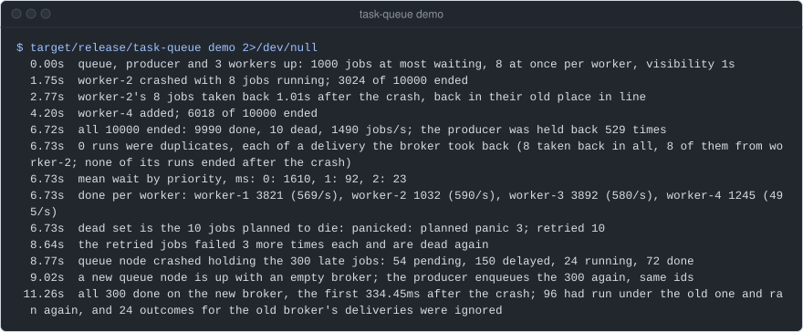
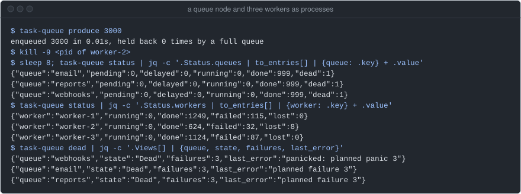
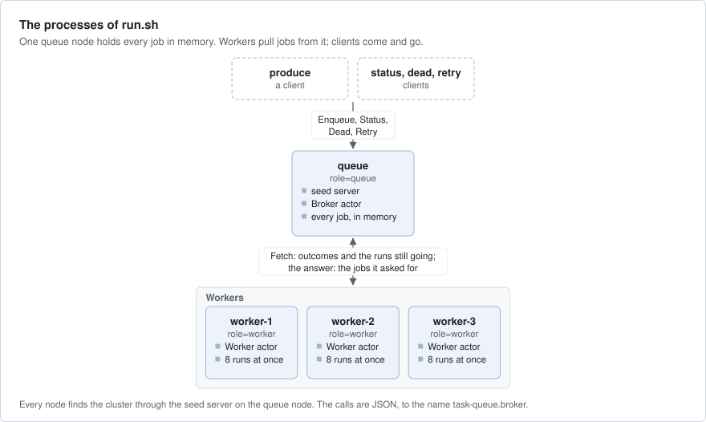
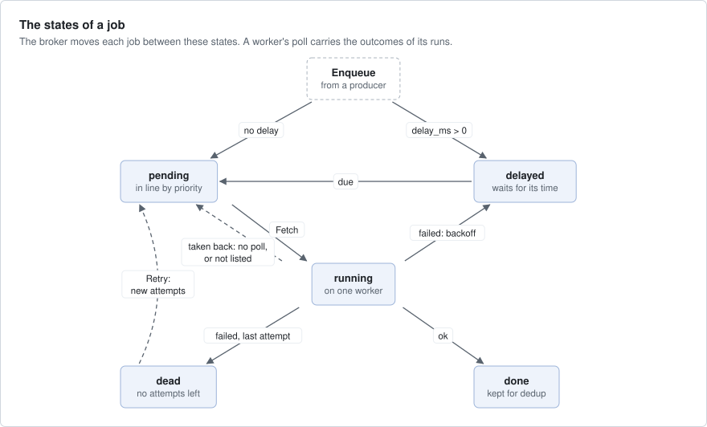
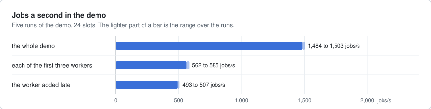
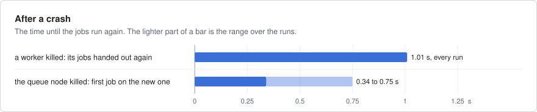
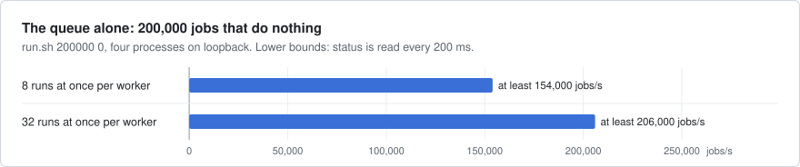

# task-queue

A background-job queue on axon, like Sidekiq or Celery. Producers put jobs in named queues with a priority, a delay
and a number of attempts; workers pull them and run them; a failed job runs again after a backoff, and after its last
attempt goes to a dead set. A worker that dies loses its jobs to the others, so each job runs at least once.



`task-queue demo` runs every node in one process and checks each step as it goes. This run was on
an EPYC 4484PX box, main `1e52123`, on 2026-10-11, with other jobs on the box (load average about 13).

## What it shows

- **`publish` and `NamedRef`**: the queue node publishes its `Broker` actor as `task-queue.broker`. Workers and
  clients call it by that name, and find a new broker by themselves after the queue node restarts (`src/main.rs`,
  `src/lib.rs`).
- **`WireProtocol` and `ActorProtocol`**: one contract for every call, a `Call` enum and an `Answer` enum in JSON
  (`src/lib.rs`).
- **Actor jobs and `on_turn_end`**: a worker runs each queued job as an axon job (`cx.submit_future`), async work that
  comes back to the actor as a message. It sends at most one poll at the end of a turn (`src/worker.rs`).
- **`axon::catch_panic`**: a job that panics is a failed run, not the end of its worker (`src/worker.rs`).
- **Timers**: the broker's 10 ms tick moves due jobs and takes back the jobs of silent workers (`src/broker.rs`).
- **`err.retry()`**: a fetch error whose `retry()` is `Never` stops the worker; any other is tried again with the
  next poll (`src/worker.rs`).
- **Seed discovery**: the queue node runs the seed server, so the cluster needs nothing but its own processes
  (`src/main.rs`). The demo uses `MemoryDiscovery` (`src/demo.rs`).
- **Bounded queues**: the broker refuses new jobs at its capacity, and the producer waits and sends the rest again
  (`src/broker.rs`, `src/demo.rs`).

## Run it

The whole story in one process, as in the image above (`tests/demo.rs` runs the same):

```bash
cargo run --release -p task-queue -- demo
```

As processes on loopback, from the repository root. `run.sh` builds the release binary, starts a queue node and three
workers, enqueues the jobs, waits until all have ended, then prints the status as JSON and the rate:

```bash
examples/task-queue/run.sh 10000          # 10,000 demo jobs
examples/task-queue/run.sh 200000 0       # 200,000 jobs that do nothing: what the queue itself manages
```

Or one process per terminal, after `cargo build --release -p task-queue`. There is no TLS between the nodes, so each
starts only with `--plaintext`: loopback or a private network only.

```bash
target/release/task-queue queue --plaintext                    # the queue node, and the seed server on port 7101
NODE_ID=worker-1 target/release/task-queue worker --plaintext  # each worker with its own NODE_ID
target/release/task-queue produce --plaintext 3000             # 3,000 demo jobs; `produce n ms`: n jobs that each sleep ms
target/release/task-queue status --plaintext                   # the counts per queue and per worker, as JSON
target/release/task-queue dead --plaintext                     # the dead set
target/release/task-queue retry --plaintext                    # the dead jobs (up to 1,000) back to pending, new attempts
```



Above, worker-2 was killed with `kill -9` while it ran jobs. After `VISIBILITY_MS` (5 s by default) the broker took
back its 8 jobs (`lost`) and the other workers ran them. Across machines, set `HOST` to the address the others reach a
node at, and `SEEDS` to the queue node's seed server.

## How it works



- **The queue node** runs one `Broker` actor. It holds every queue's jobs in memory: a heap of ready jobs by
  priority, a heap of delayed jobs, and the jobs each worker holds (`src/broker.rs`). It also runs the seed server.
- **A worker node** runs one `Worker` actor. It keeps at most `CONCURRENCY` (8) runs going, each an actor job
  (`src/worker.rs`).
- **The poll** is one `Fetch` call. It carries the outcomes of the runs that ended, the list of runs still going, and
  how many jobs the worker wants. The answer is up to that many jobs. A worker polls when a run ends, and every 100 ms
  otherwise, so the poll is also its heartbeat.
- **A ticket** names each hand-out of a job: the broker's boot, the job id and the delivery number. An outcome counts
  only for the current ticket; a late one is ignored and counted as `stale`.
- **Clients** (`produce`, `status`, `dead`, `retry`) join the cluster, make their calls and leave (`src/main.rs`).



What a client is promised:

- While the queue node lives, each job runs at least once. The jobs of a worker that stops polling for `visibility`
  (the visibility timeout, 5 s by default) go back to pending, in their old place in line.
- Jobs run highest priority first, then in the order they were enqueued, across all queues. A delayed job does not
  run before its delay.
- Job ids are the producer's: an `Enqueue` sent again after a lost answer does not add a job twice.
- A full queue refuses new jobs. The `Enqueue` answer says how many of the batch it took.
- A failed job runs again after a backoff that doubles, with jitter, until it has no attempts left.

## Numbers

All on a dev box (AMD EPYC 4484PX, 12 cores, 24 threads), release build, as recorded at axon
repository commit `2e9451cf` on 2026-09-24. The jobs use no disk.



The demo, five runs: 10,000 jobs, three workers of 8 slots and a fourth added late.



The same runs of the demo, with `visibility` 1 s.



`run.sh 200000 0`: a queue node and three workers as processes on loopback, and the clients.

| What | Result |
|---|---|
| the demo | 1,500 jobs/s (5 runs: 1,484 to 1,503) |
| each of the first three workers, while it was alive | 562 to 585 jobs/s; the one added late 493 to 507 |
| a worker killed: its jobs handed out again | 1.01 s, every run: `visibility` (1 s) and the broker's 10 ms tick |
| duplicate runs from the kill | 0 to 2 of 10,000 (50 runs: 33 with 0, 14 with 1, 3 with 2) |
| the queue node killed: the first job on the new broker | 0.34 to 0.75 s after |
| the queue alone, 200,000 jobs that do nothing | at least 154,000 jobs/s with 8 per worker, 206,000 with 32 |

What they do not show: the demo's rate is set by its jobs (24 slots over a 13.8 ms average run), not by the queue.
The queue-alone rates are lower bounds, because `run.sh` sees the end with a `status` call every 200 ms. The code has
changed since that commit, and these numbers were not measured again.

## Faults

The demo makes each fault and checks the result. It stops with an error at the first check that fails.

| Fault | What the demo checks |
|---|---|
| a worker killed (its `ActorSystem` dropped) once 30 % of the jobs have ended | its jobs go to the others; every run the broker did not count is of a delivery it took back; none of its runs ends more than 5 ms after the kill |
| a worker added at 60 % | it does work |
| 5 % of the jobs fail once or twice | each is done, with exactly its planned failures |
| ten jobs always fail, one by panicking | each is dead after three attempts; the dead set is those ten; retried, each fails three times more |
| a full queue (capacity 1,000) | the producer is held back; the waiting jobs never pass capacity by more than the jobs running |
| priorities and delays | priority 2 waits less than priority 0; no delayed job runs early; no worker runs more than 8 at once |
| the queue node killed holding 300 jobs | a new, empty broker takes the 300 again with the same ids; all run, and those done before run again |

```bash
cargo test -p task-queue          # the demo, and the binary as processes: a queue node and a worker run 200 jobs
```

The run in the image at the top passed every check.

## Left out

- A queue node that survives a crash. The broker holds everything in memory, so a crash loses every job it held.
  The demo recovers only because the producer sends its jobs again. Several queue nodes, each owning some queues
  as keyed actors, would make a crash lose less, not nothing.
- Fairness between priorities. A steady stream of high-priority jobs starves the low ones: in the run at the top,
  priority 0 waited 1,610 ms on average and priority 2 waited 23 ms. Weighted queues, as Sidekiq has, would fix it.
- Expiry of done jobs. The broker keeps their records, without payload, for dedup and `status`. The dead set is
  bounded only by what dies.
- A job at a wall-clock time (`run_at`), pushing jobs to idle workers, and cancelling a running job.
- Faster detection of a dead worker from membership events: here the missed polls are the signal.
- TLS: the nodes talk plaintext with a shared secret, for a private network only. And axon's console, which
  [market-data](../market-data/README.md) adds with `Telemetry` and a `Dashboard`.

## Files

| Path | What |
|---|---|
| `src/lib.rs` | the contract (`Call`, `Answer`, `BrokerApi`), the node setup, `find_broker` |
| `src/broker.rs` | the `Broker` actor: jobs, the ready and delayed heaps, the workers' holds, visibility |
| `src/worker.rs` | the `Worker` actor: the poll, each run as a job, a panic caught per run |
| `src/demo.rs` | the demo's jobs, the ledger of runs it checks against, and the story |
| `src/main.rs` | each role as a process, over a seed server on the queue node |
| `tests/demo.rs` | the demo, and the binary as processes |
| `run.sh` | a queue node and three workers as processes, a producer, then the status |
