# workflows

A durable workflow engine on axon, like Temporal. A workflow is a Rust `async fn`. Each of its steps goes into a
journal on three history nodes before the workflow sees the result, so when a node dies, the run goes on from its
last step on another node, and no finished step runs again.

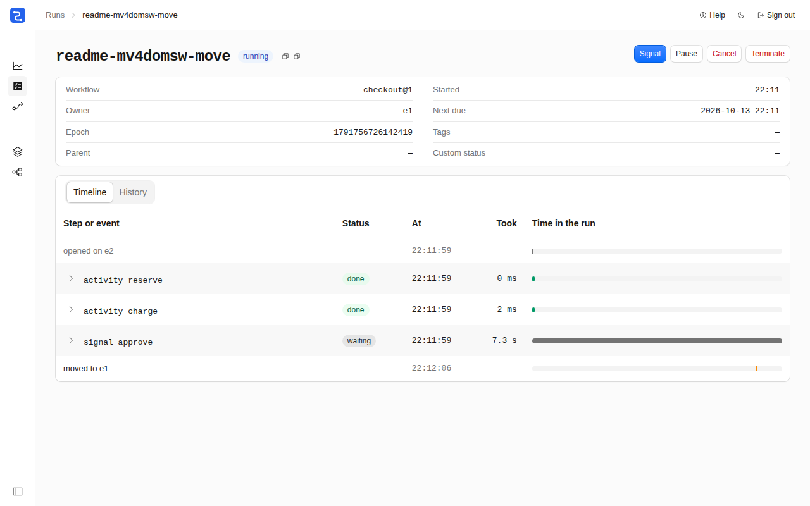

The console, on the cluster of `scripts/run.sh`: a checkout waits for its `approve` signal. Its engine, e2, was
killed with SIGKILL. The run moved to e1 and waits at the same step.

## What it shows

- **`axon::files::Log`**: each history node keeps the journals of all runs in one log on its disk, with a fence per
  run that refuses an older owner (`src/journal/core.rs`, `src/journal/service.rs`).
- **Keyed actors under `PaxosLeases`, with `.eager`**: one `Run` actor per run id in the cluster. When an engine dies,
  the other engine starts its runs with no caller (`src/run/actor.rs`, `src/node.rs`).
- **`request_parts` and `send_parts`**: a run's journal comes back from the replicas in parts larger than a frame
  (`src/journal/client.rs`).
- **`KeyedRefs`, `request_within` and `err.retry()`**: calls to runs and queue partitions, tried again only where the
  run removes duplicates (`src/run/call.rs`).
- **`Quotas`**: a `Rate` of starts per workflow and per token across the api nodes, and with `queue_tasks=n` a
  `Permits` of attempts per queue across the workers (`src/api.rs`, `src/worker.rs`).
- **`cluster.nodes` and labels**: the history nodes, engines and workers, found by their role (`src/node.rs`).
- **Jobs, `catch_panic` and `pause_until`**: activities run as jobs, and a panic in one is a failed attempt
  (`src/worker.rs`, `src/run/actor.rs`).
- **axon-testkit**: the journal on the seeded `Simulator`, and the cluster's fault stories on the World (`tests/`).

## Run it

One process with every role and one replica:

```bash
cargo build -p workflows
target/debug/workflows dev dir=target/wf        # prints {"url", "password"} once it can take leases
```

In a second terminal, with `wf`, the command line:

```bash
export PATH=$PWD/target/debug:$PATH
wf login --url http://127.0.0.1:PORT            # asks for the password that dev printed
wf start checkout --id order-1 --input '{"sku":"tea","qty":2,"account":"a1","parcels":[{"to":"Oslo"}],"ship_after_s":2}'
wf signal order-1 approve --signal-id ok-1 '{}'
wf get order-1 --wait                           # each step as it ends, then the result
```

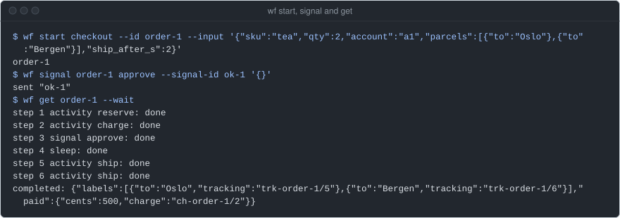

The console is at the same URL. The cluster, seven processes on loopback, with no TLS between them (`run.sh` starts
each with `--plaintext`, for loopback or a private network only):

```bash
cargo build --release -p workflows
export WF_BIN=target/release/workflows          # run.sh takes the debug build without it
R=examples/workflows/scripts/run.sh
$R up                                           # h1 h2 h3 (history), e1 e2 (engines), w1 w2 (workers)
$R wf list --filter status=running              # wf, against e1 and signed in
$R kill e1; $R start e1                         # SIGKILL a node, then start it again with what it kept
$R roll                                         # SIGTERM w1, w2, e1 and e2 in turn, each started again
$R down
```

The api nodes serve the API and the console: h1 to h3 on ports 7701 to 7703, e1 and e2 on 7704 and 7705
(`WF_PORT=n` moves them to n+1 to n+5). The password is `wf-dev`.

| | |
|---|---|
| 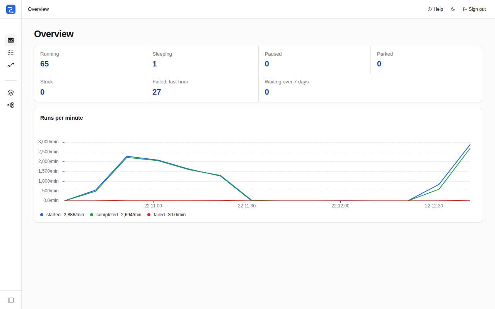<br>Overview: runs started, completed and failed per minute, and the counts. | 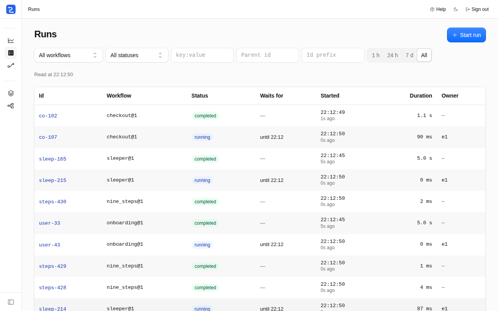<br>Runs, with filters by workflow, status, tag, parent, id and time. |
| 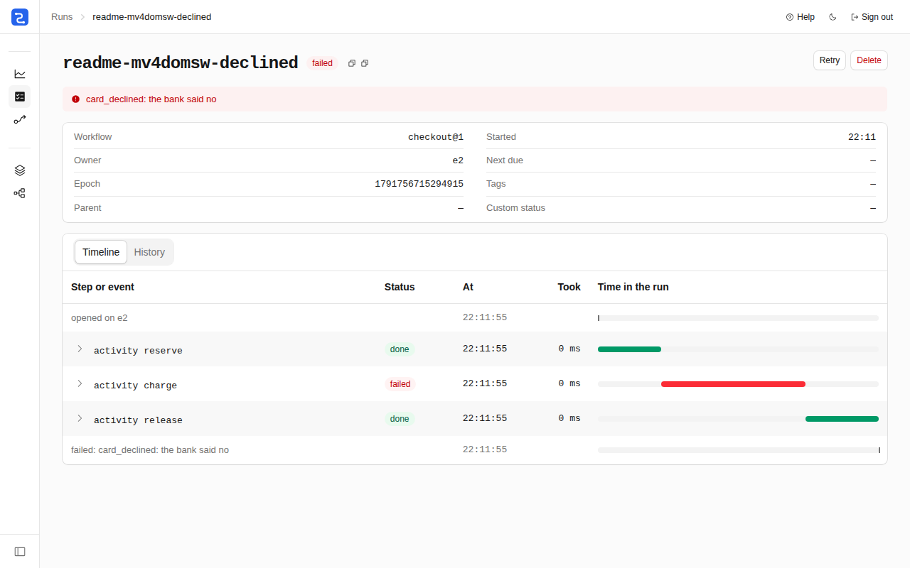<br>A declined charge fails the checkout, and its cleanup releases the stock. | 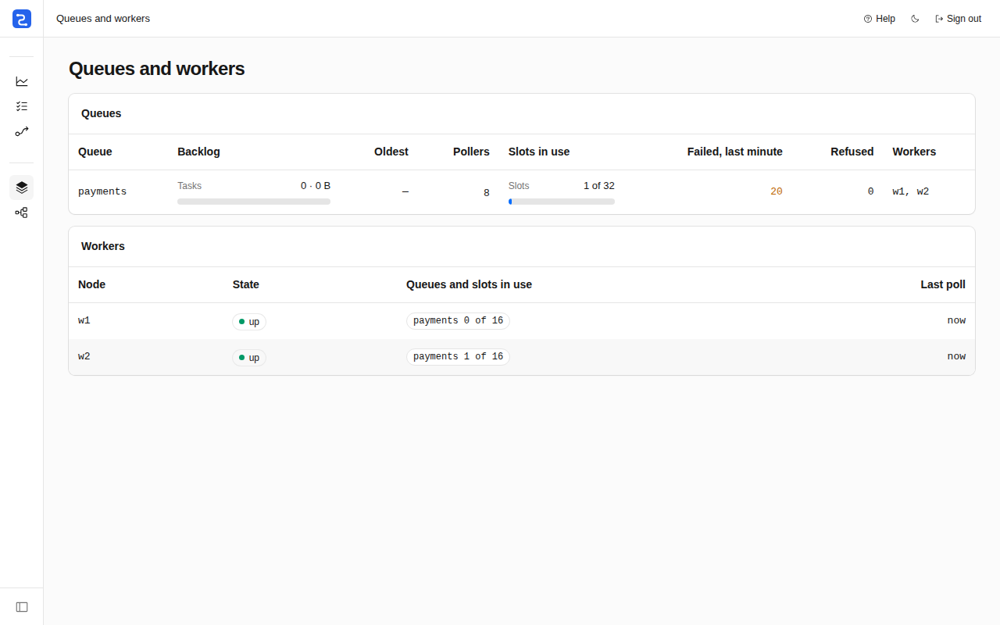<br>Queues and workers: the backlog, the slots in use, failed attempts. |
| 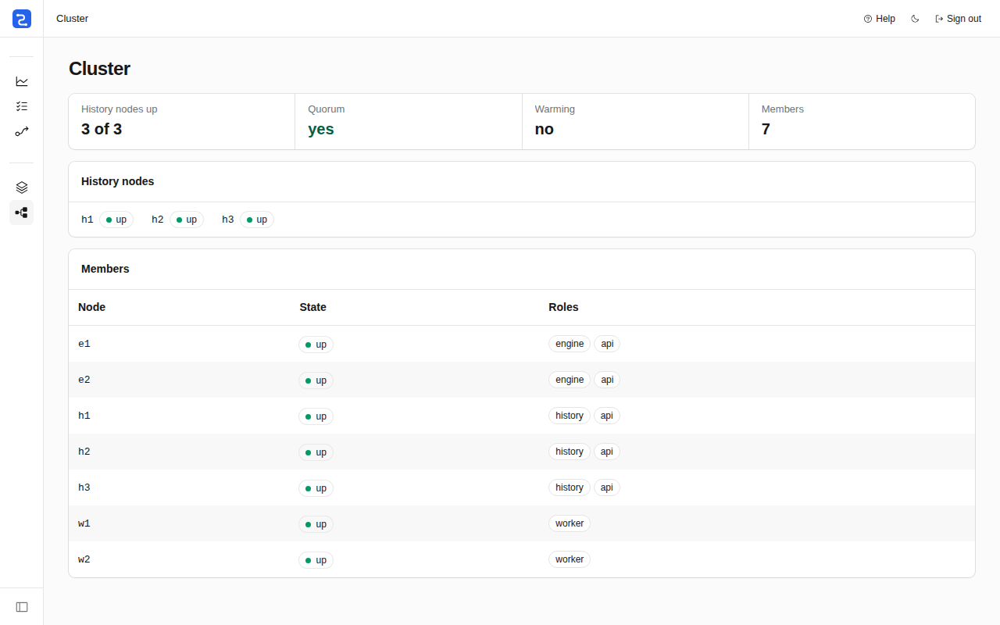<br>Cluster: the history nodes up, the quorum, each member and its roles. | |

## How it works

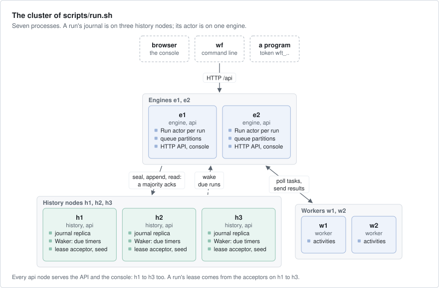

A workflow, shortened from `checkout` in `src/samples.rs`:

```rust
async fn checkout(ctx: Ctx, order: Order) -> Result<Receipt, Failure> {
    let hold = ctx.activity(Reserve { sku: order.sku.clone(), qty: order.qty }).await?;
    let retry = Retry::exponential(5).max(secs(60)).non_retryable(&["card_declined"]);
    let paid = match ctx.activity(Charge { account: order.account.clone(), cents: hold.cents }).retry(retry).await {
        Ok(paid) => paid,
        Err(e) => {
            ctx.cleanup(|c| c.activity(Release { hold: hold.id.clone() })).await?;
            return Err(e);
        }
    };
    if ctx.signal::<Value>("approve").timeout(days(2)).await?.is_none() {
        return Err(Failure::fatal("no approval within 2 days"));
    }
    ctx.sleep(secs(order.ship_after_s)).await?;
    let labels = ctx.all(order.parcels.iter().map(|p| ctx.activity(Ship { to: p.to.clone() }))).await?;
    Ok(Receipt { paid, labels })
}
```

- **A run** is a `Run` actor on an engine, one per run id in the cluster (`src/run/actor.rs`). It writes each input to
  the journal before it acts on it. When it opens, it runs the workflow's code again against the journal, so the code
  reaches the same step with the same results (`src/run/machine.rs`).
- **The journal** of a run is on all three history nodes, each in its node's `axon::files::Log` (`src/journal/`). A
  new owner seals a majority of the replicas at its lease's epoch first; an entry counts once a majority has synced
  it. A replica refuses a write from an owner older than its fence.
- **Timers** are kept in each history node's index. Its `Waker` wakes a run when a timer is due, and every 30 s wakes
  the runs that go on but wrote nothing for a while (`src/journal/service.rs`).
- **Activities** on a queue other than `local` go to a queue partition, a keyed actor on an engine that holds the
  backlog in memory. Workers poll the partitions, run each task as a job, and send the result to the run
  (`src/queue.rs`, `src/worker.rs`).
- **An idle run stops.** A run with nothing to do for a second stops and holds no lease and no memory. Its next call,
  or the waker, opens it again.
- **The API** (`src/api.rs`, `src/auth.rs`) signs the admin in with a password, and programs with named tokens of a
  scope. `wf` (`src/bin/wf.rs`) and the console (`ui/`) use it.

What a client is promised:

- A call on a run is answered once what it changed is on a majority of the history nodes.
- A step that the journal holds as done does not run again, and a replay sees its first result.
- A signal is taken once per signal id. A start with an id that exists gives the same run, or `exists` for another
  input.
- An activity runs at least once. Once its result is on a majority, it does not run again.

## Numbers

All on build-1 (Ryzen 9900X, two Samsung PM9A1 in an md RAID1 under ext4, no power-loss protection: one
`fdatasync` takes about 4.2 ms), release build.

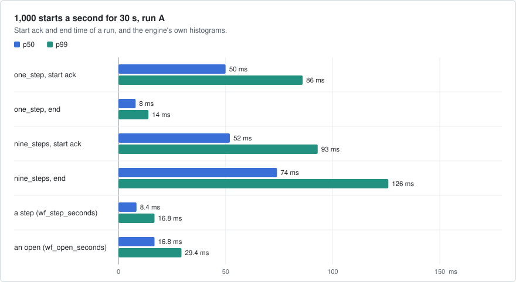

Run A of the load on the cluster of `run.sh`, ex/workflows `7106241`, 2026-10-11, load 0.4 at the start and 14.9
at the end. The engine's histograms double their buckets, so `wf_step_seconds` and `wf_open_seconds` give the
bucket's upper bound.

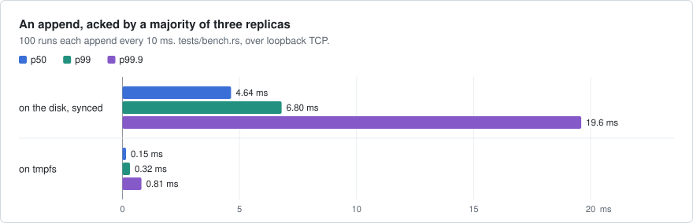

`tests/bench.rs`: three replicas on their own `ActorSystem`s and one engine. An append waits for one sync of the disk,
or for the write in flight and then its own, so p99 is one to two syncs.

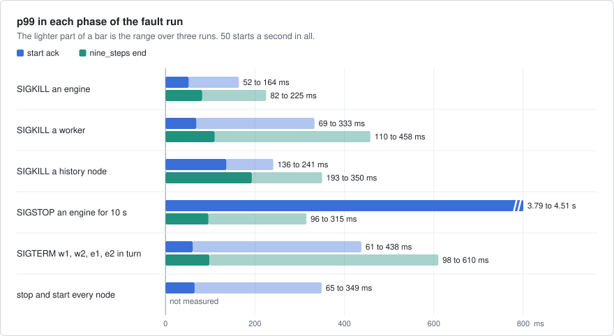

`fault.sh`, three runs on 2026-10-11, ex/workflows `7106241`, with other jobs on the box (load 9 to 17).

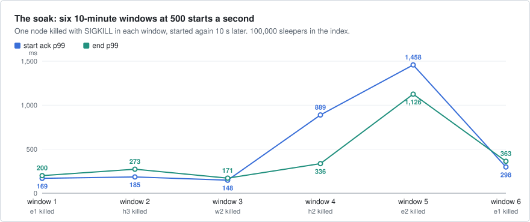

`scripts/soak.sh`, 1 hour with 100,000 sleeping runs (the design asks for 8 hours with 1,000,000), seed 7, load 7
to 11.

| What | Result |
|---|---|
| `one_step`, 1,000 starts a second for 30 s (run A) | 998 starts/s, all 30,000 completed |
| `nine_steps`, the same | 10,000 steps/s, all 300,000 steps completed |
| an append, acked by a majority and synced | 10,002 records/s, p99 6.80 ms |
| a history node's restart with 1,000,000 sleeping runs | 4.4 s with its index snapshot, 127 s without |
| `fault.sh`, three runs | each PASS: 6,000 runs, 0 violations, 0 failed attempts in the rolling restart |
| the soak, six windows with a node killed in each | every run completed, 0 violations; FAIL on its memory rule |

What they do not show: a start waits for a lease, a seal and its first append, each one or more syncs of 4.2 ms on
this disk, so the start ack p99 is over the design's 25 ms target. A history node's memory grows with the runs that
retention removed until its log copies forward, and in the soak the two history
nodes killed and started again grew to the end.

## Faults

| Layer | Where | What it does |
|---|---|---|
| Simulation | `tests/journal_sim.rs` | three replicas and two owners on the seeded simulator: lost, doubled and reordered messages, crashes inside a write, partitions. 500 seeds, each ends with the checker |
| TLA+ | `spec/JournalSeal.tla` | the seal and the chain of owners with three replicas, three owners and a crash: 44,505,167 distinct states |
| Embedded | `tests/run.rs` | one `Run` on a manual clock: steps, retries, timers, signals, cancel, the limits |
| Real nodes | `tests/cluster.rs`, `tests/api.rs`, `tests/cli.rs` | nodes on loopback: the API's error codes, tokens, the queue quota, `wf` with the real binaries |
| World | `tests/world.rs`, `tests/world_runs.rs` | the fault stories on virtual time, 64 seeds each: crashes, suspended engines, partitions, clock skew, two nodes down |
| Fault run | `fault.sh` | the cluster of `run.sh` under load: SIGKILL, SIGSTOP, a rolling and a full restart, then `wf check` |
| Mutations | `scripts/mutations.sh`, `spec/tlc.sh` | 13 rules, each weakened in turn: the test that must catch it fails |
| Browser | `ui/tests`, `ui/tests-live` | every page on a mock API, and on `run.sh` the move of a run after a kill |

```bash
SEEDS=8 cargo test -p workflows --all-features            # everything, the World stories on 8 seeds
SIM_SEED=17 cargo test -p workflows --test journal_sim    # one seed of the simulation again
examples/workflows/fault.sh                               # PASS or FAIL
bash examples/workflows/scripts/mutations.sh              # each weakened rule fails its test
```

The last independent check, on an EPYC 4484PX box with one NVMe on 2026-10-11: every test passed, the World stories on 64 seeds and the simulation on 500; `fault.sh` PASS
in 169 s with 6,000 runs and 0 violations; each mutation failed as recorded; the model passed.

## Left out

- Cron, continue-as-new, signals from one run to another, a replay debugger.
- A change of the history nodes without a full stop, more than three history nodes, shards, more than one namespace.
- Queries, updates and a search index: a list filters on one replica's index by workflow, status, tag, parent, id
  prefix and time.
- A queue's backlog survives its engine only as the run's offer again after 10 s, so a checkout whose offer was on a
  stopped engine ends about 10 s later.
- Live updates in the console (it asks every 2 s), and bulk actions in it (`wf` has them).

## Files

| Path | What |
|---|---|
| `src/workflow.rs`, `src/samples.rs` | what a workflow's author writes against; the sample workflows |
| `src/run/` | the `Run` actor, its pure core and what the API shows of a run |
| `src/journal/` | the journal's entries, a replica and its writer, the history node's actors, the index |
| `src/queue.rs`, `src/worker.rs` | queue partitions and workers |
| `src/api.rs`, `src/auth.rs`, `src/bin/wf.rs` | the HTTP API, sign-in and tokens, the `wf` command line |
| `src/main.rs`, `src/node.rs` | `workflows node` and `workflows dev`, and the roles of a node |
| `src/check.rs` | the checker that `wf check` runs over the history nodes' directories |
| `scripts/run.sh`, `fault.sh`, `scripts/soak.sh` | the cluster on loopback, the fault run, the soak |
| `ui/` | the console ([ui/README.md](ui/README.md)) |
